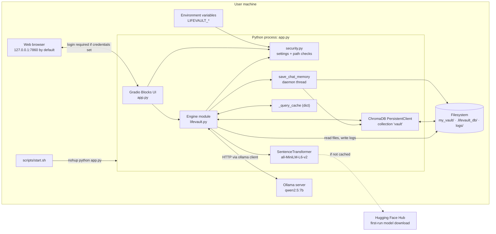
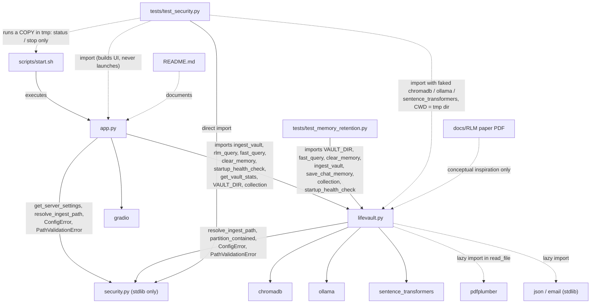
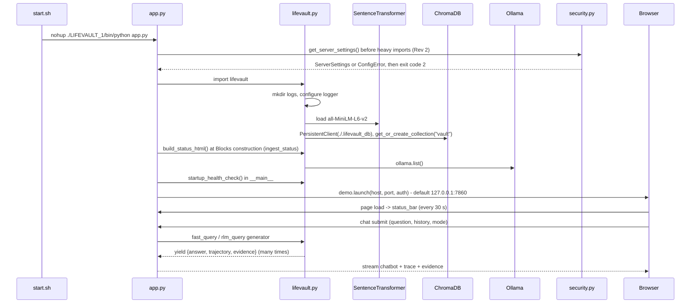
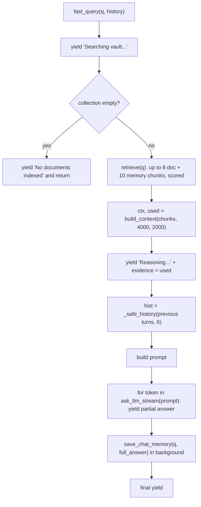
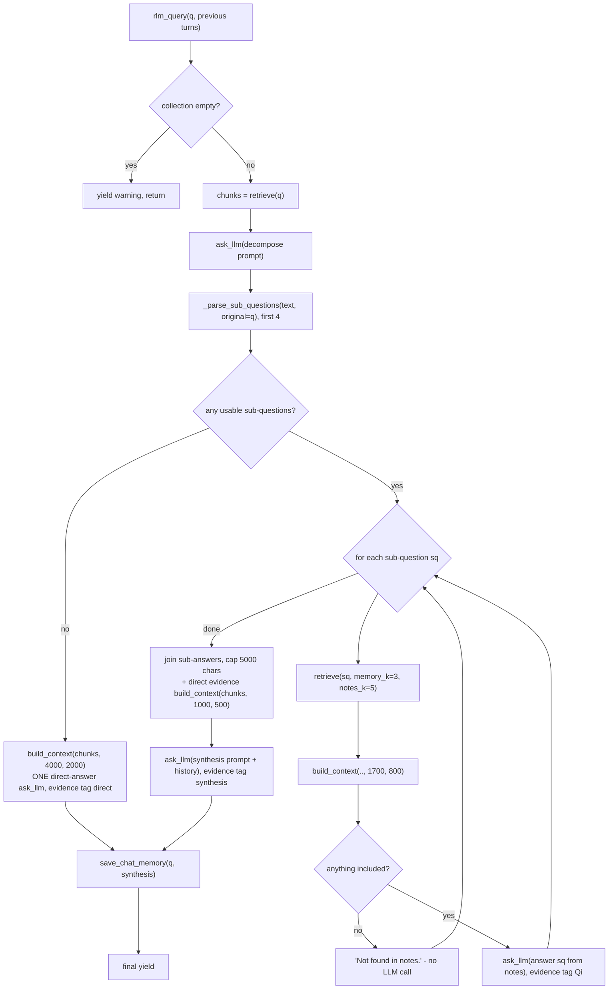
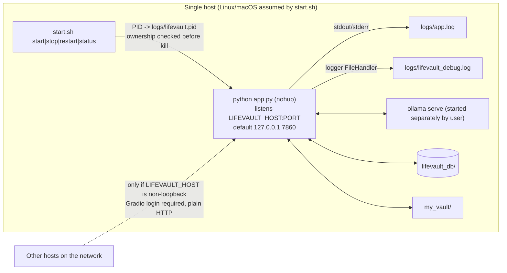

# Project Blueprint — LifeVault v2.0

> **Document type:** implementation-grounded technical blueprint (handover / architecture reference / interview prep).
> **Basis:** derived from the source at commit `7d33d2f` ("tunnings", 2026-04-20) **plus the uncommitted security hardening of 2026-10-12** (§25.1). Line numbers refer to the current working tree, including those changes.
> **Revision log:** *Rev 1* initial blueprint (static analysis). *Rev 2* adds the security changes: new `security.py`, `tests/test_security.py`, and edits to `app.py`, `lifevault.py`, `scripts/start.sh`, `README.md` and `.gitignore`. Every Rev-2 statement is labelled **Implemented and tested**, **Implemented but not fully tested**, **Not implemented** or **Unverified**. *Rev 3* (Phase 2, retrieval quality) changes `lifevault.py` (retrieval, context, parser, history and both modes), `app.py` (`do_chat` snapshot, `format_evidence`), `README.md`, and adds `tests/test_retrieval.py`. Rev-3 statements are labelled **verified with mocks**, **verified against real ChromaDB** (temp directory only), or **unverified**. No claim is made that answer quality improved, because no evaluation data exists. Ollama reliability and index consistency are still open (§28–29). *Rev 4* (Phase 3) changes `lifevault.py` (Ollama error model, timeout-bounded client, memory guard, ChromaDB telemetry opt-out, removal of `_safe_context`) and `app.py` (export normalisation), updates `README.md`, and adds `tests/test_reliability.py` and `tests/test_index_consistency.py`. **Index consistency (Task E) was investigated but not implemented:** it requires a migration of existing records, which is paused for approval (§28.5). Rev-4 statements are labelled **verified with mocks**, **verified against real ChromaDB (temp dir)**, or **unverified**; no real Ollama server was used. *Rev 5* (Phase 3, Task E, Option A as approved) implements **lazy per-file index consistency** in `lifevault.py`: document identity, verified replacement, a full-vault-only cleanup sweep, provable-only legacy removal (disabled in Rev 6), and per-entry memory indexing. `tests/test_index_consistency.py` is rewritten as a 33-case regression suite on a temporary ChromaDB. **No migration was run, and no existing record is rewritten.** *Rev 6* (release hardening) closes three edge cases in `lifevault.py`:
- An explicit, error-reporting scan: any unreadable folder makes the scan incomplete, and cleanup is skipped.
- Successfully emptied documents now drop their old chunks.
- Automatic legacy deletion is **disabled**: legacy records are only reported.

`tests/test_index_consistency.py` grows to 48 cases. Two older tests were updated because their expected behaviour changed intentionally.

*Rev 7* (real-model validation, 2026-10-12) ran the real app with real Ollama models (`qwen2.5:3b`, `qwen2.5:7b`) and the real `all-MiniLM-L6-v2` embedder, in temporary folders only (§23.10). It fixed debt item **T8**: the startup health check now requires the exact configured model tag, and the status bar distinguishes "model not installed" from "server offline" (`lifevault.py`, `app.py`). It adds 7 cases to `tests/test_reliability.py` and the opt-in `tests/test_real_ollama.py`. Line numbers in this document were remapped to the Rev 7 tree.

*Rev 8* (targeted fixes, 2026-10-12) fixes the three issues Rev 7 left open:
- **[MEM-01]** Clear Memory is ordered with saves and memory re-indexing, using the existing `_memory_lock` plus a clear counter.
- **[RET-07]** The sub-question parser also reads one-line lists and runs of questions.
- **[RET-08]** Deep-mode evidence records every step's own relevance.

It adds `tests/test_memory_concurrency.py` and new cases in `tests/test_retrieval.py`, and updates the README setup steps. `scripts/start.sh`, `security.py`, retrieval scoring, budgets and prompts are unchanged (§23.11). Line numbers were remapped to the Rev 8 tree.

*Rev 9* (v1.0 release preparation, 2026-10-12):
- The Help tab's model guidance is corrected (`app.py`), with a new test in `tests/test_reliability.py`.
- README: backup verification and safe restore, answer-quality limitations, and the full test command.
- An end-to-end release-candidate validation through the unmodified `scripts/start.sh` with real `qwen2.5:7b` (§23.12).

No engine, security or start-script changes. Line numbers were remapped to the Rev 9 tree.

*Rev 10* (v1.0 release gates, 2026-10-12): the project's own `LIFEVAULT_1` was created and verified, and the unmodified `scripts/start.sh` plus a real-model smoke test ran in the repository checkout (§23.13). Documentation only: §21, §33 and the README were brought up to date. No code changes, so the Rev 9 line numbers still apply.
> **Status labels used throughout:** **Implemented** · **Partially implemented** · **Experimental** · **Configured but not verified** · **Planned** · **Absent** · **Unknown**.
> **Rev 7:** the real application and real Ollama models *were* run, in temporary folders only, with results in §23.10. Before Rev 7: 
> **Not executed during documentation:** the real application, the Ollama model, and `tests/test_memory_retention.py` were *not* run. The project dependencies are not installed in the documenting environment, and that script mutates real user data (§23). Rev 1 used only static, side-effect-free checks (§23.4). Rev 2 additionally ran the isolated `tests/test_security.py` suite and two throwaway Gradio checks in a scratch virtualenv (§23.5). Rev 3 ran `tests/test_retrieval.py`, including tests against a real ChromaDB 1.5.8 in a temp directory, plus a ChromaDB/Gradio probe (§23.6).

---

## Table of Contents

1. [Executive Summary](#1-executive-summary)
2. [Problem Statement and Motivation](#2-problem-statement-and-motivation)
3. [Project Objectives and Scope](#3-project-objectives-and-scope)
4. [Features and Implementation Status](#4-features-and-implementation-status)
5. [Technology Stack](#5-technology-stack)
6. [Repository Structure](#6-repository-structure)
7. [High-Level Architecture](#7-high-level-architecture)
8. [Architecture Diagrams](#8-architecture-diagrams)
9. [Component and Module Responsibilities](#9-component-and-module-responsibilities)
10. [Module Dependency Map](#10-module-dependency-map)
11. [Detailed File-by-File Analysis](#11-detailed-file-by-file-analysis)
12. [End-to-End Execution Workflow](#12-end-to-end-execution-workflow)
13. [Data Flow and Data Structures](#13-data-flow-and-data-structures)
14. [Algorithms and Mathematical Formulations](#14-algorithms-and-mathematical-formulations)
15. [Model Architecture](#15-model-architecture)
16. [Training Workflow](#16-training-workflow)
17. [Evaluation and Inference](#17-evaluation-and-inference)
18. [Federated Learning Architecture](#18-federated-learning-architecture)
19. [Configuration and Hyperparameters](#19-configuration-and-hyperparameters)
20. [Dataset and Data Preprocessing](#20-dataset-and-data-preprocessing)
21. [Environment Setup and Installation](#21-environment-setup-and-installation)
22. [Running the Project](#22-running-the-project)
23. [Testing and Validation](#23-testing-and-validation)
24. [Performance and Complexity](#24-performance-and-complexity)
25. [Security and Privacy Considerations](#25-security-and-privacy-considerations)
26. [Error Handling and Failure Modes](#26-error-handling-and-failure-modes)
27. [Experimental Results](#27-experimental-results)
28. [Limitations and Technical Debt](#28-limitations-and-technical-debt)
29. [Known Issues and Recommended Improvements](#29-known-issues-and-recommended-improvements)
30. [Reproducibility Guide](#30-reproducibility-guide)
31. [Glossary](#31-glossary)
32. [References to Important Source Files](#32-references-to-important-source-files)
33. [Final Implementation Status Summary](#33-final-implementation-status-summary)

---

## 1. Executive Summary

**LifeVault** is a single-user, locally hosted **Retrieval-Augmented Generation (RAG)** application that answers natural-language questions about a folder of personal files (`.md`, `.txt`, `.pdf`, `.json`, `.eml`). It is built from four off-the-shelf components glued together by ~700 lines of Python, plus a ~350-line standard-library `security.py` (Rev 2):

| Concern | Component | Where |
|---|---|---|
| Text embedding | `sentence-transformers` model `all-MiniLM-L6-v2` (runs in-process) | `lifevault.py:103, 135` |
| Vector storage & k-NN search | ChromaDB `PersistentClient` at `./.lifevault_db`, single collection `"vault"` | `lifevault.py:136–148` |
| Text generation | Ollama server, model `qwen2.5:7b`, called through a timeout-bounded `ollama.Client` (Rev 4) | `lifevault.py:102, 1258, 1292` |
| User interface | Gradio `Blocks` web app on `127.0.0.1:7860` by default. Host, port and login are configurable via `LIFEVAULT_*` env vars, and a login is mandatory for non-loopback hosts (Rev 2) | `app.py:456–667`, `security.py` |

It offers two answer modes:

- **⚡ Fast Lookup** (`fast_query`, `lifevault.py:1657`): one retrieval, then a size-budgeted context, then one streamed LLM call (classic single-shot RAG).
- **🧠 Deep Reasoning** (`rlm_query`, `lifevault.py:1486`): retrieve → ask the LLM to decompose the question into ≤ 4 sub-questions → run one retrieval + one LLM call per sub-question → one synthesis LLM call. This is described in the project as an "RLM" (Recursive Language Model) after Zhang, Kraska & Khattab (arXiv 2512.24601, PDF in `docs/`). **The implementation is a fixed, single-level decompose-and-synthesise pipeline. It has no recursion, no REPL environment, and no model-written code, so it is not an RLM in the paper's sense** (see §14.7). Since Rev 3 the code, README and docstring all call it **decomposition-based RAG**.

**Retrieval quality (Rev 3, §11.1.10–17):**
- Separate document (4000-char) and memory (2000-char) budgets with roll-over, so memories can no longer crowd out all document evidence.
- Cosine relevance computed from the stored embeddings, a provisional memory threshold, and deduplication.
- Deep mode now feeds its initial evidence into synthesis and falls back to one direct answer when decomposition is unusable.
- The evidence panel shows exactly the chunks that were sent to the model.
- Conversation history is fixed for Gradio 6's message format.

This is covered by 82 isolated tests: 76 with mocks and 6 against a temp-directory ChromaDB 1.5.8.

**Reliability (Rev 4, §11.1.11–12, §28.5):**
- Ollama failures are typed (`LLMError`, 7 kinds) and bounded by an httpx timeout instead of an abandoned thread.
- They are shown as short, safe `❌` messages, and are never cached, saved as memories, or fed back into prompts.
- Export produces plain text from Gradio 6 message blocks.
- ChromaDB telemetry is explicitly disabled (it was already a no-op in 1.5.8).
- The dead `_safe_context` is removed.

This is covered by 79 isolated tests with mocked Ollama, 3 of them against a temp-directory ChromaDB. **Index consistency (Rev 5, §11.1.6, §28.5):**
- Documents are identified by their vault-relative path, so same-name files no longer collide.
- Edits replace a document's chunks only after the new ones are verified.
- Deleted and renamed files are swept only on a whole-vault ingest, and only when confirmed missing.
- ~~Legacy chunks are removed only when provably identical.~~ **Rev 6:** legacy chunks are never deleted automatically; they are kept and reported.
- Re-ingesting `chat_history.md` no longer duplicates memories.

This is covered by 33 tests on a real ChromaDB in a temp directory, including injected failures. All 6 former defects are fixed.

**Rev 6:**
- Cleanup runs only after a **complete** scan, so an unreadable folder can no longer make its documents look deleted.
- An emptied file is a validated update.
- Legacy chunks are never deleted (ownership is unprovable) and are reported instead.

This brings the index-consistency suite to 48 tests on a temp-directory ChromaDB.

Every final answer is appended to `my_vault/chat_history.md` and embedded into the same Chroma collection with metadata `type="memory"`. This gives the app **persistent conversational memory**, which is retrieved alongside documents on later queries.

**Security hardening (Rev 2, §25.1):**
- Localhost-only by default, with fail-closed authentication when exposed.
- Ingestion confined to permitted roots, with symlink-escape protection.
- No Google Fonts requests; Gradio analytics disabled.
- `start.sh` verifies that a PID belongs to this LifeVault checkout before killing it.

These changes are covered by 114 passing isolated tests (§23.5), which still pass after Rev 3.

There is **no model training, fine-tuning, or federated learning** in the repository. All "ML" is inference over pretrained models. The single test file is a manual, print-based behavioural script with no assertions. It needs a live Ollama instance, and it changes the real vault and database.

---

## 2. Problem Statement and Motivation

### 2.1 Stated problem (from `README.md`)

The README says LifeVault addresses **"context window rot"**: LLM quality degrades as prompts get longer. Its proposed answer is to combine RAG with an "agentic reasoning loop inspired by Zhang et al.'s *Recursive Language Models*". The goal is to query a personal knowledge base ("personal PDFs or Markdown notes … medical history, legal files, or lecture notes") on consumer hardware **without data leaving the machine**.

### 2.2 What the implementation actually addresses

| Motivation | How the code addresses it | Assessment |
|---|---|---|
| Too much text for an LLM context | Only top-k retrieved chunks (≤ 18: 8 notes + 10 memories) are sent, packed into separate budgets of 4000 document chars and 2000 memory chars (`build_context`, `lifevault.py:1093`; Rev 3, replacing the removed `_safe_context`) | **Implemented** (standard RAG) |
| Multi-hop questions across documents | Deep mode decomposes the question and retrieves per sub-question (`rlm_query`) | **Implemented** (single level, ≤ 4 sub-questions) |
| Privacy / locality | Local Ollama inference, local embeddings, local Chroma on disk | **Partially implemented**: see §25. Rev 1 had LAN binding on `0.0.0.0`, an external font fetch, and a first-run model download from Hugging Face. **Rev 2** binds localhost by default with mandatory login when exposed, and removes the font fetch. The first-run Hugging Face download remains, and there is no encryption |
| Remembering past conversations | `save_chat_memory` writes Q/A to Markdown + vector DB; `retrieve` queries a "memory" layer | **Implemented** |
| "Gigabytes of PDFs without losing tracking accuracy" | No benchmarks, scale tests, or batching | **Not established**: this is a README claim with no supporting artifact |

### 2.3 Intended users

These are inferred from the README and UI text: an individual running the app on their own laptop or desktop who wants to chat with their own notes. Nothing in the code supports multiple users: there is no authentication and no per-user data partitioning.

---

## 3. Project Objectives and Scope

### 3.1 Inputs and outputs

| | Description |
|---|---|
| **Inputs** | (a) Files under a vault folder (default `./my_vault`, overridable per ingest in the UI). (b) Free-text questions typed in the Gradio chat. (c) A mode selector (Fast / Deep). |
| **Outputs** | (a) Natural-language answer (streamed in Fast mode, final-only in Deep mode). (b) "Reasoning trace" text panel. (c) "Evidence" panel listing retrieved chunks. (d) Persisted artefacts: `.lifevault_db/` (Chroma), `my_vault/chat_history.md`, `logs/lifevault_debug.log`, `logs/app.log`, `logs/lifevault.pid`. |

### 3.2 Functional requirements (as realised in code)

1. Recursively discover supported files in a folder and index them into a persistent vector store, skipping chunks whose IDs already exist (`ingest_vault`).
2. Answer a question using retrieved chunks, in a fast mode and a decomposed mode.
3. Persist each Q/A exchange as retrievable memory.
4. Allow clearing memory while keeping documents (`clear_memory`).
5. Show system health (Ollama/model availability) and index statistics in the UI.
6. Start, stop, restart, and check the app as a background process (`scripts/start.sh`).

### 3.3 Non-functional requirements (as evidenced)

| NFR | Evidence | Status |
|---|---|---|
| Locality / privacy | Local models and DB | Partially (see §25) |
| Responsiveness | Token streaming in Fast mode; memory writes on background thread | Implemented |
| Robustness against hung LLM calls | Rev 4: httpx-enforced 120 s timeout on every Ollama call (blocking, streaming, health check 5 s); connection failures retried ≤ 2×; failures raised as `LLMError` | Implemented; verified with mocks only |
| Bounded prompt size | `MAX_CONTEXT_CHARS = 6000`, history caps | Implemented (character-based, not token-based) |
| Observability | File + console logging | Implemented |
| Reproducibility | Pinned `requirements.txt` | Partially (Python version, Ollama version and model digest are not pinned) |

### 3.4 Assumptions the implementation makes

- The process **current working directory is the project root**. All paths (`./my_vault`, `./.lifevault_db`, `logs/`) are relative (`lifevault.py:85, 89, 101, 144, 147`).
- An Ollama server is reachable at the `ollama` client's default host, and `qwen2.5:7b` has been pulled.
- The embedding model can be downloaded on first use (sentence-transformers fetches `all-MiniLM-L6-v2` from the Hugging Face Hub if it is not cached). This is standard library behaviour and is not configured in the code.
- File **names** are unique across the vault tree. Chunk IDs use `file.name`, not the full path (§28).
- Files do not change after first ingestion. Changed content at an existing chunk position is never re-embedded (§28).
- On Linux/macOS, `start.sh` assumes a virtualenv at `./LIFEVAULT_1/`.

### 3.5 Out of scope / not implemented

Training, fine-tuning, evaluation benchmarks, multi-user auth (Rev 2 adds only a single shared Gradio login), HTTPS/TLS, Docker, CI/CD, re-ranking, hybrid (BM25) search, OCR for scanned PDFs, deletion of removed files from the index, true recursive LLM calls, and token-accurate context budgeting are all **Absent**.

---

## 4. Features and Implementation Status

| # | Feature | Status | Evidence | Notes |
|---|---|---|---|---|
| F1 | Ingest `.md`/`.txt` | Implemented | `read_file` `lifevault.py:233–234` | UTF-8, errors ignored |
| F2 | Ingest `.pdf` via pdfplumber | Implemented | `lifevault.py:235–240` | Text-layer only; image-only pages dropped; no OCR |
| F3 | Ingest `.json` (flattened) | Implemented | `lifevault.py:241–245`, `_flatten_json` `:276` | Not mentioned in README |
| F4 | Ingest `.eml` (subject/from/plain-text body) | Implemented | `lifevault.py:246–262` | Multipart parts with `None` payload raise and the whole email returns `""` (§26) |
| F5 | Overlapping fixed-size character chunking | Implemented | `chunk_text` `:290` | 800 chars, 120 overlap |
| F6 | Idempotent re-ingestion | Implemented; **Rev 5**: keyed by document identity + content hash | `_ingest_document` `:420` | Unchanged files skipped; edited files replaced after verification |
| F7 | Dual-layer retrieval (memory + documents) | Implemented; **Rev 3**: scored, deduplicated, true types | `retrieve` `:1022` | Metadata filter `type`; see RET-02/03 |
| F8 | Chronological ordering of memory chunks | Implemented; **Rev 3**: applied to *selected* memories at display time | `_memory_timestamp` `:944` | Regex on `[YYYY-MM-DD HH:MM AM]` |
| F9 | Fast mode with token streaming | Implemented; **Rev 4**: bounded timeout, typed failures | `fast_query` `:1657`, `ask_llm_stream` `:1278` | Mid-stream failure → flagged error with labelled partial text |
| F10 | Deep mode (decompose → sub-answers → synthesis) | Implemented; **Rev 3**: direct-evidence synthesis, direct-answer fallback | `rlm_query` `:1486` | ≤ 4 sub-questions, single level; decomposition-based RAG |
| F11 | True recursive LM (REPL, self-invocation) | **Absent** | — | README/paper framing only |
| F12 | Persistent chat memory (file + vectors) | Implemented | `save_chat_memory` `:799` | Background daemon thread |
| F13 | Clear memory only | Implemented | `clear_memory` `:846` | Truncates `chat_history.md` |
| F14 | LLM retry + timeout | **Rev 4: reimplemented** | `ask_llm` `:1237` | httpx timeout 120 s; only connection failures retried (≤ 3 attempts) |
| F15 | Prompt-level result cache | Implemented; **Rev 4**: successes only | `_query_cache` `:151`, `ask_llm` `:1237` | Unbounded, in-process; key = model + prompt |
| F16 | Health check (Ollama, vault, Chroma) | Implemented | `startup_health_check` `:166` | Re-run every 30 s by the UI |
| F17 | Status bar, live stats | Implemented | `app.py:256, 467` | |
| F18 | Reasoning trace + evidence panels | Implemented | `app.py:277, 294, 511–523` | |
| F19 | Clear chat | Implemented | `app.py:380, 551` | Docstring promises "with confirmation"; **no confirmation exists** |
| F20 | Export last answer | Implemented; **Rev 4**: plain-text normalisation of Gradio 6 content | `app.py:436–451, 556` | Copies into a read-only textbox (no clipboard access); skips placeholders, progress lines and errors |
| F21 | Red error styling for `❌` answers | **Absent (no-op)** | `app.py:368–372` | Both branches do the same thing. Rev 4 errors are still recognisable by the `❌ ` prefix and the engine's `error: True` flag, but are not styled differently |
| F22 | Vault path persists in session state | **Absent** | `app.py:566` | Plain `Textbox`, no `gr.State` |
| F23 | Ctrl+Enter shortcut | **Absent / mismatched** | `app.py:501` | Placeholder says Enter / Shift+Enter (Gradio default) |
| F24 | Background process manager | Implemented | `scripts/start.sh` | PID file, nohup. Rev 2: PID ownership check, configured URL |
| F25 | Memory-retention test script | Experimental | `tests/test_memory_retention.py` | No assertions; manual |
| F26 | "Strips corrupted fonts automatically" (README) | **Absent** | — | No such code |
| F27 | Docker / CI / packaging | Absent | — | |
| RET-01 | Separate document/memory context budgets with exact roll-over; separators counted; skip-and-continue; attribution | **Implemented; verified with mocks** | `build_context` `lifevault.py:1093` | Rev 3 |
| RET-02 | Cosine relevance from stored embeddings; thresholds (`MIN_DOC_RELEVANCE = 0.0` → none; `MIN_MEMORY_RELEVANCE = 0.25` provisional) | **Implemented; scoring verified against real ChromaDB 1.5.8 (temp dir)**; threshold *value* unvalidated on real MiniLM data | `_cosine` `:916`, `_select` `:995` | Rev 3 |
| RET-03 | Dedup by normalised text; true metadata type in fallback; safe `n_results` | **Implemented; verified with mocks and real ChromaDB** | `_query_rows` `:960`, `retrieve` `:1022` | Rev 3 |
| RET-04 | Deep mode: initial evidence reaches synthesis; evidence panel = chunks in prompts | **Implemented; verified with mocks** | `rlm_query` `:1486`, `fast_query` `:1657`, `app.format_evidence` | Rev 3 |
| RET-05 | Strict sub-question parsing; direct-answer fallback; no LLM call for evidence-less sub-questions | **Implemented; verified with mocks** | `_parse_sub_questions` `:1386` | Rev 3 |
| RET-06 | History: Gradio-6 content blocks, placeholders/errors filtered, snapshot of previous turns | **Implemented; verified with mocks + Gradio 6.12 round-trip** | `_safe_history` `:1449`, `app.do_chat` | Rev 3 |
| LLM-01..04 | Typed Ollama failures (`LLMError`, 7 kinds); timeout-bounded client; no failed/empty caching; errors flagged, prefixed, never saved as memory or fed back into prompts | **Implemented; verified with mocks** (real `httpx`/pydantic exception types; no real Ollama) | `lifevault.py:1132–1320`, `rlm_query`, `fast_query`, `save_chat_memory` | Rev 4 |
| EXP-01 | Export normalises Gradio-6 content blocks to plain text; skips placeholders/progress/errors | **Implemented; verified with mocks + Gradio 6.12 round-trip** | `app.py:391–451` | Rev 4 |
| PRIV-01 | ChromaDB `anonymized_telemetry=False` on the engine's client | **Implemented; verified against real ChromaDB 1.5.8 (temp dir)** | `lifevault.py:136–148` | Rev 4 (capture is already a no-op in 1.5.8) |
| IDX-01..09 (Task E + Rev 6) | Document identity, verified per-file replacement, full-vault sweep **after a complete scan only**, read-only legacy reporting, emptied-document handling, per-entry memory indexing, ingest lock, honest summary | **Implemented; verified against real ChromaDB 1.5.8 (temp dir) with injected failures**; 12 safety guards mutation-tested (Rev 5 + Rev 6) | `lifevault.py:312–792` | Rev 5/6 |
| SEC-01 | Localhost default; host/port/login from env; fail-closed auth off-loopback; `show_error` only on loopback | **Implemented and tested** (config logic, refusal path); Gradio login enforcement verified on a dummy app only | `security.py` `get_server_settings`; `app.py:33–40, 654–667` | Rev 2 |
| SEC-02 | Ingestion confined to permitted roots (`./my_vault` + `LIFEVAULT_ALLOWED_ROOTS`) | **Implemented and tested** | `security.py` `resolve_ingest_path`; `lifevault.py:662–669`; `app.py:332–338` | Rev 2 |
| SEC-03 | Skip files whose real path escapes the ingestion folder (symlinks) | **Implemented and tested** | `security.py` `partition_contained`; `lifevault.py:697–700` | Rev 2 |
| SEC-04 | No external font requests | **Implemented and tested** (CSS assertion; Base theme verified to use bundled fonts) | `app.py:51–58` | Rev 2 |
| SEC-05 | Gradio analytics disabled | **Implemented and tested** (`demo.analytics_enabled is False`) | `app.py:456` | Rev 2 |
| SEC-06 | `start.sh` PID ownership verification | **Implemented, partially tested**: refusal/status paths tested; the actual kill path deliberately not exercised | `scripts/start.sh:27–64, 89–109` | Rev 2 |

---

## 5. Technology Stack

| Layer | Technology | Version (pinned in `requirements.txt`) | Usage |
|---|---|---|---|
| Language | Python | Not pinned. The README says "3.10+". The code uses PEP 604 `list \| None` and PEP 585 `dict[str, str]`, which need ≥ 3.10 at runtime for the `\|` annotations in signatures | Everything |
| Vector DB | `chromadb` | `1.5.8` | `PersistentClient`, `get_or_create_collection`, `add`, `get`, `query`, `delete`, `count` |
| Embeddings | `sentence-transformers` | `5.4.1` | `SentenceTransformer("all-MiniLM-L6-v2").encode(str)` |
| LLM client | `ollama` | `0.6.1` | `ollama.list()`, `ollama.chat(...)`, `ollama.chat(..., stream=True)` |
| UI | `gradio` | `6.12.0` | `Blocks`, `Tabs`, `Chatbot`, `Radio`, `Textbox`, `HTML`, `Markdown`, `Progress`, `launch(css=, theme=)` |
| PDF parsing | `pdfplumber` | `0.11.9` | Lazy-imported in `read_file` |
| Stdlib | `hashlib`, `threading`, `logging`, `re`, `json`, `email`, `pathlib`, `datetime` | — | Hashing IDs, background writes, timeouts, parsing |
| LLM runtime | Ollama server (external binary) | **Not pinned** | Hosts `qwen2.5:7b` |
| Shell | Bash | — | `scripts/start.sh` |
| Fonts (browser) | Rev 1: Google Fonts via CSS `@import`. **Rev 2:** removed. The CSS names the DM fonts only if they are installed locally, otherwise system-font stacks (`app.py:51–58`). The Gradio `Base` theme uses fonts bundled with Gradio (`LocalFont`), as verified in the Gradio 6.12 source | — | No external font requests |
| Testing (Rev 2) | `pytest` | Not pinned (9.1.1 used in the scratch venv) | `tests/test_security.py`; not in `requirements.txt` |

Transitive dependencies (PyTorch, transformers, hnswlib or Chroma's Rust core, FastAPI/uvicorn for Gradio, and so on) are **not** pinned. No lock file exists.

---

## 6. Repository Structure

### 6.1 Files (9 tracked at `7d33d2f`; Rev 2 adds 2 new, not yet committed)

```text
lifevault/
├── .gitignore                       # ignores __pycache__/, LIFEVAULT_1/, .lifevault_db/, logs/, my_vault/, .env (Rev 2)
├── LICENSE                          # MIT, "Copyright (c) 2026 LifeVault"
├── README.md                        # user-facing docs (partly inaccurate, see §28.4)
├── app.py                           # Gradio UI + process entry point (566 lines in Rev 2)
├── lifevault.py                     # core engine: ingest, retrieve, LLM, memory, modes (708 lines in Rev 2)
├── security.py                      # NEW (Rev 2): server settings + ingestion-path validation, stdlib only (349 lines)
├── requirements.txt                 # 5 pinned packages
├── docs/
│   └── Recursive Language Models - 2512.24601v2_copy.pdf   # reference paper (3.7 MB, not used by code)
├── scripts/
│   └── start.sh                     # background start/stop/restart/status (126 lines in Rev 2, executable)
└── tests/
    ├── test_memory_retention.py     # manual behavioural script (112 lines) — mutates real data
    └── test_security.py             # NEW (Rev 2): isolated pytest suite, 114 tests (600 lines)
```

### 6.2 Runtime-generated (git-ignored) paths

| Path | Created by | Contents |
|---|---|---|
| `logs/` | `lifevault.py:85` (import time), `start.sh:13` | `lifevault_debug.log` (DEBUG+), `app.log` (stdout/stderr of nohup'd app), `lifevault.pid` |
| `my_vault/` | `start.sh:13`; `startup_health_check` `:190`; `security.resolve_ingest_path` (default vault only, Rev 2); `save_chat_memory` `:819` | User files + auto-generated `chat_history.md` |
| `.lifevault_db/` | `chromadb.PersistentClient` `:136` | Chroma persistent store (SQLite + index segments) |
| `LIFEVAULT_1/` | User (`python -m venv LIFEVAULT_1`) | Virtualenv that `start.sh` expects |

None of these existed in the working tree at documentation time. No virtualenv, vault, DB, or logs were present. This was re-confirmed after the Rev-2 test runs.

### 6.3 Git history (context only, does not prove behaviour)

Five commits, all dated 2026-04-20: initial commit → `start.sh` expanded → "Upgrade to Version 2.0" (large rewrite of `app.py`/`lifevault.py`) → minor changes → "tunnings". The last commit made three changes. It raised `MEMORY_K` from 5 to 10. It started indexing `chat_history.md` during ingestion, as `type="memory"` with content-hash IDs. It also added the newer-timestamp rule and the "general knowledge" disclaimer to the prompts, and it added the test script.

---

## 7. High-Level Architecture

LifeVault is a **two-module monolith** in a single OS process. Rev 2 adds a small, dependency-free **security helper module**:

1. **Presentation layer (`app.py`)**: Gradio `Blocks` app. It defines layout and CSS and wires events to handler functions (`do_chat`, `do_ingest`, `do_clear_memory`, `do_export`, `do_clear_chat`). It formats engine output into text panels. It contains no retrieval or LLM logic.
2. **Engine layer (`lifevault.py`)**: a module with **import-time side effects**. Importing it configures logging, loads the embedding model into memory, opens the Chroma DB, and creates module-level singletons (`embedder`, `chroma`, `collection`, `_query_cache`, `_memory_lock`). It exposes generator functions that yield incremental UI state dicts.
3. **Security helpers (`security.py`, Rev 2)**: pure standard-library functions with no import-time side effects. `get_server_settings` validates host, port and login. `resolve_ingest_path` and `partition_contained` confine ingestion. Both `app.py` and `lifevault.py` import them. They are kept separate so they can be tested without loading the engine.

External processes and services:

- **Ollama server** (separate process, HTTP on the client's default host): runs the LLM.
- **Filesystem**: the vault folder (input), Chroma persistence dir, logs, and the PID file.
- **Hugging Face Hub** (first run only, implicit): source of the embedding weights.
- **Browser**: renders Gradio. Rev 1 fetched Google Fonts; Rev 2 makes no external font requests.

**Communication mechanisms**

| From → To | Mechanism | Data |
|---|---|---|
| Browser ↔ Gradio | HTTP + Gradio's websocket/SSE event protocol. Rev 2: bound to `127.0.0.1` by default; Gradio login (cookie session) required when credentials are set | Text inputs, chatbot message lists, HTML |
| Environment → `security.py` | `os.environ` (`LIFEVAULT_*`) | Host, port, credentials, allowed roots (Rev 2) |
| `app.py` → `lifevault.py` | In-process Python calls; generators | `dict{answer, trajectory, evidence}`; `(log_str, fraction)` tuples |
| `lifevault.py` → Ollama | `ollama` Python client (HTTP) | `messages=[{"role":"user","content":prompt}]` → response text / token stream |
| `lifevault.py` → Chroma | In-process library calls on a persistent client | IDs, 384-d float vectors, documents, metadata |
| `lifevault.py` → sentence-transformers | In-process `encode` | `str` → `numpy.ndarray` (384,) → `list[float]` |
| `save_chat_memory` → disk/DB | Background daemon thread guarded by `_memory_lock` | Appended Markdown entry + memory chunks |
| `start.sh` → `app.py` | `nohup` child process; PID file (ownership verified via `/proc` in Rev 2) | stdout/stderr to `logs/app.log` |

---

## 8. Architecture Diagrams

### 8.1 High-level system architecture



Rev 2 removed the Rev-1 "Browser → Google Fonts CDN" edge (§25.1).

### 8.2 Module dependency diagram



### 8.3 Internal call graph of `lifevault.py`

```mermaid
flowchart TD
    ingest_vault --> read_file
    read_file --> _flatten_json
    ingest_vault --> chunk_text
    save_chat_memory --> chunk_text
    ingest_vault --> resolve_ingest_path["security.resolve_ingest_path"]
    ingest_vault --> partition_contained["security.partition_contained"]
    retrieve --> _query_rows
    _query_rows --> _cosine
    retrieve --> _select
    _select --> _norm_text
    build_context --> _fill
    build_context --> _entries_len
    build_context --> _memory_timestamp
    _fill --> _entry
    fast_query --> retrieve
    fast_query --> build_context
    fast_query --> _safe_history
    fast_query --> ask_llm_stream
    fast_query --> save_chat_memory
    rlm_query --> retrieve
    rlm_query --> ask_llm
    rlm_query --> _parse_sub_questions
    rlm_query --> build_context
    rlm_query --> _safe_history
    rlm_query --> save_chat_memory
    _safe_history --> _content_text
    ask_llm --> _get_llm_client
    ask_llm --> _classify_llm_exception
    ask_llm --> _message_content
    ask_llm_stream --> _get_llm_client
    ask_llm_stream --> _classify_llm_exception
    fast_query --> _error_answer
    rlm_query --> _error_answer
    startup_health_check --> _get_llm_client
    startup_health_check
    get_vault_stats
    clear_memory
```



### 8.4 End-to-end execution workflow (startup → query)



### 8.5 Data-flow diagram

```mermaid
flowchart LR
    Files["my_vault/**/*.md .txt .pdf .json .eml"] --> RF["read_file -> str"]
    RF --> CT["chunk_text -> list of {text, source, id}"]
    CT --> Dedup{"id already in DB?"}
    Dedup -- yes --> Skip["skip"]
    Dedup -- no --> Enc["embedder.encode -> 384 floats"]
    Enc --> Add["collection.add(id, emb, text, {source, type})"]
    Add --> DB[(".lifevault_db")]

    Q["User question"] --> QE["embedder.encode(query)"]
    QE --> Doc["query type=document, 16 candidates<br/>+ distances + embeddings"]
    QE --> Mem["query type=memory, 20 candidates<br/>+ distances + embeddings"]
    DB --> Mem
    DB --> Doc
    Doc --> SelD["cosine score, dedup, top 8<br/>no threshold"]
    Mem --> SelM["cosine score, dedup, drop below 0.25, top 10"]
    SelD --> SC["build_context<br/>docs 4000 + memories 2000, roll-over"]
    SelM --> SC
    Hist["Gradio chat history<br/>snapshot of previous turns"] --> SH["_safe_history<br/>max 12 msgs x 500 chars"]
    SC --> Prompt["prompt string"]
    SH --> Prompt
    Prompt --> LLM["Ollama qwen2.5:7b"]
    LLM --> Ans["answer"]
    Ans --> UI["Gradio chatbot"]
    Ans --> SCM["save_chat_memory (thread)"]
    SCM --> MD["my_vault/chat_history.md (append)"]
    SCM --> DB
```



### 8.6 Inference workflow: Fast Lookup



### 8.7 Inference workflow: Deep Reasoning



### 8.8 Deployment architecture



No container, reverse proxy, TLS, or service-manager (systemd) configuration exists. In Rev 2, network exposure is opt-in and always requires a login. That login does **not** add transport encryption: HTTPS (reverse proxy) or a secure tunnel (SSH port forwarding, VPN) is required on untrusted networks. Neither is provided by the repository.

---

## 9. Component and Module Responsibilities

| Component | File / symbol | Responsibility | Consumes | Produces |
|---|---|---|---|---|
| Logger | `lifevault.py:85–97` | DEBUG → `logs/lifevault_debug.log`, INFO → stderr | — | Log lines |
| Config constants | `lifevault.py:101–111` | All tunables (hard-coded) | — | Module constants |
| Singletons | `lifevault.py:135–156` | Embedding model, Chroma client/collection, cache, lock | Config | Shared state |
| Health check | `startup_health_check` | Probe Ollama model list, vault folder, Chroma | Ollama, FS, DB | `{"ok","server","model","vault","message"}` (Rev 7 adds `server`) |
| File reader | `read_file`, `_flatten_json` | Format-specific text extraction | Path | `str` |
| Chunker | `chunk_text` | Overlapping windows + stable IDs | text, source name | `list[{"text","source","id"}]` |
| Ingestor | `ingest_vault` | Walk folder, chunk, dedupe, embed, add | Folder | Generator of `(log, fraction)` |
| Memory writer | `save_chat_memory` | Append Q/A to Markdown, embed as memory | question, answer | Side effects only |
| Memory eraser | `clear_memory` | Delete `type=memory` vectors, truncate file | — | Status string |
| Stats | `get_vault_stats` | Count total/memory/doc chunks | DB | `dict` |
| Retriever | `retrieve` | Two filtered k-NN queries, chronological memory sort | query | `list[{"text","source","_type"}]` |
| LLM (blocking) | `ask_llm` | Cached (successes only), timeout-bounded chat completion; retries connection failures | prompt | non-empty `str`, or raises `LLMError` (Rev 4) |
| LLM (stream) | `ask_llm_stream` | Timeout-bounded token generator | prompt | Generator of `str`; raises `LLMError` (incl. `empty`) (Rev 4) |
| Sub-question parser | `_parse_sub_questions` | Regex extraction of list items | LLM text | `list[str]` |
| LLM error model (Rev 4) | `LLMError`, `_classify_llm_exception`, `_message_content`, `_error_answer`, `_get_llm_client` | Map ollama/httpx failures to 7 kinds with safe user messages | exceptions, responses | `LLMError`; UI error text |
| History formatter | `_safe_history`, `_content_text` | Last N *previous* turns, 500 chars each; placeholders/errors skipped (Rev 3) | Gradio history snapshot | `str` |
| Context builder (Rev 3) | `build_context` | Separate doc/memory budgets, roll-over, attribution | scored chunks, budgets | `(context, included_chunks)` |
| Relevance scoring (Rev 3) | `_cosine`, `_query_rows`, `_select` | Cosine from stored embeddings; dedup; thresholds | Chroma results | scored, filtered chunks |
| Deep mode | `rlm_query` | Decompose → sub-answer → synthesise | question, history | Generator of state dicts |
| Fast mode | `fast_query` | One-shot RAG with streaming | question, history | Generator of state dicts |
| UI shell | `app.py` | Layout, CSS, event wiring, formatting | Engine API | Web UI |
| Process manager | `scripts/start.sh` | Background lifecycle; Rev 2 verifies PID ownership before `stop` | venv, app.py, `LIFEVAULT_HOST/PORT` (display) | PID file, log |
| Behaviour script | `tests/test_memory_retention.py` | Manual checks of memory persistence | Engine API, Ollama | Printed pass/fail |
| Server settings (Rev 2) | `security.get_server_settings` | Validate host/port/credentials; fail closed | `LIFEVAULT_HOST/PORT/AUTH_USER/AUTH_PASSWORD` | `ServerSettings(host, port, is_local, auth)` or `ConfigError` |
| Ingest path guard (Rev 2) | `security.resolve_ingest_path`, `get_allowed_roots`, `is_within` | Resolve and confine ingestion folders | user path, `LIFEVAULT_ALLOWED_ROOTS` | resolved `Path` or `PathValidationError` / `ConfigError` |
| Symlink filter (Rev 2) | `security.partition_contained` | Drop files whose real path escapes the ingestion folder | file list, root | `(inside, skipped_with_reason)` |
| Security tests (Rev 2) | `tests/test_security.py` | Isolated pytest suite | tmp dirs, fakes | 114 test cases |

---

## 10. Module Dependency Map

### 10.1 Import-level dependencies

| Module | Imports (project) | Imports (third-party) | Imported by |
|---|---|---|---|
| `lifevault.py` | `security` (4 names, Rev 2) | `chromadb`, `ollama`, `sentence_transformers`; lazy: `pdfplumber`; stdlib `json`, `email` (lazy), `os`, `re`, `time`, `hashlib`, `logging`, `threading`, `datetime`, `pathlib`, `typing.Generator` | `app.py`, `tests/test_memory_retention.py` |
| `app.py` | `security` (4 names, imported first, Rev 2), `lifevault` (8 names) | `gradio`; stdlib `sys` | Executed by `start.sh` or `python app.py`; imported (not launched) by `tests/test_security.py` |
| `security.py` (Rev 2) | — | stdlib only: `ipaddress`, `os`, `re`, `dataclasses`, `pathlib`, `typing` | `app.py`, `lifevault.py`, `tests/test_security.py` |
| `tests/test_security.py` (Rev 2) | `security`; `lifevault` and `app` only under fakes | `pytest`; optional `gradio` | Run manually / CI-ready |
| `tests/test_memory_retention.py` | `lifevault` (7 names) | — (stdlib `os`, `shutil` *unused*, `time`, `sys`, `pathlib.Path` *unused*) | Run manually |
| `scripts/start.sh` | runs `app.py` | — | User |

### 10.2 Symbols exported by `lifevault.py` and their consumers

| Symbol | `app.py` | tests | Internal callers |
|---|---|---|---|
| `ingest_vault` | `do_ingest` | `test_rebuild_safety` | — |
| `rlm_query` | `do_chat` | — | — |
| `fast_query` | `do_chat` | 3 tests | — |
| `clear_memory` | `do_clear_memory` | imported, **not called** | — |
| `startup_health_check` | `build_status_html`, `__main__` | `__main__` | — |
| `get_vault_stats` | `build_status_html` | — | — |
| `VAULT_DIR` | `do_ingest` default, textbox default | imported, not used | `startup_health_check`, `ingest_vault`, `save_chat_memory`, `clear_memory` |
| `collection` | imported, **not used** in `app.py` | `test_rebuild_safety` (direct `delete`) | most functions |
| `save_chat_memory` | — | imported, not called directly | `fast_query`, `rlm_query` |

### 10.3 Unused / disconnected / duplicated code

| Item | Evidence | Classification |
|---|---|---|
| `collection` import in `app.py` | `app.py:46`, never referenced | Unused import |
| `shutil`, `Path` imports in tests | `tests/test_memory_retention.py:2,4` | Unused imports |
| `clear_memory`, `save_chat_memory`, `VAULT_DIR` imports in tests | `:11–15` | Imported, unused |
| `docs/…2512.24601v2_copy.pdf` | No code reference | Reference material only |
| Duplicate branches in `do_chat` | `app.py:369–372` | Dead conditional (`UI-06`) |
| Commented-out filter | `lifevault.py:695` | Deprecated behaviour, kept as comment |
| Memory-chunk embedding logic duplicated | `ingest_vault:704–714` vs `save_chat_memory:799–807` | Duplicate logic (same check → encode → add pattern) |
| Two document/memory DB-query blocks + fallback | `retrieve` | Rev 1/2 near-duplicate logic; **Rev 3** folded into one loop over layers (`retrieve` `:1022–1058`) |
| `_safe_context` | — | **Removed in Rev 4** (unused since Rev 3; no references anywhere in the repository) |

---

## 11. Detailed File-by-File Analysis

### 11.1 `lifevault.py` — core engine (696 lines)

**Purpose.** All non-UI behaviour: ingestion, storage, retrieval, LLM invocation, memory, and both answer modes.

**Role in execution.** Imported by `app.py`. The import has heavy side effects: it loads an approximately 90 MB model and opens the DB. Every UI action ends up here.

#### 11.1.1 Module header and import-time side effects (`:1–156`)

- Module docstring (`:1–61`) lists `BUG-01…07` and `FEAT-01…10` changelog entries. Several do not match the code (§28.4). `__version__ = "2.0"` appears **inside the docstring** (`:7`), so it is **not** a real module attribute.
- `os.makedirs("logs", exist_ok=True)` (`:85`) runs relative to the CWD.
- Logger `"LifeVault"`: a `FileHandler` at DEBUG and a `StreamHandler` at INFO, with format `"%(asctime)s | %(levelname)-7s | %(message)s"` (`:86–97`). Handlers are attached at import, so importing twice in one interpreter (e.g., via `importlib.reload`) would duplicate log lines.
- `embedder = SentenceTransformer(EMBED_MODEL)` (`:135`). Synchronous; may download weights on first run.
- `chroma = chromadb.PersistentClient(path="./.lifevault_db", settings=Settings(anonymized_telemetry=False))`; `collection = chroma.get_or_create_collection("vault")` (`:136–148`). **(Rev 4)** The settings are applied only when the `chromadb` module exposes `Settings`, which the real package always does; the isolated-test stand-ins don't, and get a logged warning. **No embedding function, distance metric, or HNSW parameters are specified.** Embeddings are always supplied explicitly, and the distance defaults to Chroma's default (§14.2).
- `_query_cache: dict[str, str] = {}` (`:151`): unbounded. **Rev 4:** only non-empty successful `ask_llm` results are stored; the key is `md5(model + NUL + prompt)`.
- `_memory_lock = threading.Lock()` (`:156`).

#### 11.1.2 `startup_health_check() -> dict` (`:166–219`)

- **Purpose:** produce a health dict for the UI and console.
- **Steps:**
  1. **(Rev 4)** `_get_llm_client(HEALTH_TIMEOUT).list()` with a 5 s httpx timeout (previously the unbounded module-level `ollama.list()`). **(Rev 7)** If the listing succeeds, `server=True` (`:177`). `model=True` only if the **exact** configured tag is installed (`:182`); an untagged name also matches `<name>:latest`. Before Rev 7 it took `base = OLLAMA_MODEL.split(":")[0]` and accepted any installed name containing `base` as a substring. As a result `qwen2.5:3b` satisfied `qwen2.5:7b`, and the UI showed "Model online" while every chat failed with 404. This was observed on a real server in Rev 7, and it was debt item T8. Failures (including an unreachable server) are caught and reported.
  2. Vault. If `VAULT_DIR` exists, it counts `*.md|*.txt|*.pdf` recursively (it ignores `.json` and `.eml`) and sets `vault=True` even when there are 0 files. Otherwise it **creates the folder** and reports the misleading message "was empty — created it" (`:199–202`).
  3. Chroma: `collection.count()`.
  4. `ok=False` if any issue; `message` joins the issues with `" | "`.
- **Side effects:** may create `my_vault/`; INFO logs on every call. Because `app.py:467` re-runs this every 30 s per open page, it produces **periodic `ollama.list()` HTTP calls, a recursive filesystem walk, and log lines**.
- **Complexity:** $O(F)$ for the `rglob` over the vault plus one HTTP call.
- **Edge cases:** the `vault` and `ok` fields are computed independently. The UI only reads `health["model"]`.
- **Assumption:** `ollama.list()` returns an object that supports `.get("models")` and `m["model"]` (ollama-python's subscriptable response models). This was **not verified in this environment**. If it does not hold, the bare `except` (`:189`) reports "Ollama not running".

#### 11.1.3 `read_file(path: Path, strict: bool = False) -> str` (`:223–273`)

| Suffix | Behaviour |
|---|---|
| `.md`, `.txt` | `path.read_text(encoding="utf-8", errors="ignore")`. Undecodable bytes are silently dropped. |
| `.pdf` | `pdfplumber.open(path)`; `p.extract_text() or ""` per page; drops whitespace-only pages; joins with `\n`. |
| `.json` | `json.loads(...)` → `_flatten_json`. |
| `.eml` | `email.message_from_string`; emits `Subject:` / `From:` lines; for multipart, every `text/plain` part's decoded payload; otherwise the decoded top-level payload. |
| other | Returns `""` (unreachable from `ingest_vault`, which globs only the 5 types). |

- **Rev 5 `strict=True`** (used only by ingestion, `:265`, `:270`) re-raises instead of returning, so an unreadable file is reported and its previous chunks are kept (fixes T9 for ingestion). The default `strict=False` behaviour below is unchanged.
- **Errors:** an `ImportError` returns the string `"[Skipped <name> — install missing library: …]"`. **That string is not empty, so it gets chunked and indexed as document content** if it exceeds 60 characters (it typically does). Any other exception is logged and returns `""`.
- **Edge cases:** encrypted PDFs raise inside pdfplumber, which leads to `""` and a log line. Scanned PDFs yield little or no text (no OCR). For `.eml`, `get_payload(decode=True)` returns `None` for some parts. `.decode` then raises `AttributeError`, so the **whole email** becomes `""`. HTML-only emails produce only Subject/From.

#### 11.1.4 `_flatten_json(obj, prefix="") -> str` (`:276–287`)

Recursive depth-first traversal:
- dict → for each `k, v`, it recurses with `prefix + f"{k}: "` (keys **accumulate**: `{"a":{"b":1}}` → `"a: b: 1"`)
- list → recurses on each item with the same prefix
- scalar → `f"{prefix}{obj}"`

Empty dicts and lists produce empty strings, which leave blank lines in the output. The function makes $O(\text{nodes})$ calls, and string joins at each level make the worst case $O(\text{nodes}\cdot\text{depth})$. It has no recursion-depth guard, so a JSON nested deeper than roughly 1000 levels would raise `RecursionError`. That error is caught by `read_file`'s broad `except`.

#### 11.1.5 `chunk_text(text: str, source: str) -> list[dict]` (`:290–309`)

- Sliding window over **characters** (not tokens or sentences): window `CHUNK_SIZE=800`, stride `CHUNK_SIZE − CHUNK_OVERLAP = 680`.
- Each window is `.strip()`ped and kept only if `len > 60`.
- **ID scheme:**
  - `source == "chat_history.md"` → `md5(chunk_text)` (content-addressed)
  - otherwise → `md5(f"{source}::{idx}")`, where `idx` counts **kept** chunks (position-addressed)
- **Returns** `[{"text", "source", "id"}, …]`.
- **Observed** (isolated re-execution of this function, §23.4): a 2000-char input gives chunk lengths `[800, 800, 640]`.
- **Implications:**
  - Position IDs make re-ingestion idempotent. They also mean that if file content changes, `ingest_vault` sees existing IDs and **skips the new text**, so stale content remains. If the file grows, only the new trailing positions are added.
  - `source` is the bare filename, so `a/notes.md` and `b/notes.md` produce **identical IDs**. The second file's chunks at overlapping positions are silently skipped.
  - Short files (≤ 60 non-whitespace-trimmed chars) produce **no chunks**, and the log reports "(0 chunks, 0 new)".

#### 11.1.6 Index consistency (`:312–792`) and `ingest_vault` (`:652–677`), Rev 5/6 [IDX-01..09]

**Superseded (Rev 1–4):**
- Chunk IDs were `md5(file.name + "::" + idx)` and metadata was `{source: file.name, type}`.
- Existing IDs were skipped, so edits were ignored. Nothing was ever deleted. Same-name files collided.
- `chat_history.md` was windowed as one file, which duplicated memories.
- An `add` failure escaped the generator.

**Schema-2 records** (`INDEX_SCHEMA = 2`, `:323`):

| Field | Value |
|---|---|
| `doc_id` | `"vault:<resolved path relative to the default vault>"`, or `"abs:<resolved absolute path>"` for files under another permitted root (`_document_identity`, `:340`) |
| `source` | Display label: the vault-relative path (e.g. `notes/project.md`), or `<ingested folder>/<relative path>`. Accurate for same-name files |
| `doc_hash` | SHA-256 of the extracted text |
| `chunk_index`, `chunk_count` | Position and total |
| `schema` | `2` |
| **id** | `md5("v2::" + doc_id + "::" + doc_hash + "::" + chunk_index)` (`_v2_chunk_id`, `:360`): stable for unchanged content, never equal to a legacy ID |

Using the **resolved** path means a symlink alias inside the vault and its target are one document, and ingesting a sub-folder yields the same identity as ingesting the whole vault.

**Per-file replacement (`_ingest_document`, `:420`):**
1. `read_file(strict=True)`. On failure the file is marked **failed** and its previous chunks are kept; a failed read is never treated as empty. **Rev 6 [IDX-09]:** if the read *succeeded* but yields no chunk (empty, whitespace, or ≤ 60 chars of text), that is a validated new state with zero chunks. All chunks with this `doc_id` are deleted, the deletion is confirmed, and the status is `emptied` (or `empty` if there was nothing to remove). A failed delete gives `partial` and keeps the chunks for a retry. Other documents are untouched, because the delete is keyed by `doc_id`.
2. Prepare all IDs, texts and metadata, and validate them (unique IDs, no blank texts).
3. `existing` = this `doc_id`'s current schema-2 IDs. Only **missing** IDs are embedded and added: a real-ChromaDB probe showed that `add` with an existing ID is silently ignored rather than overwriting.
4. If `add` fails, the IDs this call tried to create are deleted (best effort; they didn't exist before), and the result is **failed**.
5. **Verify** (`_verify_chunks`, `:379`): every ID is present, the stored text equals the prepared text, and metadata matches `doc_id`/`doc_hash`. If that fails, the new IDs are removed and the result is **failed**; the old chunks stay.
6. Only then delete `existing − new` (`_delete_ids`, `:364`). The delete is confirmed by a follow-up `get`. Any failure gives **partial**, and the next run retries, because new chunks are present while obsolete ones remain.
7. Status is `new`, `updated`, `unchanged` or `partial`.

**Legacy records: read-only since Rev 6 (`_superseded_legacy_ids`, `:395`).** The only evidence a legacy record carries is its ID `md5("<filename>::<k>")`, its metadata `{source: <filename>, type}`, its text and its embedding. It has no path, root or timestamp.

Pre-v2.0 ingestion accepted any path, and extra allowed roots still exist. A legacy record whose name and text match a vault file may therefore have come from a same-named file **outside** the vault. Rev 5 removed such records when the name was unique and the text identical. **Rev 6 disables all automatic legacy deletion**, because ownership is never provable from the stored evidence.

During a whole-vault ingest, the same match is now used only to **report** how many legacy chunks repeat text that is now also indexed under a path. The criteria are: legacy ID of chunk *k*, legacy metadata, `source` equal to the name, and text equal to chunk *k*. The summary shows the total kept (`_count_legacy_documents`, `:645`) and how many are such duplicates. Records are never modified, so their source attribution stays exactly as stored. At retrieval, exact-text duplicates are collapsed by the Phase-2 de-duplication. Which copy's label wins depends on ranking order: either the legacy `project.md` or the schema-2 `notes/project.md`. Both are true descriptions of where that text was indexed from.

**Memories (`_ingest_memory_file`, `:512`; `_memory_segments`, `:503`).** `chat_history.md` is split at each `\n\n### [YYYY-MM-DD HH:MM AM] User: ` marker back into the exact entries `save_chat_memory` wrote. Each entry is chunked as before, so content-hash IDs match and nothing is duplicated. Metadata is unchanged (`{source, type: memory}`). Memories are only ever added here, never deleted.

**Full-vault sweep (`_cleanup_removed_documents`, `:557`).** It runs only when the resolved ingest folder **equals the resolved default vault** and (Rev 6) the scan was **complete**; sub-folders and extra roots never sweep. It is skipped when the scan contained no documents. For each schema-2 `vault:` document absent from the scan's inventory:
- the inventory includes files whose ingestion failed, so a failed read is never treated as a deletion;
- the doc is deleted only if `os.lstat(vault_root/rel)` raises `FileNotFoundError`;
- any other `OSError` (e.g. a permission-denied directory), a path that still exists, or a path containing `..` is **kept** and counted.

`abs:` documents and memories are never swept.

**Orchestration (`ingest_vault`, `:652`; `_ingest_folder`, `:680`):**
1. Path validation (Rev 2, unchanged).
2. A non-blocking `_ingest_lock` (a second concurrent ingest is refused).
3. **Scan (Rev 6 [IDX-08], `_scan_folder`, `:604`; `_list_dir`, `:598`).** It replaces `Path.rglob`, which (verified on Python 3.14) silently skips unreadable directories. The walk uses `os.scandir` and records every directory that can't be listed and every entry whose type can't be determined. It doesn't descend symlinked directories (same as rglob's default) and matches extensions case-sensitively (`fnmatchcase`), as before. If the root can't be listed (no files plus problems) → "nothing was changed". Otherwise readable files are processed normally, the summary lists the unreadable folders and counts as a problem, and **the sweep is skipped entirely** ("Cleanup skipped: the scan was incomplete…").
4. `partition_contained` (Rev 2).
5. Per-file processing inside try/except, so one failure never stops the others.
6. The sweep and legacy report, for a full vault only.
7. The summary starts with **"✅ Done" only if no file failed or was partial and the sweep had no error**; otherwise "⚠️ Finished with problems in N item(s) — their previous index entries were kept".

**Crash consistency (best effort, no atomicity claimed):**
- ChromaDB `add`/`delete` calls are separate operations.
- A crash after step 3 leaves extra unverified new-version chunks. The old version is still present; the next run completes and verifies.
- A crash between steps 5 and 6 leaves both versions. Retrieval de-duplicates identical text; the next run deletes the obsolete version.
- At no point is the previous version deleted before the new one is verified.

**Verified:** 48 cases on real ChromaDB 1.5.8 in `tmp_path` (§23.8, §23.9). In mutation testing, removing each of 6 Rev-5 and 6 Rev-6 safety guards made at least one test fail.

#### 11.1.7 `save_chat_memory(question: str, answer: str, epoch: int | None = None) -> None` (`:799–843`)
- **(Rev 8) [MEM-01]:** `epoch` is `memory_epoch()` (`:794`) captured when the question was asked. `fast_query` and `rlm_query` capture it at entry; the default is the epoch at call time. Under the lock, `_write()` first compares it with `_memory_epoch` (`:161`). If Clear Memory ran since the question was asked, the answer is not saved and an INFO line is logged (`:815`).
- **(Rev 4) Guard (`:807–809`):** returns immediately, with no thread, file write or vector, if the answer is empty or whitespace, or starts with `❌` (`UI_ERROR_PREFIX`). This is defence in depth: the modes already skip saving on failure. Verified with mocks (`TestEngineFailures.test_save_chat_memory_*`).

- Spawns a **daemon** thread running `_write()`:
  1. Acquires `_memory_lock`.
  2. Builds `entry = "\n\n### [<ts>] User: <q>\n\n### [<ts>] LifeVault: <a>\n\n---\n"` with `ts = "%Y-%m-%d %I:%M %p"` (minute resolution, 12-hour clock).
  3. Appends to `my_vault/chat_history.md` (always `VAULT_DIR`, regardless of the path used in the Ingest tab).
  4. `chunk_text(entry, "chat_history.md")` → content-hash IDs → embeds and adds any IDs not already present, with `{"source":"chat_history.md","type":"memory"}`.
- **Errors** are logged, not surfaced.
- **Caveats:**
  - Daemon threads are killed at interpreter exit, so a write in flight at shutdown can be lost or truncated.
  - The lock serialises memory writes, `clear_memory` and (Rev 8) the memory re-index step of ingestion (`_ingest_memory_file`, `:512` → `_index_memory_file`, `:524`). Document ingestion keeps its own `_ingest_lock`. The lock order is always ingest → memory, so there is no cycle.
  - ~~Errors are persisted too~~ (Rev 1/2 only; since Rev 4 the guard above rejects `❌` answers).
  - Entries longer than 800 chars are split, and only the chunk(s) containing a timestamp sort correctly (§11.1.10).

#### 11.1.8 `clear_memory() -> str` (`:846–883`), Rev 8 [MEM-01]

**Superseded (Rev 1–7):** it took no lock, so it could run between an answer and its background save, and the save then restored the memory (observed with real models in Rev 7). It truncated `chat_history.md` only when memory vectors existed, so file-only entries came back on the next ingest (debt item T10). Its error message included the raw exception text, including file paths.

**Current semantics:**
1. Acquire `_memory_lock` for at most `MEMORY_CLEAR_TIMEOUT = 30` s (`:162`). On timeout it returns "❌ Memory is busy … Nothing was cleared", and the epoch is unchanged.
2. `_memory_epoch += 1`. Every save carrying an older epoch is dropped: generations that started before the clear never repopulate memory, while questions asked afterwards save normally.
3. Delete all `type="memory"` IDs, then re-read and raise if any remain.
4. Truncate `chat_history.md` whenever it is non-empty (`:870–871`), whether or not vectors existed.
5. Return ✅ (something was cleared) or ℹ️ (nothing to clear). Any exception gives a generic ❌ message, with details only in the debug log. The lock is always released, and document chunks are never touched.

A save or memory re-index already inside the lock finishes first and is then removed by the clear. Verified deterministically (gated threads and an instrumented lock, real ChromaDB in a temp dir) by `tests/test_memory_concurrency.py`.

#### 11.1.9 `get_vault_stats() -> dict` (`:887–906`)

`total = count()`; `mem_count = len(get(where={"type":"memory"})["ids"])`; `documents = total − mem_count`. Fetching all memory IDs is $O(M)$ per call. The status bar calls it every 30 s.

#### 11.1.10 `retrieve(query, memory_k=MEMORY_K, notes_k=NOTES_K) -> list[dict]` (`:1022–1058`), Rev 3

**Superseded behaviour (Rev 1/2).** The old version had these problems:
- It made two filtered queries without distances and returned `memories (sorted oldest→newest) + documents`.
- A document-query exception fell back to an unfiltered query that labelled **every** chunk `document`.
- It had no scores, no relevance threshold and no deduplication.
- It requested `n_results=min(k, total count)`.

These are findings T1, T11 and §14.2–14.3.

**Current behaviour (Phase 2, [RET-02/03]):**
1. If `collection.count() == 0`, it returns `[]`. Otherwise it encodes the query once.
2. For each layer, `("document", notes_k)` then `("memory", memory_k)` (layers with `k ≤ 0` are skipped):
   - `n = max(1, min(k × RETRIEVAL_OVERFETCH, total))`. The lower bound matters because Chroma 1.5.8 **raises** `TypeError` for `n_results=0` (observed in the real-Chroma probe).
   - It calls `collection.query(..., include=["documents","metadatas","distances","embeddings"], where={"type": layer})`.
   - If the **document** query raises, it falls back to an unfiltered query. If the memory query raises, that layer is skipped.
3. `_query_rows` (`:960`) flattens each result. Each row gets `id`, `text`, `source`, **`_type` from the chunk's own metadata** (fixes B2/T-fallback), `distance` (Chroma squared L2, or `None` if missing or non-finite), `relevance = _cosine(query, stored embedding)` (§14.2), and its Chroma rank.
4. `_select` (`:995`) handles each layer:
   - It sorts by relevance, descending, with unscored rows last and Chroma rank as the tie-breaker.
   - It skips duplicate IDs and duplicate `_norm_text` (whitespace-collapsed, casefolded), keeping the best-ranked copy.
   - It applies the layer threshold only when `_filter_active` (`:990`): a finite number > 0, not a `bool`. It never applies to a `None` score.
   - It keeps at most `k`.
5. Returns `documents + memories`, each list best-first. Callers (`build_context`) handle budgeting and the chronological display of memories.

**Thresholds:**
- `MIN_DOC_RELEVANCE = 0.0` means documents are **never** filtered.
- `MIN_MEMORY_RELEVANCE = 0.25` is **provisional**. It was enabled only after the scoring method was validated against real ChromaDB (§23.6); its *value* has not been tuned on real MiniLM data.

**Verified:** with mocks (`TestSelect`, `TestRetrieveFake`), and against **real ChromaDB 1.5.8** in a temp directory (`TestRealChroma`). The real-Chroma checks covered:
- squared-L2 metric;
- distance/embedding shapes;
- `k` greater than the number of filtered matches;
- an empty memory layer;
- threshold behaviour on real scores;
- deduplication.

**Not verified:** behaviour on a real MiniLM-embedded vault, and latency.

#### 11.1.10a Context builder: `build_context(chunks, doc_chars, mem_chars, min_truncated)` (`:1093–1129`), Rev 3 [RET-01]
- Splits the chunks into documents and memories, keeping the given relevance order.
- **Reservations:** `DOC_CONTEXT_CHARS = 4000`, `MEMORY_CONTEXT_CHARS = 2000`.
- **Roll-over:** `doc_budget = doc_chars + max(0, mem_chars − need_mem)`, and symmetrically for memories, where `need_x` is the full length of that source's entries plus separators (`_entries_len`, `:1069`). Spare capacity therefore moves only from a source whose chunks **all** fit, and the total never exceeds `doc_chars + mem_chars`.
- `_fill` (`:1073`) is greedy:
  - The separators (`\n\n---\n\n`, 7 chars) **count**.
  - A chunk that doesn't fit is **skipped and scanning continues**.
  - A chunk is truncated (with a `… [truncated]` marker and a `truncated=True` flag) only if `room ≥ MIN_TRUNCATED_CHARS = 200`. The budget is then exactly full.
- `_entry` (`:1061`) builds each entry as `[Source: <file> · note|memory · relevance 0.62|n/a]\n<text>`.
- **Selected** memories are displayed oldest → newest (`_memory_timestamp`, `:944`). They are selected by relevance, so truncation no longer removes the newest ones.
- The output has two sections, `### Notes from your files` and `### Conversation memories (oldest → newest)`. An empty section reads "(No relevant notes found in your files.)" or "(No relevant conversation memories.)". The headers (~90 chars) are **not** counted in the budgets.
- Returns `(context, chunks_actually_included)`. Those included chunks drive the evidence panel.
- **Verified with mocks:** 14 `TestBuildContext` cases, including 200 randomised budget-invariant trials. The test reproducing the original failure (10 long memories + documents) now includes the documents.

#### 11.1.11 Ollama error model (`:1132–1320`) and `ask_llm` (`:1237–1275`), Rev 4 [LLM-01..04]

**Superseded (Rev 1–3):**
- `ollama.chat` ran in a daemon thread with `join(timeout)`. A timed-out request kept generating in the background, and retries stacked more requests on top.
- Exceptions raised inside the thread were lost, so `""` was returned **and cached**.
- Failures were returned as `"❌ LLM failed after 3 attempts: <raw backend text>"`, which callers treated as an answer and saved as memory.

**Current:**
- **`LLMError(kind)`** (`:1153`) has `kind ∈ {unavailable, model_not_found, timeout, http, empty, malformed, unexpected}` and a fixed `user_message` (`_LLM_USER_MESSAGES`, `:1140`). The messages contain no backend text, host, path or status code, only the configured model name and timeout. Unknown kinds map to `unexpected`.
- **`_get_llm_client(timeout)`** (`:1170`) keeps one `ollama.Client(timeout=…)` per timeout value, behind a lock. The ollama 0.6.1 source shows `Client(**kwargs)` passing `timeout` to `httpx.Client`. A timeout therefore aborts the HTTP request itself, and there are no worker threads. Host resolution is unchanged (library default / `OLLAMA_HOST`).
- **`_classify_llm_exception`** (`:1184`) maps the exception types found in the ollama 0.6.1 source:

| Exception | Kind |
|---|---|
| `ollama.ResponseError` with status 404, or text containing "model … not found" | `model_not_found` |
| Any other `ResponseError` (HTTP status, or in-stream `{"error": …}` with status −1) | `http` |
| `TimeoutError`, any `httpx.TimeoutException` (unwrapped by ollama on both paths) | `timeout` |
| `httpx.HTTPStatusError` | `http` |
| Builtin `ConnectionError` (ollama's non-stream wrap of `httpx.ConnectError`), any `OSError`, `httpx` transport/network/protocol errors (**unwrapped on the streaming path**) | `unavailable` |
| `ValueError` (`json.JSONDecodeError`, pydantic `ValidationError`), `httpx.DecodingError` | `malformed` |
| Anything else | `unexpected`, logged at ERROR **with traceback** |

- **`_message_content`** (`:1224`) reads `response["message"]["content"]` from either a pydantic model or a dict. `None` becomes `""`; a missing structure or non-string content becomes `malformed`.
- **`ask_llm`** (`:1237`):
  1. Checks the cache (successes only).
  2. Calls `client.chat(...)` and strips the result. Empty or whitespace text is `LLMError("empty")`.
  3. On failure it classifies and logs (`_log_llm_failure`, `:1215`: kind, exception type, first 300 chars; **never the prompt**). Only `unavailable` is retried, up to `MAX_RETRIES = 2` more times, `LLM_RETRY_DELAY = 1 s` apart. Generation is read-only, so a retry repeats nothing harmful. Everything else is raised immediately.
- **Signature** is unchanged; the return contract changed from "string or error string" to "non-empty string or raises". All callers were updated: `rlm_query` (4 call sites). `fast_query` uses the streaming variant. `tests/test_retrieval.py` mocks `ask_llm` and is unaffected.
- **Verified with mocks:** 26 `TestAskLLM` cases using real `httpx` exception classes and a real pydantic `ValidationError`.
- **Not verified:** a real Ollama server, real model latency, or behaviour behind a proxy.

#### 11.1.12 `ask_llm_stream(prompt, timeout=LLM_TIMEOUT)` (`:1278–1311`), Rev 4
- Iterates `client.chat(..., stream=True)` and yields non-empty tokens.
- Any failure is classified and raised as `LLMError`, possibly **after** tokens have been yielded.
- A connection failure **before the first non-blank token** is retried like `ask_llm`. After that nothing is retried, because a partial stream can't be resumed.
- A stream with no non-whitespace text raises `LLMError("empty")`.
- Never cached.
- **Timeout semantics:** httpx bounds connecting and **each wait between chunks**, not total generation time. A steadily streaming answer can therefore run longer than 120 s; a stall can't.
- **Verified with mocks:** 9 `TestAskLLMStream` cases.

**`_error_answer(err, partial="")`** (`:1314`) builds the UI text: `"❌ " + user_message`, plus a labelled partial answer if one exists. The `❌ ` prefix (`UI_ERROR_PREFIX`) is what `_safe_history`, `app.do_export` and `save_chat_memory` recognise after a Gradio round trip. Inside the engine, the structured signal is the exception, plus `"error": True` on the yielded result.

#### 11.1.13 `_parse_sub_questions(text, original=None) -> list[str]` (`:1386–1426`), Rev 3 [RET-05], Rev 8 [RET-07]
**Superseded:**
- A third pattern `^[A-Z][a-z]+,?\s+(.+)` captured preamble prose (observed: `"Here are the sub-questions:"` → `'are the sub-questions:?'`).
- `len > 10` dropped `"What is X?"`.
- A whole-text fallback sent the entire decomposition output, or an `❌` error string, as one "question".

**Current:**
- Returns `[]` for empty input or input starting with `❌`.
- *(Rev 3–7: accepted only line-leading numbered and bulleted items. qwen2.5:3b's one-line "1. 2. Compare … 9. Which …?" therefore became a single sub-question.)*
- **Rev 8 [RET-07]:** it skips code-fence and heading lines, then reads each line:
  - Bulleted lines (`_SUBQ_BULLET`, `:1324`).
  - Lines holding **consecutive** list numbers `1.`/`1)`/`**1.**` (`_split_numbered`, `:1336`). A number counts only at line start or after `. ? ! ; : )` plus whitespace, so `v2.`, `2.5` and "chapter 2." are not markers. Empty items are dropped and a lead-in such as "Sub-questions:" is ignored.
  - Otherwise, an unmarked line made **only** of 2+ complete questions (`_split_questions`, `:1361`). A boundary is a `?` outside double quotes followed by a capital, digit or quote. Any other sentence punctuation in a part ("Sure! …", "Dr. Smith") makes the line ambiguous, and it yields nothing.
  - A single unmarked question yields nothing.
- Never calls the LLM. On real output from both installed models (24 fresh samples plus 7 recorded in Rev 7) it matched the old parser on all clean lists and fixed the recorded run-on case (1 → 5 sub-questions). `MAX_SUB_CALLS` still keeps the first 4.
- Strips `*_"'\`?` characters, whitespace and (Rev 8) trailing `.;:,` together, then appends exactly one `?`.
- Keeps a question when its length is `≥ MIN_SUBQ_CHARS = 8`.
- Drops duplicates (by `_question_key`: normalised, `?`-insensitive) and restatements of `original`.
- **There is no fallback.** An empty result makes `rlm_query` answer directly.

**Verified with mocks:** 11 `TestParser` cases (preamble, bullets, Markdown, duplicates, restatement, error string, prose, `1. Why?`, rules). The test also caught a strip-order bug (`` `Where is it`? `` kept a backtick), which was fixed.

#### 11.1.14 `_safe_context`: removed (Rev 4)
It had been unused since Rev 3. A repository-wide search (all `.py`, `.md`, `.sh` files and tests) found no callers or imports, only documentation. The function and its only dependency, the constant `MAX_CONTEXT_CHARS`, were deleted. The module changelog line for `[FEAT-08]` now notes it was superseded. `TestDeadCodeRemoved` checks that no repository source references it.

#### 11.1.15 `_safe_history(history, window=HISTORY_WINDOW) -> str` (`:1449–1466`), Rev 3 [RET-06]
**Superseded:**
- `str(content)` was applied to raw Gradio messages. **Verified in this phase:** Gradio 6.12's `Chatbot.preprocess` returns `content` as a list of `{"text", "type"}` blocks, so prompts contained `[{'text': …}]` text.
- Only `"Thinking..."` was filtered, not the real `⏳ Thinking…` placeholder.
- The current question and placeholder were included because `do_chat` appended them first.
- In Deep mode, `do_chat`'s in-place updates were visible to the engine, so the "last assistant message" read `Synthesising...`.

**Current:**
- `_content_text` (`:1432`) converts `str`, `dict` with `text`, or lists of blocks to plain text and ignores non-text parts.
- `_safe_history` skips non-dict entries, empty messages, both placeholders (`_HISTORY_PLACEHOLDERS`, `:1429`), and earlier `❌` error answers.
- It keeps the last `window × 2` messages, each capped at 500 chars.
- **The caller must pass only previous turns.** `app.do_chat` now passes a deep-copied snapshot (§11.2.2).

**Verified with mocks:** 3 `TestHistory` cases, `TestFastQuery.test_history_has_no_duplicate_question_or_placeholder`, and `TestDoChatSnapshot` (Gradio UI imported under fakes, never launched).

#### 11.1.16 `rlm_query(user_question, history=None) -> Generator` (`:1486–1653`), Rev 3: decomposition-based RAG
The docstring states explicitly that it is **not a Recursive Language Model**. The function name and the UI label "🧠 Deep Reasoning" are kept for compatibility.

| Stage | Code | LLM calls | Retrieval / context |
|---|---|---|---|
| 0. Empty-DB check | `:1535` | 0 | `collection.count() == 0` → warning |
| 1. Initial retrieval | `:1539` | 0 | `retrieve(q)`; **used** for direct evidence (stage 4) or the fallback answer |
| 2. Decompose | `:1556` | 1 | `_parse_sub_questions(text, original=q)[:MAX_SUB_CALLS]` |
| 2b. **Fallback** (no usable sub-questions) | `:1567–1591` | 1 | `build_context(chunks, 4000, 2000)`; one direct answer; evidence tagged `direct`; then return |
| 3. Sub-calls | `:1597–1624` | ≤ 1 each | `retrieve(sq, memory_k=3, notes_k=5)` → `build_context(.., 1700, 800)`; **no LLM call if nothing was included** ("Not found in notes.") |
| 4. Synthesis | `:1627–1651` | 1 | Sub-answers (cap `SUB_ANSWERS_CHARS = 5000`) + **direct evidence** `build_context(chunks, 1000, 500)` + `_safe_history` |

- **LLM calls:** at most $2 + n_{sub}$ with $n_{sub} \le 4$, or exactly 2 on the fallback path.
- **Evidence panel:** the union of chunks actually placed into prompts, deduplicated by ID (`_evidence_key`, `:1482`), each with `used_in ⊆ {direct, Q1…Q4, synthesis}`. **Rev 8 [RET-08]:** `_track` (`:1510`) also records `uses = [{step, relevance, truncated}, …]`, one per step and in step order, with **that step's** relevance and truncation. Before Rev 8 a reused excerpt kept only its first step's values. Identity is still the chunk `id` (exact normalised text only for id-less chunks), so different excerpts are never merged.
- **Prompt rules** (`_ANSWER_RULES`, `:1470`) now tell the model that each source line carries a cosine relevance score.
- **Error handling (Rev 4) [LLM-04]:** every `ask_llm` call is wrapped.
  - **Decomposition:** a fatal kind (`unavailable`, `model_not_found`, `timeout`, `http`, `unexpected`) stops with an error result. `empty`/`malformed` falls through to the existing direct-answer fallback.
  - **Sub-question:** a fatal kind stops the query, with no synthesis call. `empty`/`malformed` is **omitted** from the synthesis findings and shown in the trace as "⚠️ Answer i unavailable". Error text never enters a prompt.
  - **Direct answer / synthesis:** any `LLMError` gives an error result.
  - **Error results** are `{"answer": "❌ …", "error": True, …}` and are **never** passed to `save_chat_memory`.
  - **Verified with mocks:** `TestEngineFailures` (deep cases).
- **Verified with mocks:** 10 `TestDeepMode` cases:
  - every sub-prompt contains document text even with 10 memories present;
  - the synthesis prompt contains direct evidence;
  - evidence equals the chunks used, with labels;
  - 4 unusable decompositions each lead to exactly 2 calls;
  - a sub-question without evidence makes no call;
  - the call-count bound holds;
  - an empty DB makes no call.
- **Not verified:** answer quality with a real LLM.

#### 11.1.17 `fast_query(user_question, history=None) -> Generator` (`:1657–1711`), Rev 3
1. Empty DB → warning, no LLM call.
2. `retrieve(q)` → `build_context(chunks, 4000, 2000)`. A non-empty DB with no relevant results still produces a prompt in which both sections say "No relevant …". Previously this case was misreported as "No documents indexed".
3. The prompt gains a single relevance-score instruction. Notes now appear under `Retrieved context:` with two labelled sections.
4. The answer is streamed. **Evidence = exactly the chunks in the prompt.** Previously it was all ~18 retrieved chunks, even when the context had been cut.
5. **(Rev 4)** On `LLMError` the stream stops. The yielded result is `{"answer": _error_answer(e, partial), "error": True}`; `save_chat_memory` is **not** called, and the trace gains "⚠️ Model error". On success it behaves as before. Verified with mocks (`TestEngineFailures`, `TestUIErrorHandling`).

**Verified with mocks:** 4 `TestFastQuery` cases. Neither mode has been run with a real LLM.

### 11.2 `app.py` — Gradio UI and entry point (566 lines in Rev 2)

**Purpose.** Builds the web UI at **import time** (module-level `with gr.Blocks(...) as demo:`) and launches the server under `__main__`.

**Rev 2, early configuration gate (`:27–40`):** `app.py` first imports `security`. When it runs as `__main__`, it calls `get_server_settings()` **before** `import gradio` and `import lifevault`. On `ConfigError` it prints `LifeVault configuration error: <reason>` to stderr and exits with **code 2**. A bad or unsafe configuration therefore never loads the model or opens the DB, and fails within `start.sh`'s 2-second liveness window. **Implemented and tested**: four invalid configurations were run against a temp copy of `app.py` + `security.py` with no engine present; all exited 2 with the expected message (§23.5).

#### 11.2.1 Constants

- `CSS` (`:53–252`): a dark theme defined with CSS variables (`--bg #0a0b10`, `--accent #7c6af7`, etc.). **Rev 2:** the Google Fonts `@import` was removed. Fonts now come from `--font-sans`, `--font-mono` and `--font-serif` variables (`:55–57`). These list the DM fonts first, which are used only if installed locally, then system stacks such as `system-ui`, `ui-monospace` and Georgia. The visual design is otherwise unchanged, but **exact appearance with fallback fonts is Unverified** because no screenshot was taken. It styles tabs, inputs, buttons, chatbot bubbles, and the trace/evidence/log panels (fixed `max-height` + `overflow-y: auto`). There is **no** sticky-input or mobile-specific rule, despite docstring claim `UI-11`.

#### 11.2.2 Helper and handler functions

| Function | Lines | Behaviour |
|---|---|---|
| `build_status_html() -> str` | `:256–274` | Calls `startup_health_check()` and `get_vault_stats()`; renders a model badge and a vault badge (counts, or a "Vault empty" warning). **Rev 7:** the model badge has three states: "🟢 Model online"; "🔴 Model not installed — run: ollama pull <model>" (server reachable, configured tag missing; the name is read from `lifevault.OLLAMA_MODEL` at call time and HTML-escaped); "🔴 Model offline — run: ollama serve" (server unreachable). No host or exception text is shown. |
| `format_trajectory(trajectory) -> str` | `:277–287` | `▸ step` lines followed by indented, non-empty detail lines. |
| `format_evidence(evidence) -> str` | `:294–325` | Numbered list with "💭 Memory" / "📄 Note", source name, first 240 chars + `…`. **Rev 3:** the type comes from the engine's `_type`, with the old `"chat_history" in source` check as fallback. It appends `relevance 0.62`, `used in: Q1, synthesis` and `truncated` when present. Verified with mocks (`TestDoChatSnapshot.test_evidence_panel_labels`). **Rev 8 [RET-08]:** when steps differ in relevance or truncation it shows a range and each step, e.g. `relevance 0.41–0.72 · used in: Q1 (0.59), Q2 (0.41, truncated), synthesis (0.61)`. Otherwise the format is unchanged. Missing or malformed fields render safely (`_rel_text`, `:290`). |
| `do_ingest(vault_path, progress=gr.Progress())` | `:330–341` | Uses the textbox path, or `VAULT_DIR` if blank. Iterates `ingest_vault`, updates the progress bar, yields `(log, status_html)`. **Rev 2:** it first calls `resolve_ingest_path` (`:332–338`). On rejection it yields a single readable `"⛔  Ingestion refused: …"` log line and returns, with no traceback. `ingest_vault` re-validates as defence in depth. **Implemented and tested** (`TestAppIntegration`, with the UI built under fakes and never launched). |
| `do_chat(question, history, mode)` | `:344–377` | Ignores blank input. Copies history, appends the user message and the `"⏳ Thinking…"` placeholder, yields. Chooses `rlm_query` if `mode == "🧠 Deep Reasoning"`, else `fast_query`, **passing the history that already contains the placeholder**. On each engine yield it overwrites the placeholder's content and yields `(history, trace_text, evidence_text)`. **Rev 3 (`:350–353`):** before appending anything, it takes `prior_turns = copy.deepcopy(list(history or []))` and passes **that** to the engine, so the engine sees neither the current question, nor the placeholder, nor any later UI mutation. Verified with mocks: the engine's view was identical before and after streaming and equal to the previous turns. |
| `do_clear_chat()` | `:380–382` | Resets the chatbot and panels. UI-only; does **not** clear memory. |
| `do_clear_memory()` | `:385–388` | `clear_memory()`; returns `(msg, status_html)` into the ingest log/status. |
| `do_export(history) -> str` | `:436–451` | **Rev 4 [EXP-01]:** walks the history backwards over `role == "assistant"` dicts and normalises content with `_export_text` (`:400`): `str`; Gradio 6.12 blocks `{"type":"text","text"}`, joined by newlines; `{"type":"file"}` → `[Attachment: <orig_name|alt_text|basename>]` (never the server path); `{"type":"component"}` → `[<component> content]`; anything else → `[non-text content]` (never a Python repr). It skips placeholders, progress lines (`_EXPORT_PLACEHOLDERS`, `_EXPORT_PROGRESS_RE`, `:392–397`) and `❌` errors, returning the most recent genuine answer. History is only read. Semantics unchanged: the *last answer*, not a full transcript. Verified with mocks and a real Gradio 6.12 `postprocess→preprocess` round trip (`TestExport`). |

#### 11.2.3 Layout and event wiring (`:456–645`)

```
Blocks(title="LifeVault")
├─ HTML header
├─ status_bar = HTML(build_status_html, every=30)        # periodic refresh
└─ Tabs
   ├─ "💬 Chat"
   │   ├─ Radio chat_mode ["⚡ Fast Lookup", "🧠 Deep Reasoning"] (default Fast)
   │   ├─ Chatbot (height 420)
   │   ├─ Textbox chat_q (lines=2) + Button "Send →" + Button "Clear"
   │   ├─ Textbox chat_trace (read-only) + Textbox chat_evid (read-only)
   │   └─ Textbox export_box + Button "Export ↗"
   ├─ "📁 Ingest Vault"
   │   ├─ Textbox vault_path_input (default VAULT_DIR)
   │   ├─ Button "⬆ Ingest Files" + Button "🗑 Clear Memory Only"
   │   ├─ Textbox ingest_log
   │   └─ HTML ingest_status = build_status_html()        # evaluated ONCE at import
   └─ "❓ Help" (Markdown; Rev 9: names the configured model via `lifevault.OLLAMA_MODEL`)
```

| Event | Handler | Inputs → Outputs | Chained |
|---|---|---|---|
| `chat_btn.click` | `do_chat` | `[chat_q, chatbot, chat_mode]` → `[chatbot, chat_trace, chat_evid]` | `.then(_clear_input → chat_q)` |
| `chat_q.submit` | `do_chat` | same | same |
| `clear_btn.click` | `do_clear_chat` | — → `[chatbot, chat_trace, chat_evid]` | — |
| `export_btn.click` | `do_export` | `[chatbot]` → `[export_box]` | — |
| `ingest_btn.click` | `do_ingest` | `[vault_path_input]` → `[ingest_log, ingest_status]` | — |
| `mem_btn.click` | `do_clear_memory` | — → `[ingest_log, ingest_status]` | — |

- **Input clearing:** the input box is cleared only **after** the whole generator finishes, because `.then` waits for the generator to complete. During a long Deep query the question stays in the box.
- **`ingest_status` staleness:** `ingest_status` is initialised by calling `build_status_html()` **at import time**. That runs a health check (Ollama HTTP call) during module import, before `__main__`. After that it updates only on ingest or clear-memory. The top `status_bar` updates every 30 s.

#### 11.2.4 `__main__` block (`:647–667`)

1. Runs `startup_health_check()` and prints its message between `=` rules. Startup **does not abort** if unhealthy.
2. **Rev 2:** prints `Listening on <host>:<port> · login required|disabled`. The credentials are never printed.
3. **Rev 2:** `demo.launch(server_name=s.host, server_port=s.port, auth=s.auth, share=False, show_error=s.is_local, css=CSS, theme=gr.themes.Base())`. With the defaults this binds `127.0.0.1:7860` without a login, and `show_error` is on only for loopback hosts. `Blocks(..., analytics_enabled=False)` (`:456`) disables Gradio analytics.

**Rev-2 verification of the Gradio integration:**
- **Signatures (verified):** in Gradio 6.12.0, as installed in the scratch venv, `inspect.signature` confirms that `Blocks.__init__` accepts `analytics_enabled`, and that `Blocks.launch` accepts `server_name`, `server_port`, `auth`, `show_error`, `share`, `css` and `theme`.
- **Login enforcement (verified on a dummy app only):** a throwaway `gr.Blocks` was launched on an ephemeral `127.0.0.1` port with `auth=(user, test password)`. Unauthenticated `/config` returned **401**, a wrong-password login was rejected (400), and after a correct login `/config` returned 200.
- **Not verified:** the real `app.py` was never launched. Its `demo.launch(...)` call, the full UI under authentication, and binding to a non-loopback interface were not exercised. Gradio may also make other outbound requests (for example version checks); these were **not audited**.

Because the UI is built at import, `import app` alone (without `__main__`) still loads the engine, the model, the DB, and performs a health check.

---

### 11.3 `scripts/start.sh` — process manager (126 lines in Rev 2)

- Resolves `ROOT_DIR` as the parent of the script dir, `PID_FILE=$ROOT_DIR/logs/lifevault.pid`, and `LOG_FILE=$ROOT_DIR/logs/app.log`. It always runs `mkdir -p logs my_vault`.
- **Rev 2, `lifevault_pid()` (`:27–95`):** returns the PID only if all of the following hold:
  1. The PID file content, trimmed of **leading/trailing** whitespace only, matches `^[1-9][0-9]{0,9}$`. Content such as `12 34`, `-1`, `0`, `abc` or `1;echo …` is malformed.
  2. `kill -0` succeeds.
  3. On Linux, `/proc/<pid>/cmdline` has `argv[0]` with basename `python*` and an argument exactly `app.py` (or `$ROOT_DIR/app.py`).
  4. On Linux, `readlink -f /proc/<pid>/cwd` equals the resolved `ROOT_DIR`, so an `app.py` from a different checkout is rejected.

  Without `/proc` (e.g. macOS) it falls back to matching `ps -o args=` and **cannot check the cwd**. That branch is Unverified. On bash older than 4.4 (`mapfile -d` unsupported), the check fails closed and `stop` never kills.
- **Rev 2, `app_url()` (`:16–29`):** displays `http://$LIFEVAULT_HOST:$LIFEVAULT_PORT` (defaults 127.0.0.1:7860). `0.0.0.0` or `::` is shown as `localhost`, and IPv6 literals are bracketed. This is display only; validation happens in `app.py`.
- `start` (default):
  1. If `lifevault_pid` confirms a running instance, it reports "already running". Otherwise a stale, malformed or foreign PID file is discarded.
  2. Otherwise it runs `cd "$ROOT_DIR"` and `nohup ./LIFEVAULT_1/bin/python app.py >> app.log 2>&1 &`, then writes `$!` to the PID file.
  3. After `sleep 2` it checks liveness. On failure it removes the PID file and exits 1.
- `stop` (Rev 2, `:149–169`): sends SIGTERM **only** if `lifevault_pid` confirms ownership, then waits up to 10 s for exit. Otherwise it prints why ("malformed — not killing anything", "stale PID file", or "does not belong to this LifeVault app — not killing it"). In every case it removes the PID file. It never escalates to SIGKILL.
- `restart`: `"$0" stop; sleep 1; "$0" start`. The new wait in `stop` reduces the chance that the port is still bound.
- `status`: uses `lifevault_pid` and prints the configured URL.
- **Rev-2 verification:** `TestStartScript` runs a **copy** of the script in a temp tree. It tests: no PID file; 6 malformed contents; a stale PID; an unrelated live Python process, which is **not killed** and is still alive afterwards; and an `app.py` from another directory, which is also not killed. It also checks that `status` recognises a genuine `python app.py` in the copy root and shows the configured URL for 3 host/port combinations. **The positive kill path of `stop` was deliberately not tested** (the user asked that no process be killed), so it remains **Implemented but not fully tested**.
- **Assumptions:** the venv is named `LIFEVAULT_1` at the root, and the platform is POSIX. There is no Windows equivalent.
- The 2-second liveness check can pass even if the app later dies during model loading (which may take longer than 2 s). `logs/app.log` is then the only signal.

---

### 11.4 Test files

**`tests/test_security.py` (Rev 2, 600 lines)** is an isolated pytest suite with 114 cases. Its contents and safety design are described in §23.5.

**`tests/test_memory_concurrency.py` (Rev 8)** has 9 deterministic Clear-Memory ordering tests on a real temporary ChromaDB (§23.11).

**`tests/test_real_ollama.py` (Rev 7, opt-in)** has 6 real-model integration tests: exact-model health, real generation, a grounded Fast answer, Deep with both documents, an unsupported question with no invented price, and a missing model failing gracefully with nothing saved. They are skipped unless `LIFEVAULT_REAL_OLLAMA=1`, and also skipped when the server, model or cached embedder is unavailable. Each test runs in `tmp_path` (CWD switched and guarded) with a real temporary ChromaDB and the Hugging Face hub offline. `LIFEVAULT_TEST_MODEL` selects the model; the default is the configured one.

**`tests/test_memory_retention.py` (112 lines)**

Discussed in §23. It is a manual script with three `test_*` functions that **print** ✅/❌ and **never assert**.

### 11.5 `README.md`

User documentation. Its accuracy is assessed in §28.4. Accurate points: Ollama + `qwen2.5:7b`, venv name, `start.sh` commands, port 7860, the two modes, and the persistent memory concept.

### 11.6 `requirements.txt`, `.gitignore`, `LICENSE`

Covered in §5, §6, and §21. The license is MIT.

### 11.7 `docs/Recursive Language Models - 2512.24601v2_copy.pdf`

The paper *Recursive Language Models* (Zhang, Kraska, Khattab; arXiv:2512.24601v2). Algorithm 1 in the paper places the prompt in a REPL variable, and the LLM iteratively writes code that can call `sub_RLM` on slices of it until `Final` is set. **None of this is implemented here**; see §14.7.

### 11.8 `security.py` — security configuration helpers (Rev 2, 349 lines)

**Purpose.** Centralises network, authentication and ingestion-path policy. It uses **only the standard library** and has **no import-time side effects**, so it can be imported and tested without loading the engine. It is imported by `app.py`, `lifevault.py` and `tests/test_security.py`.

**Constants (`:69–77`):** `DEFAULT_HOST="127.0.0.1"`, `DEFAULT_PORT=7860`, `DEFAULT_VAULT_DIR="./my_vault"`, and the five `ENV_*` variable names.

**Exceptions (`:86–91`):** `ConfigError(ValueError)` signals an invalid or unsafe configuration. `PathValidationError(ValueError)` signals a rejected ingestion path. Its messages are written to be safe to show users: they contain no resolved symlink targets and no credentials.

#### 11.8.1 `ServerSettings` (`:65–74`)
A frozen dataclass `(host, port, is_local, auth)`. `auth` is declared with `repr=False`, so `repr()` and `str()` never contain the password, which is tested. `auth_enabled` is a property.

#### 11.8.2 `is_loopback_host(host) -> bool` (`:77`)
True only for `localhost` (case-insensitive) or an IP literal with `ipaddress.ip_address(h).is_loopback`, i.e. 127.0.0.0/8 or `::1`. **Any other hostname counts as non-local**, even one that might resolve to loopback (e.g. `localhost.evil.com`, `127.0.0.1.nip.io`). Ambiguous names therefore always require a login. This is fail-safe by design, and the trade-off is that a custom hostname for loopback also needs credentials.

#### 11.8.3 `_validate_host` / `_validate_port` (`:91`, `:121`)
- **Host:** whitespace is stripped; an empty value is an error; length is capped at 253.
  - Accepted forms: a valid IPv4 or IPv6 literal (via `ipaddress`), or an RFC 1123 hostname (labels `[A-Za-z0-9-]{1,63}`, no leading or trailing hyphen).
  - **All-numeric dotted names** such as `127.1` or `0177.0.0.1` are rejected, because resolvers may interpret them as shorthand or octal IPv4.
  - Also rejected: schemes, `host:port`, brackets, paths, spaces and wildcards.
- **Port:** the stripped value must match `^[0-9]{1,5}$` and lie in 1–65535. This rejects `+80`, `8_080` and `0x50`, which `int()` alone would accept or mis-handle.

#### 11.8.4 `get_server_settings(env=None) -> ServerSettings` (`:135`)
`env` defaults to `os.environ`; tests pass explicit dicts.
1. Host: `LIFEVAULT_HOST`, or `127.0.0.1` if **unset**. A value that is set but blank is an error, not the default.
2. Port: `LIFEVAULT_PORT`, or 7860.
3. Credentials:
   - The user counts as present if non-blank after stripping; the password counts as present if non-empty (it is not stripped).
   - **Exactly one present → `ConfigError`** naming the missing variable. This applies on loopback too.
4. If the host is not loopback and there is no auth → `ConfigError` ("Refusing to start…"). The message includes the HTTPS/secure-tunnel caveat.
5. Returns `ServerSettings`. If both credentials are present, `auth=(user, password)` is set even on localhost.

Error messages never include credential values, which is tested with a sentinel password.

#### 11.8.5 `get_allowed_roots(default_vault, env, base_dir) -> list[Path]` (`:208`)
- `roots[0]` is the default vault resolved **non-strictly** relative to `base_dir` (default CWD), because it may not exist yet. Symlinks along the existing prefix are followed.
- Each `os.pathsep`-separated `LIFEVAULT_ALLOWED_ROOTS` entry is stripped; empty entries are ignored.
- Each remaining entry must:
  - contain no NUL character;
  - be absolute after `~` expansion;
  - strictly resolve (`.resolve(strict=True)`) to an **existing directory**;
  - not be the filesystem root.
- **Any malformed entry raises `ConfigError` for the whole configuration (fail closed).** Even the default vault cannot be ingested until the entry is fixed.

#### 11.8.6 `is_within(path, root) -> bool` (`:254`)
Returns `path == root or root in path.parents`. This is **component-wise** containment, so `/x/my_vault2` is not within `/x/my_vault`. Both arguments must already be resolved.

#### 11.8.7 `resolve_ingest_path(user_path, default_vault, env, base_dir) -> Path` (`:259`)
1. **Type check:** `None` is treated as blank; a `PathLike` is converted with `fspath`; any non-string raises `PathValidationError`.
2. **Allowed roots:** computed first (may raise `ConfigError`).
3. **Default and expansion:** blank input means `default_vault`. A NUL character is rejected. `~` is expanded, and relative paths are joined to `base_dir`.
4. **Auto-create the default vault only:** if the candidate resolves to the default root and the default path does not exist:
   - a **dangling symlink** raises an error and is **never created through**;
   - otherwise the directory is created with `mkdir(parents=True)`.
5. **Strict resolution:** `.resolve(strict=True)` resolves `..` and every symlink, and the result must be a directory.
   - `FileNotFoundError` → "does not exist"
   - `PermissionError` → "permission denied"
   - other `OSError`/`RuntimeError` (symlink loop, name too long) → "could not be resolved"
6. **Containment:** `roots[0]` is re-resolved strictly, then the resolved candidate must be `is_within` one of the roots. Otherwise it raises "Folder is outside the permitted ingestion folders…". The message names `LIFEVAULT_ALLOWED_ROOTS` but **does not list the roots or the resolved target**.

Complexity is $O(R + d)$ filesystem `stat`/`readlink` calls, where $R$ is the number of roots and $d$ the path depth.

#### 11.8.8 `partition_contained(files, root) -> (inside, skipped)` (`:325`)
Strictly resolves each file. A file is kept iff its real path is within `root`. Skipped entries carry one of three reasons: `"link points outside the ingestion folder"`, `"broken link or missing file"`, or `"could not be resolved"`. The cost is $O(F \cdot d)$.

**Error handling.** Every filesystem exception is translated into `PathValidationError` or `ConfigError` with a short message, using `from None` so OS error detail and paths are not chained into user-visible text.

**Limitations.**
- There is a **TOCTOU window**: a path validated here could be swapped for a symlink before it is read (see §11.1.6).
- The policy assumes that whoever can set environment variables or write inside the vault is already trusted.
- `ingest_vault`'s default argument and `save_chat_memory` still use the relative `VAULT_DIR`, so the vault location still depends on the process CWD (pre-existing behaviour).

---

## 12. End-to-End Execution Workflow

### 12.1 Application startup (`./scripts/start.sh start` or `python app.py`)

| # | Step | Code |
|---|---|---|
| 1 | Shell creates `logs/`, `my_vault/`; discards a stale/foreign PID file (Rev 2); launches `python app.py` with nohup | `start.sh:13, 67–87` |
| 1a | **(Rev 2)** `from security import …`; under `__main__`, `get_server_settings()` validates host/port/auth. A `ConfigError` exits with code 2 **before** any heavy import | `app.py:27–40` |
| 2 | `import gradio` | `app.py:42` |
| 3 | `from lifevault import …` triggers the engine import | `app.py:43` |
| 3a | `logs/` created; logger configured | `lifevault.py:85–97` |
| 3b | Config constants bound | `:101–111` |
| 3c | `SentenceTransformer("all-MiniLM-L6-v2")` loaded (possibly downloaded) | `:135` |
| 3d | Chroma persistent client opened; collection `vault` fetched or created | `:136–148` |
| 3e | Cache and lock created | `:151, 156` |
| 4 | `CSS` string defined; helper functions defined | `app.py:53–451` |
| 5 | `gr.Blocks` context builds components; `ingest_status = gr.HTML(build_status_html())` performs an **eager** health check (Ollama `list`) | `app.py:456–645`, `:584` |
| 6 | `__main__`: second health check, printed to stdout (→ `logs/app.log` under nohup) | `app.py:647–652` |
| 7 | Prints `Listening on host:port · login …` (no credentials), then `demo.launch(server_name, server_port, auth, show_error=is_local, …)` starts the HTTP server (default `127.0.0.1:7860`) and blocks | `app.py:654–667` |

**Configuration loading:** engine tunables are still Python constants. **Rev 2:** the `LIFEVAULT_HOST`, `LIFEVAULT_PORT`, `LIFEVAULT_AUTH_USER` and `LIFEVAULT_AUTH_PASSWORD` env vars are read once at startup (step 1a), and `LIFEVAULT_ALLOWED_ROOTS` is read on **every ingestion request** (`resolve_ingest_path`), so changes take effect without restart. There are no CLI args, config files, or `.env` loading.

### 12.2 Page load

The browser connects. `status_bar` evaluates `build_status_html` and re-runs it every 30 s while the page is open.

### 12.3 Ingestion path

`ingest_btn.click` → `do_ingest(path)` → **(Rev 2)** `resolve_ingest_path(path)`. A rejection yields `"⛔  Ingestion refused: …"` and stops here. Otherwise → `ingest_vault(resolved)` → `resolve_ingest_path` again → `rglob` → **(Rev 2)** `partition_contained` (escaping links skipped + WARNING) → per file: `read_file` → `chunk_text` → per chunk: `collection.get` → (`embedder.encode` → `collection.add`) → yield → `progress(fraction)` + `build_status_html()` (health check + stats) per file → the UI updates the log and status.

`build_status_html()` runs a full health check **after every file**, which adds an Ollama HTTP call and a vault walk per file.

### 12.4 Fast Lookup query path

`chat_q.submit` → `do_chat(q, history, "⚡ Fast Lookup")` → placeholder yield → `fast_query(q, history)`:

1. **(Rev 3)** `do_chat` deep-copies the previous turns first.
2. `collection.count()` → `retrieve(q)`: 1 encode + 2 Chroma queries (with distances and embeddings), cosine scoring, deduplication, memory threshold.
3. `build_context(chunks, 4000, 2000)` → `(ctx, used)`; `_safe_history(previous turns)`; prompt build. Evidence = `used`.
4. `ask_llm_stream` → Ollama streaming chat, timeout-bounded (Rev 4); per token, `do_chat` re-yields the full history and the formatted trace/evidence. On `LLMError` there is a single flagged error result, and nothing is saved.
5. `save_chat_memory`: a thread appends to the file and embeds the entry.

Then `.then(_clear_input)` runs.

### 12.5 Deep Reasoning query path

`do_chat(..., "🧠 Deep Reasoning")` → `rlm_query`:

1. `collection.count()` → `retrieve(q)` (kept as `chunks`)
2. `ask_llm(decompose)` → `_parse_sub_questions(text, original=q)[:4]`
3. **No usable sub-questions** → `build_context(chunks, 4000, 2000)` → one `ask_llm(direct answer)` → `save_chat_memory` → done (2 LLM calls in total).
4. Otherwise, 1–4 × [`retrieve(sq,3,5)` → `build_context(.., 1700, 800)` → `ask_llm(sub)` only if something was included]
5. `build_context(chunks, 1000, 500)` (direct evidence) + `_safe_history(previous turns)` → `ask_llm(synthesis)`
6. `save_chat_memory`

Evidence accumulates across steps 3–5 as exactly the chunks placed into prompts, tagged by use. **(Rev 4)** Any step can end the generator early with a flagged `❌` error result (§11.1.16); nothing is saved in that case.

Each stage yields, so the UI shows the progressive trace. The answer text is replaced by status strings ("Researching 2/4…") until the final synthesis arrives; there is no token streaming in this mode.

### 12.6 Clear memory path

`mem_btn.click` → `do_clear_memory` → `clear_memory` (DB delete + file truncate) → status refresh.

### 12.7 Termination

- `start.sh stop` sends SIGTERM, **only after verifying PID ownership (Rev 2)**, and waits up to 10 s; Gradio/uvicorn shut down. Pending daemon memory-write threads may be killed. There are no explicit shutdown hooks; Chroma's persistent client relies on its own durability.
- In the foreground (`python app.py`), Ctrl+C has the same effect.
- **(Rev 2)** An invalid or unsafe `LIFEVAULT_*` configuration terminates `app.py` immediately with exit code 2 and a stderr message, before the engine loads.

### 12.8 Test script path

`python tests/test_memory_retention.py`: health check (exits 1 if not OK) → three tests in sequence against the **live** DB and vault (§23).

**(Rev 2)** `python -m pytest tests/test_security.py`: pure tests of `security.py`; engine/UI imports under fakes in a temp CWD; `start.sh` copies in temp trees (§23.5). It does not touch the real vault, DB, Ollama or processes.

---

## 13. Data Flow and Data Structures

### 13.1 Lifecycle summary

1. **Origin:** user files in `my_vault/` (or another path typed in the UI), and user chat input.
2. **Load:** `read_file` per suffix → Python `str`.
3. **Validate:** only emptiness (`text.strip()`) and minimum chunk length (> 60). There is no schema, size, encoding, or MIME validation.
4. **Transform:** character windows → MD5 IDs → 384-d embeddings.
5. **Partition:** a single collection, logically partitioned by the metadata `type ∈ {document, memory}`. There are no train/val/test splits; this is not an ML training project.
6. **Store:** Chroma (`.lifevault_db/`) and the Markdown memory log.
7. **Retrieve:** filtered k-NN → Python dicts.
8. **Produce:** prompt strings → LLM text → Gradio messages.

### 13.2 Key in-memory structures

| Structure | Shape / schema | Produced by | Consumed by |
|---|---|---|---|
| Chunk (ingest) | `{"text": str (≤800, >60 chars), "source": str, "id": str}` from `chunk_text`. Rev 5: the `id` is used only for memories and for recognising legacy records; schema-2 document IDs come from `_v2_chunk_id` | `chunk_text` | ingestion helpers |
| Chroma record | `id: str`, `embedding: list[float]` (len 384, float32 on disk), `document: str`, `metadata: {"source": str, "type": "document"\|"memory"}` | `collection.add` | `collection.query/get/delete` |
| Chroma record, schema 2 (Rev 5) | Documents: `metadata = {source: <vault-relative path>, type: "document", doc_id, doc_hash, chunk_index, chunk_count, schema: 2}`; `id = md5("v2::doc_id::doc_hash::k")`. Memories and legacy records keep `{source, type}` | `_ingest_document` | `retrieve` (reads `source`/`type` only, as before), sweep, legacy check |
| Retrieved chunk (Rev 3) | `{"id": str, "text": str, "source": str, "_type": "memory"\|"document", "distance": float\|None (Chroma squared L2), "relevance": float\|None (cosine, [-1, 1])}` | `retrieve` | `build_context` |
| Evidence item (Rev 3) | Retrieved chunk + optional `"truncated": True` + (Deep mode) `"used_in": list[str]` ⊆ {`direct`, `Q1`…`Q4`, `synthesis`} + (Rev 8) `"uses": [{"step", "relevance", "truncated"}]` | `build_context`, `rlm_query` | `app.format_evidence` |
| Engine state yield | `{"answer": str, "trajectory": list[tuple[str, str]], "evidence": list[RetrievedChunk]}` | `fast_query`, `rlm_query` | `app.do_chat` |
| Ingest yield | `tuple[str, float]` (log, fraction ∈ [0,1]) | `ingest_vault` | `app.do_ingest` |
| Gradio history | `list[{"role", "content", "metadata", "options"}]`. **Verified (Rev 3) for Gradio 6.12:** `Chatbot.preprocess` returns `content` as a **list of `{"text": str, "type": "text"}` blocks**, not a string. `do_chat` itself appends plain-string messages | Gradio `Chatbot` / `do_chat` | `_safe_history` (normalised via `_content_text`), `do_export` (**not** normalised; see §28.2 T16) |
| Health dict | `{"ok": bool, "server": bool, "model": bool, "vault": bool, "message": str}` (`server` since Rev 7) | `startup_health_check` | `build_status_html`, `__main__`, tests |
| Stats dict | `{"total": int, "documents": int, "memories": int, "status": "online"\|"error"}` | `get_vault_stats` | `build_status_html` |
| Query cache | `dict[md5(model + NUL + prompt) → non-empty str]` (Rev 4: successes only) | `ask_llm` | `ask_llm` |

Gradio 6 may deliver `Chatbot` message `content` in a structured (non-string) form. The code applies `str(...)` in `_safe_history` but compares raw values in `do_export`. Whether the content arrives as plain strings in Gradio 6.12 is **Unknown** (not run).

### 13.3 Tensor shapes

| Tensor | Shape | Notes |
|---|---|---|
| `embedder.encode(str)` | `(384,)` float32 → `.tolist()` | 384 is the documented output dimension of `all-MiniLM-L6-v2` (external fact; not asserted in code) |
| Query embedding to Chroma | `[[384 floats]]` (batch of 1) | |
| Chroma query result | `documents: [[str]*k]`, `metadatas: [[dict]*k]` | Outer list = number of queries (1) |

### 13.4 Persisted artefacts

| Artefact | Format | Lifetime |
|---|---|---|
| `.lifevault_db/` | Chroma persistent format | Until manually deleted (README: "DO NOT DELETE") |
| `my_vault/chat_history.md` | Markdown, append-only, `### [YYYY-MM-DD HH:MM AM] User: …` / `### [...] LifeVault: …` / `---` | Truncated by `clear_memory` |
| `logs/lifevault_debug.log` | Text, no rotation | Unbounded growth |
| `logs/app.log` | stdout/stderr, append | Unbounded growth |
| `logs/lifevault.pid` | Integer PID | Removed on stop |

### 13.5 Units

- `CHUNK_SIZE`, `CHUNK_OVERLAP`, and every `*_CHARS` limit are **Unicode code points (characters)**, not tokens or bytes.
- `LLM_TIMEOUT` is seconds. The UI poll interval (`every=30`) is seconds.
- Timestamps use local time, minute resolution, and a 12-hour clock.

---

## 14. Algorithms and Mathematical Formulations

### 14.1 Overlapping fixed-window chunking (`chunk_text`, `lifevault.py:290`)

**Problem:** split a long text into embedding-sized pieces while preserving context across boundaries.

Let $L = |T|$ (characters), window $W = 800$, overlap $O = 120$, stride $S = W - O = 680$. Window $i$ covers

$$
T\big[iS \;:\; \min(iS + W,\, L)\big], \qquad i = 0, 1, \dots, \left\lceil L / S \right\rceil - 1,
$$

and is kept iff $|\mathrm{strip}(\cdot)| > 60$. The number of windows is $\lceil L/S \rceil$, so the storage blow-up from overlap is approximately $W/S = 800/680 \approx 1.18\times$. The final window may be shorter than $W$; it is still emitted if longer than 60 characters, which can produce a mostly duplicated tail chunk (e.g., $L = 1400$ gives windows $[0,800)$, $[680,1400)$, $[1360,1400)$, and the last, at 40 chars, is dropped).

**ID function (Rev 1–4 / legacy records):**

$$
\mathrm{id} = \begin{cases} \mathrm{MD5}(\text{chunk text}) & \text{source} = \texttt{chat\_history.md} \\ \mathrm{MD5}(\text{filename} \,\|\, \texttt{"::"} \,\|\, k) & \text{otherwise, } k = \text{index among kept chunks} \end{cases}
$$

**Rev 5 schema-2 document IDs:** $\mathrm{id} = \mathrm{MD5}(\texttt{"v2::"} \,\|\, \text{doc\_id} \,\|\, \texttt{"::"} \,\|\, \mathrm{SHA256}(\text{text}) \,\|\, \texttt{"::"} \,\|\, k)$, with doc_id = the resolved vault-relative path (§11.1.6). Memories keep the content-hash rule above.

**Cost:** $O(L)$ time. MD5 is used only as an identifier, not for security.
**Advantages:** simple, deterministic, language-agnostic.
**Limitations:** cuts mid-word and mid-sentence; is unaware of tokens (the embedder truncates long inputs, see §15.1); position IDs make updates invisible.
**Alternatives:** recursive/semantic splitters, token-based windows, content-hash IDs with stale-ID cleanup per file.

### 14.2 Dense retrieval and relevance scoring (`retrieve`, `lifevault.py:1022`), Rev 3

**Embedding:** $\mathbf{e} = f_\theta(x) \in \mathbb{R}^{384}$ with $f_\theta$ = all-MiniLM-L6-v2, called as `embedder.encode(text)` with **no** `normalize_embeddings` argument (`lifevault.py:726, 832, 1034`). The library default for that argument is `False`, so normalisation depends on the model's own pipeline. The model's published `modules.json`, fetched read-only in Rev 3, lists `Transformer → Pooling (mean) → Normalize`, so its embeddings *should* have $\lVert\mathbf{e}\rVert_2 = 1$. This was **not** confirmed by running the model (sentence-transformers is not installed in the test venv), and the model revision is not pinned.

**Chroma metric (verified against real ChromaDB 1.5.8, temp dir):**
- A collection created as in `lifevault.py:136–148` reports `configuration_json["hnsw"]["space"] == "l2"`.
- The returned distance is **squared** L2: identical vectors give 0.0, orthonormal 2.0, opposite 4.0.
- Distances come back as `list[list[float]]`; embeddings as `list[ndarray(k, dim)]`.
- `n_results` greater than the number of filtered matches returns fewer results without error, and zero matches return `[[]]`. `n_results = 0` raises `TypeError`, so the code uses $\max(1,\cdot)$.

**Why not $1 - d/2$.** For unit vectors $\lVert\mathbf{q}-\mathbf{d}\rVert^2 = 2(1-\cos)$, so $1 - d/2 = \cos$. But in the probe a non-unit vector in the **same direction** ($\lVert\mathbf{d}\rVert = 5$) gave $d = 16$, so $1 - d/2 = -7$. The conversion is only valid if normalisation holds, which the repository cannot guarantee.

**Rev 3 relevance (`_cosine`, `:916`).** It requests the stored embeddings and computes

$$
\mathrm{rel}(q, d) = \operatorname{clamp}_{[-1,1]}\!\left(\frac{\mathbf{q}^\top\mathbf{d}}{\lVert\mathbf{q}\rVert\,\lVert\mathbf{d}\rVert}\right),
$$

which is valid **for any vector norm and any Chroma metric**. The clamp is justified because cosine is bounded in $[-1,1]$ by Cauchy–Schwarz, so it only absorbs floating-point rounding. The score is `None` (undefined) for a missing vector, a length mismatch, a zero norm, or non-finite values; such chunks are **never** filtered and are ranked after scored ones. Real-Chroma tests confirmed $\mathrm{rel} = 1.0$ for identical and same-direction non-unit vectors, $0.3 < \mathrm{rel} < 0.95$ for keyword-overlapping vectors, $|\mathrm{rel}| < 0.01$ for disjoint vectors, and $\mathrm{rel} = 1 - d/2$ (±1e-5) for unit vectors.

**Candidates and selection.** For layer $\tau \in \{\text{document}, \text{memory}\}$ with budget $k_\tau$ ($8$ / $10$; $5$ / $3$ in sub-calls), Chroma returns the $n_\tau = \max(1, \min(2k_\tau, N))$ approximate nearest neighbours under squared L2 (HNSW). These are re-ranked by $\mathrm{rel}$. When embeddings are unit-norm the order is identical; otherwise cosine order takes precedence within the over-fetched pool. Selection then applies:

$$
\mathcal{S}_\tau = \operatorname{top}_{k_\tau}\Big\{ d \in \operatorname{dedup}(\mathcal{C}_\tau) \;:\; \theta_\tau \le 0 \;\lor\; \mathrm{rel}(q,d) = \text{None} \;\lor\; \mathrm{rel}(q,d) \ge \theta_\tau \Big\},
$$

with $\theta_{\text{doc}} = 0$ (filtering disabled) and $\theta_{\text{mem}} = 0.25$ (**provisional**). Deduplication keeps the highest-ranked copy per normalised text (`" ".join(text.split()).casefold()`) and per ID.

**Limitations of the scoring method:**
- Cosine with MiniLM measures topical similarity, not answer-bearing relevance.
- $\theta_{\text{mem}} = 0.25$ has **not** been calibrated on real MiniLM score distributions, so relevant memories phrased differently could fall below it. Set the constant to `0` to disable.
- Re-ranking cannot recover a chunk that Chroma's L2 ANN search left out of the over-fetched pool (only possible if norms vary).
- HNSW is approximate.

### 14.3 Budgeted context packing (`build_context`, `:1093`), Rev 3

*Rev 1/2 (`_safe_context`, now unused):* a greedy prefix over `memories + documents` under one 6000/2500-char budget, stopping at the first overflow. With 10 full memories, **0 documents** fitted (observed in §23.4).

*Rev 3:* let $D = (d_1,\dots)$ and $M = (m_1,\dots)$ be the selected documents and memories in relevance order, with formatted entries $e(\cdot)$ and separator length $\sigma = 7$. Define

$$
\mathrm{need}(X) = \sum_{x\in X} |e(x)| + \sigma\,\max(0, |X|-1),
$$

$$
B_D = B^{0}_D + \max\big(0,\; B^{0}_M - \mathrm{need}(M)\big), \qquad
B_M = B^{0}_M + \max\big(0,\; B^{0}_D - \mathrm{need}(D)\big),
$$

with $(B^0_D, B^0_M) = (4000, 2000)$, or $(1700, 800)$ per sub-question, or $(1000, 500)$ for synthesis evidence. A source passes on spare capacity only if **all** its entries fit, so the total used is at most $B^0_D + B^0_M$; 200 randomised trials checked this. Each source is filled independently by `_fill`:
- An entry is taken if $\text{used} + \sigma\,[\text{non-first}] + |e| \le B$.
- Otherwise, if the remaining room $r \ge 200$, a truncated entry of exactly $r$ characters (marker included) is taken and filling stops.
- Otherwise the entry is **skipped and scanning continues**.

This is still greedy, not knapsack-optimal, but it is order-preserving by relevance. **Guarantee:** document evidence always has its own reserved $B^0_D$, regardless of how many or how long the memories are.

**Token approximation (heuristic, not in code):** roughly 4 chars per token for English, so 6000 chars ≈ 1.5k tokens. Section headers (≈ 90 chars) are outside the budgets.

### 14.4 Question decomposition and synthesis ("Deep Reasoning", `rlm_query`, `:1486`), Rev 3

**Formulation** ($M$ = LLM, $\mathcal{R}$ = `retrieve`, $\mathrm{ctx}_{a,b}$ = `build_context` with budgets $a/b$, $h$ = previous-turn history):

$$
\begin{aligned}
C &= \mathcal{R}(q), \qquad z = M\big(\pi_{\text{dec}}(q)\big), \qquad S = \mathrm{parse}(z, q)_{1:4} \\
\text{if } S = \varnothing:&\quad y = M\big(\pi_{\text{direct}}(q,\ \mathrm{ctx}_{4000,2000}(C),\ h)\big) \\
\text{else:}&\quad a_i = \begin{cases} M\big(\pi_{\text{sub}}(s_i,\ \mathrm{ctx}_{1700,800}(\mathcal{R}_{5,3}(s_i)))\big) & \text{if the context is non-empty} \\ \text{"Not found in notes."} & \text{otherwise} \end{cases} \\
&\quad y = M\big(\pi_{\text{syn}}(q,\ \mathrm{trunc}_{5000}(\Vert_i\ s_i, a_i),\ \mathrm{ctx}_{1000,500}(C),\ h)\big)
\end{aligned}
$$

- **LLM calls:** at most $2 + |S| \le 6$; exactly 2 on the fallback path; fewer when sub-questions have no evidence. **Retrievals:** $1 + |S|$.
- **What changed versus Rev 1/2:**
  - $C$ now reaches the synthesis step (direct evidence) or the fallback answer.
  - The parser no longer turns preambles into questions and no longer falls back to the whole text.
  - Sub-prompts reserve document budget, and evidence equals the chunks in prompts.
- **Unchanged limitations:**
  - Single depth with sequential sub-calls.
  - No adaptive re-planning.
  - Sub-answers are capped at 2–3 sentences.
  - ~~An `❌` sub-answer is passed to synthesis~~: **fixed in Rev 4**. Failed sub-answers are omitted or end the query (§11.1.16).
  - Synthesis may use world knowledge if flagged.
- **Not a Recursive Language Model** (§14.7).
- **Alternatives:** query rewriting / HyDE, multi-query retrieval with RRF, iterative ReAct-style retrieval, the actual RLM REPL scaffold.

### 14.5 Timeouts and retries (`ask_llm`, `ask_llm_stream`), Rev 4

*Rev 1–3:* a thread-join timeout with up to 3 attempts gave $T_{\max} = 3\cdot120 + 2 = 362$ s per call. Abandoned threads kept running, so up to 3 requests could pile up at Ollama.

*Rev 4:* the timeout $\tau = 120$ s is enforced by httpx per phase (connect, write, each read), so a timed-out request is closed. Only `unavailable` failures are retried, $R = 2$ times with $\beta = 1$ s between attempts:

$$
T_{\max}^{\text{blocking}} \approx \underbrace{\tau}_{\text{one slow attempt, not retried}}
\quad\text{or}\quad (R+1)\,t_{\text{connect-fail}} + R\beta \;\; (\text{server down; } t_{\text{connect-fail}} \ll 1\text{ s locally}).
$$

These figures are **theoretical**; nothing was measured. A connect *timeout* (as opposed to a refusal) is classified as `timeout` and is not retried. For streaming, $\tau$ bounds each gap between chunks, not the total duration. Deep mode's worst case drops from about $6 \times 362$ s to about $6\tau$ = 12 min, because a fatal error stops the remaining steps. In the single-request case, at most one request per call is in flight at a time.

### 14.6 Prompt-keyed memoisation (`_query_cache`), Rev 4

$\mathrm{cache}[\mathrm{MD5}(\text{model} \,\|\, \texttt{\textbackslash 0} \,\|\, p)] = M(p)$ **only if** $M(p)$ succeeded and is non-empty after stripping. Failures, empty responses and streamed answers are never cached. Hits still occur mainly for the decomposition prompt. The cache is unbounded with no TTL ($O(\#\text{prompts}\times|\text{answer}|)$) and is cleared on restart.

### 14.7 Discrepancy: "Recursive Language Model" vs. implementation

| RLM paper (Algorithm 1, `docs/…pdf`) | LifeVault `rlm_query` |
|---|---|
| Prompt stored as a variable in a REPL; LLM sees only metadata | Prompt (question) is given to the LLM directly; context is retrieved chunks |
| LLM writes code to inspect and slice the context | No code generation or execution |
| LLM can call `sub_RLM` recursively, to arbitrary depth, on programmatic slices | Exactly one decomposition, at most 4 non-recursive sub-calls |
| Loop until the model sets `Final` | Fixed 3-stage pipeline |
| Can process inputs ≫ context window by symbolic access | Bounded by top-k retrieval; anything not retrieved is invisible |

**Conclusion:** "Deep Reasoning" is best described as **query-decomposition RAG** (a plan-and-solve / least-to-most style pipeline). The code docstring itself says "Simplified RLM" (`:1488`). The README's phrases "inner `while` loop" (it is a `for` loop) and "Recursive" overstate it.

### 14.8 Chronological memory ordering

$t(d) = \mathrm{strptime}(\text{first match of } \texttt{[YYYY-MM-DD HH:MM AM]})$, else $-\infty$ (`datetime.min`). The sort is stable and ascending. Continuation chunks of long entries lack a timestamp and so sort to the front, losing their time context.

---

## 15. Model Architecture

**No model is defined, trained, or modified in this repository.** Two pretrained models are used as black boxes.

### 15.1 Embedding model: `all-MiniLM-L6-v2` (`lifevault.py:103, 135`)

| Property | Value | Source |
|---|---|---|
| Loader | `SentenceTransformer("all-MiniLM-L6-v2")` | code |
| Architecture | 6-layer MiniLM (BERT-style) encoder, mean pooling, L2 normalisation | external model card (not in repo) |
| Output dim | 384 | external |
| Parameters | ≈ 22.7 M | external, approximate |
| Max sequence length | 256 word-pieces (inputs beyond are truncated) | external |
| Device | sentence-transformers default (CUDA if available, else CPU); not configured | library default |
| Batch size | 1 (called per chunk) | code |

**Implication:** 800 characters is roughly 150–250 English word-pieces, so most chunks fit within 256. Dense or non-English text may exceed this and be truncated silently. This is an inference.

### 15.2 Generator LLM: `qwen2.5:7b` via Ollama (`lifevault.py:102`)

| Property | Value | Source |
|---|---|---|
| Invocation | `ollama.chat(model, messages=[{"role":"user", ...}])`, single user message, no system role | code |
| Options | None (no temperature, top-p, seed, `num_ctx`, `num_predict`) | code |
| Parameters | ≈ 7.6 B (Qwen2.5-7B-Instruct); the Ollama default tag is a 4-bit quantisation | external, approximate; quantisation depends on the pulled tag |
| Context window used | Ollama server default `num_ctx` (not set by code) | **Unknown** for the user's Ollama version |
| Hardware | Ollama auto-detects GPU; the README mentions NVIDIA/AMD acceleration | README |

**Risk:** the Fast prompt can reach roughly 6000 (context) + up to about 6000 (history: 12 × 500) + about 700 (instructions) ≈ 12–13k characters, or about 3–3.5k tokens by heuristic. If the server's default context is smaller than that, Ollama truncates the prompt from the start, which drops the instructions. This is a **potential issue requiring verification** against the installed Ollama version.

### 15.3 Post-processing

- `.strip()` on non-stream responses.
- No output parsing except `_parse_sub_questions` for the decomposition.
- No citation verification.
- No guardrails or output filtering.

---

## 16. Training Workflow

**Absent.** There are no training scripts, datasets, loss functions, optimisers, schedules, checkpoints, or fine-tuning code. `.lifevault_db/` is a retrieval index, not a model checkpoint. The "memory" mechanism is non-parametric: it adds text to the vector store and never updates model weights.

---

## 17. Evaluation and Inference

### 17.1 Inference

Documented in §11.1.16–17, §12.4–12.5, and §8.6–8.7.

### 17.2 Evaluation

- **No quantitative evaluation exists.** There are no retrieval metrics (recall@k, MRR), no answer-quality metrics, no labelled QA set, and no latency benchmarks.
- The only evaluation-like artefact is `tests/test_memory_retention.py`. It runs three qualitative checks by substring matching on LLM output (§23).
- Timing statements in the UI and README ("5–15 s", "30–90 s") are **unsubstantiated estimates**; no measurement artefact exists. `ask_llm` logs each call's duration to `lifevault_debug.log`, which could be used to measure this.

---

## 18. Federated Learning Architecture

**Absent / not applicable.** The repository contains no federated learning code, no Flower or other FL framework, no clients or servers in the FL sense, no aggregation, and no data partitioning across parties. The only "client/server" relationships are browser ↔ Gradio and Python ↔ Ollama HTTP. The Phase-7 checklist items (client execution, strategies, FedAvg, non-IID partitioning, etc.) are all **Absent**.

---

## 19. Configuration and Hyperparameters

### 19.1 Engine constants (`lifevault.py:101–111`), all hard-coded

| Name | Value | Used in | Meaning / effect |
|---|---|---|---|
| `VAULT_DIR` | `"./my_vault"` | health check, ingest default, memory file, UI default | Input folder; also where `chat_history.md` lives |
| `OLLAMA_MODEL` | `"qwen2.5:7b"` | `ask_llm`, `ask_llm_stream`, health | Generator model tag |
| `EMBED_MODEL` | `"all-MiniLM-L6-v2"` | `:135` | Embedding model |
| `CHUNK_SIZE` | `800` | `chunk_text` | Window length (chars) |
| `CHUNK_OVERLAP` | `120` | `chunk_text` | Overlap (chars); stride 680 |
| `MEMORY_K` | `10` | `retrieve` default | Memory chunks per query. The comment says "notes > memory", but 10 > 8 |
| `NOTES_K` | `8` | `retrieve` default | Document chunks per query |
| `MAX_SUB_CALLS` | `4` | `rlm_query` | Max sub-questions |
| `LLM_TIMEOUT` | `120` | `ask_llm`, `ask_llm_stream`, `_LLM_USER_MESSAGES` | httpx timeout per phase (s). Rev 1–3: thread-join timeout |
| `MAX_RETRIES` | `2` | `ask_llm`, `ask_llm_stream` | Extra attempts **for connection failures only** (Rev 4) |
| `LLM_RETRY_DELAY` (Rev 4) | `1.0` | same | Seconds between connection retries |
| `HEALTH_TIMEOUT` (Rev 4) | `5` | `startup_health_check` | httpx timeout for the model listing |
| `UI_ERROR_PREFIX` (Rev 4) | `"❌ "` | `_error_answer`, `save_chat_memory` | Marks error text for history/export/memory filters |
| ~~`MAX_CONTEXT_CHARS`~~ | — | — | **Removed in Rev 4** with `_safe_context` |
| `HISTORY_WINDOW` | `6` | `_safe_history` | Turns (×2 messages) |

**Rev 3 retrieval constants (`lifevault.py:113–130`).** These are ordinary module constants, as requested, with no env overrides. **None are empirically tuned.**

| Name | Value | Used in | Meaning |
|---|---|---|---|
| `DOC_CONTEXT_CHARS` / `MEMORY_CONTEXT_CHARS` | 4000 / 2000 | `fast_query`, Deep fallback | Reserved budgets (chars); roll-over between them |
| `SUB_DOC_CONTEXT_CHARS` / `SUB_MEMORY_CONTEXT_CHARS` | 1700 / 800 | `rlm_query` sub-calls | Per-sub-question budgets (replace the old single 2500) |
| `SYNTH_DOC_EVIDENCE_CHARS` / `SYNTH_MEMORY_EVIDENCE_CHARS` | 1000 / 500 | `rlm_query` synthesis | Direct evidence from the initial retrieval |
| `SUB_ANSWERS_CHARS` | 5000 | `rlm_query` synthesis | Cap on joined sub-answers (was `MAX_CONTEXT_CHARS` = 6000) |
| `MIN_TRUNCATED_CHARS` | 200 | `build_context` | Minimum room to include a truncated chunk |
| `MIN_DOC_RELEVANCE` | 0.0 | `retrieve` | ≤ 0 disables, so documents are never filtered |
| `MIN_MEMORY_RELEVANCE` | 0.25 | `retrieve` | Cosine threshold for memories. **Provisional**; ≤ 0, `None` or non-finite disables |
| `RETRIEVAL_OVERFETCH` | 2 | `retrieve` | Candidates fetched = k × 2, before dedup and threshold |
| `MIN_SUBQ_CHARS` | 8 | `_parse_sub_questions` | Minimum sub-question length, including `?` |

### 19.2 Inline magic numbers

| Value | Location | Purpose |
|---|---|---|
| `60` | `chunk_text:287` | Minimum chunk length |
| `3`, `5` | `rlm_query:1485` | Sub-call `memory_k`, `notes_k` |
| ~~`2500`~~ | — | Rev 1/2 sub-call budget; replaced by `SUB_*_CONTEXT_CHARS` in Rev 3 |
| ~~`6`~~ | — | Rev 1/2 evidence slicing (`chunks[:6]`); removed in Rev 3 (evidence = chunks used) |
| `200` | `rlm_query:1503` | Trace preview length |
| ~~`100`~~ | — | Rev 1–3 `_safe_context` truncation threshold; removed in Rev 4 |
| `500` | `_safe_history:1355` | Per-message cap |
| `1.0` | `LLM_RETRY_DELAY` | Backoff seconds (now a named constant) |
| `"%Y-%m-%d %I:%M %p"` | `save_chat_memory:790`, `_memory_timestamp:902` | Timestamp format (must match in both places) |
| `240` | `app.py:323` | Evidence preview chars |
| `30` | `app.py:467` | Status refresh (s) |
| `"127.0.0.1"`, `7860` | `security.py:38–39` (`DEFAULT_HOST`/`DEFAULT_PORT`); `start.sh` `app_url` fallback | Default bind address / port. Rev 1 hard-coded `"0.0.0.0"`/7860 in `launch()`; Rev 2 makes them configurable via env |
| `253`, `63`, `1–65535` | `security.py` `_validate_host`/`_validate_port` | Host length / label length / port range limits (Rev 2) |
| `10` × 1 s | `start.sh` `stop` | Max wait for clean shutdown (Rev 2) |

### 19.3 Not configurable (but relevant)

- Ollama host and port: the `ollama` client default. It may honour the `OLLAMA_HOST` env var, which is library behaviour not referenced in the code.
- Ollama generation options (temperature, `num_ctx`, …): server defaults.
- Chroma distance metric and HNSW parameters: library defaults.
- Embedding device: library default.
- Gradio queue/concurrency: library defaults.

### 19.4 Environment variables

**Rev 1:** none were read. **Rev 2** reads the following (all via `security.py`; **Implemented and tested**):

| Variable | Default | Validation | Effect |
|---|---|---|---|
| `LIFEVAULT_HOST` | `127.0.0.1` (when unset) | IP literal or RFC 1123 hostname; set-but-blank, scheme, port suffix, brackets, path, all-numeric shorthand → `ConfigError` | Bind address. Loopback = `localhost`, 127.0.0.0/8, `::1`; everything else is "network-exposed" |
| `LIFEVAULT_PORT` | `7860` | `^[0-9]{1,5}$`, 1–65535 | Bind port |
| `LIFEVAULT_AUTH_USER` | unset | Non-blank; must be paired with the password | Gradio login username |
| `LIFEVAULT_AUTH_PASSWORD` | unset | Non-empty; must be paired with the user | Gradio login password (never printed or logged) |
| `LIFEVAULT_ALLOWED_ROOTS` | unset | `os.pathsep`-separated; each entry absolute, existing directory, not `/`; empty entries ignored; any bad entry rejects all | Extra ingestion roots besides `./my_vault` |

The host, port and credential variables are read once when `app.py` starts. `LIFEVAULT_ALLOWED_ROOTS` is read at each ingestion. **No `.env` file is loaded** (no `python-dotenv` dependency), and `.env` was added to `.gitignore` as a precaution. No `.env` or credential file was created. No secrets or credentials were found in the repository. The commit metadata contains author email addresses, which are intentionally not reproduced here.

**Gradio's own env vars:** `app.py` now passes `server_name`, `server_port` and `share=False` explicitly. Gradio's `GRADIO_SERVER_NAME` / `GRADIO_SERVER_PORT` therefore cannot silently override the validated settings; Gradio only consults them when the argument is `None` (library behaviour, not separately tested).

---

## 20. Dataset and Data Preprocessing

- **Dataset:** the user's personal files. **No dataset ships with the repository**, and no download URLs or sample data are provided.
- **Supported formats:** `.md`, `.txt`, `.pdf`, `.json`, `.eml` (case-sensitive extensions on case-sensitive filesystems).
- **Preprocessing:** format-specific text extraction (§11.1.3) → `strip` per window → no normalisation, deduplication, language detection, or cleaning. In particular, the README's "strips corrupted fonts" is not implemented.
- **Labels / splits / class mappings / augmentation:** not applicable.
- **Special file:** `chat_history.md` is both an output (memory log) and an input (re-ingested as `type="memory"`).
- **Size limits:** none. Each file is read fully into memory.

---

## 21. Environment Setup and Installation

### 21.1 Requirements established by the repository

| Item | Requirement | Source |
|---|---|---|
| Python | "3.10+" | README; code syntax requires ≥ 3.10 |
| Ollama | Installed and serving | README, health check |
| Model | `qwen2.5:7b` pulled | README, `OLLAMA_MODEL` |
| Disk | "~8 GB free" | README (estimate) |
| Python packages | `chromadb==1.5.8`, `sentence-transformers==5.4.1`, `ollama==0.6.1`, `gradio==6.12.0`, `pdfplumber==0.11.9` | `requirements.txt` |
| Network (first run) | Download embedding model from Hugging Face. Rev 1 also had the browser fetch Google Fonts; Rev 2 removed that | implicit |
| Test tooling (Rev 2) | `pytest` (any recent version; 9.1.1 used). Optionally `gradio==6.12.0` for the UI integration tests. Neither chromadb, sentence-transformers nor Ollama is needed | `tests/test_security.py` |

### 21.2 Installation (from README)

```bash
ollama pull qwen2.5:7b
python -m venv LIFEVAULT_1          # name is required by scripts/start.sh
source LIFEVAULT_1/bin/activate
pip install -r requirements.txt
```

Optional pre-check (from README): `ollama run qwen2.5:7b "Hello"`.

**(Rev 8) Verified variant**, as documented in the README:
- **Ollama:** user-local Ollama in `~/.local/ollama`, started by hand with `OLLAMA_HOST=127.0.0.1:11434 ~/.local/ollama/bin/ollama serve`. `start.sh` never starts it.
- **PyTorch:** optionally CPU-only, installed first with `pip install --index-url https://download.pytorch.org/whl/cpu torch`.
- **Tested with:** Python 3.14.6 and the `requirements.txt` pins. **Rev 10:** the project's own `LIFEVAULT_1` was created with the README commands (CPU torch `2.14.1+cpu`); `pip check` was clean and the five pins matched exactly. `start.sh` start/status/restart/stop then ran in the repository checkout (§23.13). **Rev 9:** the unmodified `scripts/start.sh` start/status/stop/restart cycle was verified in a disposable copy of the repository whose `LIFEVAULT_1` pointed to that scratch environment (§23.12).
- **Backup and restore:** the README's *Backup and recovery* section: stop the app, then copy `my_vault/` and `.lifevault_db/`.

### 21.3 Known setup problems (inferred from code)

- **Running from another directory** creates `logs/`, `.lifevault_db/`, and `my_vault/` in that directory instead, so the app appears to have an empty vault. Run from the project root (`start.sh` does `cd "$ROOT_DIR"`).
- **Venv not named `LIFEVAULT_1`:** `start.sh` fails. Check `logs/app.log`.
- **Wrong Qwen variant installed** (e.g., `qwen2.5:14b`): ~~the health check shows 🟢, but every chat fails~~. **Fixed in Rev 7:** the badge shows "🔴 Model not installed — run: ollama pull qwen2.5:7b".
- **First start is slow** because of the embedding download. `start.sh`'s 2-second liveness check may report success before the app is actually listening.
- **(Rev 2) Network access no longer works by default:** existing setups that opened the UI from a phone or another PC must now set `LIFEVAULT_HOST` plus both auth variables (§22.1). Otherwise `app.py` refuses to start, which is deliberate.
- **(Rev 2) Ingesting folders outside `./my_vault`** from the UI now fails until they are listed in `LIFEVAULT_ALLOWED_ROOTS`. Symlinks inside the vault that point outside it are skipped.
- **(Rev 2) `start.sh` on macOS or old bash:** ownership verification falls back to `ps` (macOS, no cwd check) or fails closed (bash < 4.4), in which case `stop` refuses to kill. Neither path is tested.
- **Python versions:** the documenting machine has Python 3.14; compatibility of the pinned versions with it is **Unknown**. Prefer a Python version supported by all pinned wheels (Unknown which; verify).

---

## 22. Running the Project

All commands are taken from the README, `start.sh`, `app.py`'s docstring, or the test file.

| Workflow | Command | Notes |
|---|---|---|
| Start Ollama | `ollama serve` | If not already running as a service |
| Start app (background) | `./scripts/start.sh start` (or just `./scripts/start.sh`) | Writes `logs/lifevault.pid`, `logs/app.log` |
| Status | `./scripts/start.sh status` | |
| Stop | `./scripts/start.sh stop` | SIGTERM, only if the PID is verified as this checkout's `python app.py` (Rev 2) |
| Restart | `./scripts/start.sh restart` | Also clears the in-memory LLM cache |
| Start app (foreground) | `python app.py` (venv active, from repo root) | |
| Open UI | `http://127.0.0.1:7860` | Rev 2: local machine only by default (Rev 1 bound `0.0.0.0` with no login) |
| Security tests (Rev 2) | `python -m pytest tests/test_security.py -v` (any venv with `pytest`; add `gradio==6.12.0` to run the UI tests) | Isolated; safe to run (§23.5) |
| Ingest | UI → **📁 Ingest Vault** → path → **⬆ Ingest Files** | No CLI ingestion entry point |
| Clear memory | UI → **📁 Ingest Vault** → **🗑 Clear Memory Only** | Irreversible |
| Debug log | `tail -f logs/lifevault_debug.log` | |
| Behaviour script | `python tests/test_memory_retention.py` (from repo root, venv active, Ollama running) | **Modifies your real memory/DB**; back up `my_vault/chat_history.md` and `.lifevault_db/` first |

### 22.1 Enabling network access safely (Rev 2)

```bash
export LIFEVAULT_HOST=0.0.0.0        # or a specific interface IP
export LIFEVAULT_PORT=7860           # optional
export LIFEVAULT_AUTH_USER=me
read -rs LIFEVAULT_AUTH_PASSWORD && export LIFEVAULT_AUTH_PASSWORD   # not echoed or stored in history
./scripts/start.sh restart
```

- If either credential is missing, `app.py` exits with code 2 and `start.sh` reports a failed start; see `logs/app.log`.
- **The Gradio login does not encrypt traffic.** On untrusted networks, keep `LIFEVAULT_HOST` on loopback and use an SSH tunnel (`ssh -L 7860:127.0.0.1:7860 host`) or a VPN, or put LifeVault behind a TLS reverse proxy. None of these is provided by the repository.
- Extra ingestion folders: `export LIFEVAULT_ALLOWED_ROOTS=/home/me/notes:/home/me/papers` (absolute paths, `:`-separated).

**Changing the model** requires editing `OLLAMA_MODEL` in `lifevault.py`; there is no UI or env setting. (Rev 1–8 Help text suggested `llama3.2:3b` without saying this. Since Rev 9 the Help tab's **Model** section, `app.py:610`, names the configured model, recommends `qwen2.5:7b`, describes `qwen2.5:3b` as faster but less reliable, and points to `ollama list`.) Since Rev 7 the health check requires that exact tag (e.g. `llama3.2:3b`) to be installed.

---

## 23. Testing and Validation

### 23.1 Inventory

`tests/test_memory_retention.py` is the only test file.

| Function | Intent | Procedure | Pass criterion | Assertion? |
|---|---|---|---|---|
| `test_refresh_simulation` | Fact persists without UI history | `fast_query("My favorite color is neon purple.", [])`; sleep 1 s; `fast_query("What is my favorite color?", [])` | `"neon purple"` in answer | **No**, prints ✅/❌ |
| `test_rebuild_safety` | `chat_history.md` is re-indexed on ingest | Counts memory chunks; **`collection.delete(where={"type":"memory"})`**; `ingest_vault()`; recounts | `count_3 > 0` | **No** |
| `test_conflict_resolution` | Newer fact overrides older | Tell "Whiskers", then "renamed to Shadow"; ask the cat's name | `"shadow"` in answer and `"whiskers"` not | **No**, prints warning |

Helpers: `wait_for_async_save()` sleeps 1 s, a race-prone wait for the daemon memory thread. `extract_answer()` drains a generator.

### 23.2 Characteristics and gaps

- **Not a real automated test suite.** Under `pytest` the functions would be collected (names match `test_*`) and would **always pass**, since they contain no assertions, provided imports and Ollama calls succeed.
- **Not isolated:** they use the production DB (`./.lifevault_db`) and vault, append to `chat_history.md`, delete all memory vectors, and re-ingest the whole vault.
- **Non-deterministic:** they depend on LLM output (no seed or temperature control) and on the 1-second sleep racing the background thread.
- **External dependency:** they require a running Ollama with the model.
- **Missing tests:** unit tests for `chunk_text`, `_parse_sub_questions`, `_safe_context`, `_safe_history`, `_flatten_json`, `read_file` per format; retrieval-filter tests with a temporary Chroma; timeout/retry tests with a mocked `ollama`; chat-handler UI tests. Rev 2 added security, ingestion-guard and `start.sh` tests (§23.5). There is still no CI, no coverage configuration, and no `pytest.ini`/`conftest.py`.

### 23.3 Execution status

**Not executed.** Reasons: (1) none of the required packages are installed in the documenting environment (`ModuleNotFoundError: No module named 'chromadb'`); (2) no Ollama model is available; (3) running the script would modify user data. **No claim is made that these tests pass.**

### 23.4 Verification commands actually executed during documentation (Rev 1)

| Command (summarised) | Observed result |
|---|---|
| `git ls-files` | 9 tracked files (listed in §6.1) |
| `python3 -c "import ast; ast.parse(...)"` on all 3 `.py` files | All parse OK. Top-level functions match those documented |
| `bash -n scripts/start.sh` | Syntax OK |
| `grep -rnE 'TODO\|FIXME\|XXX\|HACK'` over `.py`/`.sh` | No markers found |
| `python3 -c "import chromadb, gradio, ollama, sentence_transformers, pdfplumber"` | `ModuleNotFoundError: No module named 'chromadb'` (deps not installed) |
| Isolated execution (via `ast` extraction, no project import) of `_parse_sub_questions`, `chunk_text`, `_safe_history`, `_safe_context` | (1) `"Here are the sub-questions:\n1. What is X?\n2) When did Y happen?"` → `['are the sub-questions:?', 'When did Y happen?']`. (2) 2000-char text → chunk lengths `[800, 800, 640]`. (3) History `[user 'q', assistant '⏳ Thinking…']` → `'User: q\nAssistant: ⏳ Thinking…'` (placeholder not filtered). (4) 10 memory chunks of 800 chars + 8 document chunks → context contains **0** document chunks and 8 memory entries (7 full + 1 truncated) |
| `pdftotext -l 3` on the reference paper | Confirmed title, authors, and Algorithm 1 (REPL-based recursion) |

---

### 23.5 Rev 2: isolated security test suite and verification

**Environment.** A new scratch virtualenv outside the repository (Python 3.14.6) with `pytest 9.1.1` and `gradio==6.12.0` only. `LIFEVAULT_1`, system Python, and the project's other pinned dependencies were not installed, used or modified.

**Safety design of `tests/test_security.py`:**

| Concern | How it is prevented |
|---|---|
| Real environment variables | `get_server_settings` / `resolve_ingest_path` receive explicit `env` dicts; engine fixtures use `monkeypatch.delenv` |
| Real vault / `chat_history.md` / DB | All paths are under pytest `tmp_path`. The engine is imported only after `monkeypatch.chdir(tmp_path)`, and a guard asserts that CWD ≠ project root |
| ChromaDB, embedding model, Ollama | `sys.modules` entries for `chromadb`, `sentence_transformers` and `ollama` are replaced by in-memory fakes (`monkeypatch.setitem`, restored afterwards); the fake `ollama.chat` raises if called |
| Launching the app | `app` is imported (which builds the `Blocks`) but never launched |
| Killing processes | `start.sh` is copied into `tmp_path`, and only `status`/`stop` are run, against throw-away processes the script must **refuse** to kill. Those processes exit on their own (`sleep` ≤ 4 s) and are waited on, never signalled |

**Coverage (114 cases):**

| Class | # | Covers |
|---|---|---|
| `TestServerSettings` | 53 | localhost defaults; 5 loopback spellings; explicit host/port; 5 non-loopback hosts refused without credentials (message names both variables + HTTPS caveat); both credentials accepted; missing user / missing password (on loopback and network); blank user; empty password; 12 invalid ports (`0`, `65536`, `+80`, `8_080`, `0x50`, full-width digits, …); 3 boundary ports; 15 invalid hosts (scheme, `host:port`, `[::1]`, `127.1`, `0177.0.0.1`, `0`, over-long, …); password absent from `repr` and all error messages; conservative loopback detection |
| `TestResolveIngestPath` | 39 | default vault (blank / `None` / spaces); relative, absolute and `PathLike` inside the vault; auto-creation of the default vault; explicit allowed root and its subfolders; multiple roots with empty segments; 4 outside paths; 3 `..` traversals; 2 common-prefix siblings (`my_vault2`, `notes_private`); symlink escape (target name not disclosed); symlink staying inside; allowed root given via symlink; symlinked default vault; dangling default-vault link (target **not** created); symlink loop; nonexistent paths (not created); file instead of directory; NUL bytes; non-text input; over-long path; permission denied (skipped as root); 6 malformed `LIFEVAULT_ALLOWED_ROOTS` cases, all fail closed |
| `TestPartitionContained` | 1 | escaping file link, escaping directory link, broken link, internal alias |
| `TestEngineIntegration` | 5 | `ingest_vault` under fakes: default vault still ingests; default vault auto-created; outside path refused with 0 chunks; missing path not created; symlink escape skipped with a WARNING log |
| `TestAppIntegration` | 3 | `do_ingest` rejection is a single readable `⛔` line with no traceback and nothing indexed; `demo.analytics_enabled is False`; no `@import`/`googleapis` in `CSS` |
| `TestStartScript` | 13 | no PID file; 6 malformed PID contents (`abc`, `-1`, `0`, `12 34`, empty, `1;echo injected`); stale PID; unrelated live process **not killed**; `app.py` from another directory **not killed**; `status` recognises the genuine copy-root `python app.py` and prints the configured URL for 3 host/port combinations |

**Commands executed and observed results (Rev 2):**

| Command | Result |
|---|---|
| `PYTHONDONTWRITEBYTECODE=1 <scratch>/bin/python -m pytest tests/test_security.py -p no:cacheprovider -q -rs` | First run: **1 failed, 112 passed**. The failure was a real weakness: `start.sh` read the PID file `12 34` as PID `1234`, because it stripped *all* whitespace. Fixed to trim only leading/trailing whitespace. Final run, after adding the `"0"` host case: **114 passed, 0 failed, 0 skipped** (≈ 22 s) |
| `python3 -c "import ast; ast.parse(...)"` on `security.py`, `app.py`, `lifevault.py`, `tests/test_security.py` | All OK |
| `bash -n scripts/start.sh` | OK |
| `inspect.signature(gr.Blocks.__init__ / gr.Blocks.launch)` (Gradio 6.12.0) | `analytics_enabled` on `Blocks`; `server_name`, `server_port`, `auth`, `show_error`, `share`, `css`, `theme` on `launch` |
| `inspect.signature(gr.themes.Base.__init__)` + Gradio `fonts.py` source | `Base` defaults to `LocalFont("IBM Plex Sans"/"IBM Plex Mono")` with no Google stylesheets |
| Throwaway dummy `gr.Blocks` launched on an ephemeral `127.0.0.1` port with `auth=("u", <test-only password>)`, then `demo.close()` | `/config` unauthenticated → **401**; `/` → login page; wrong-password login → **400**; correct login → 200; `/config` with session → **200** |
| `python app.py` run as a **temp copy** of `app.py` + `security.py` (no `lifevault.py` present) with 4 bad configs: `HOST=0.0.0.0`; `HOST=0.0.0.0` + user only; `PORT=99999`; `HOST=bad/host` | All exited with **code 2** and the expected message, before any engine import. With full credentials, validation passed and execution continued to `import lifevault` (absent in the copy, as expected) |
| `ls -d my_vault .lifevault_db logs` in the repo, after all runs | None exist. The tests created no real data directories |

**What these tests do NOT establish:**
- That the real `app.py` launches correctly with Gradio 6.12 (it was never launched).
- End-to-end login enforcement on the real UI, or behaviour when bound to a non-loopback interface.
- The `start.sh` **kill path** and its `ps` fallback on macOS.
- That Gradio makes no other outbound requests.
- Visual fidelity of the fallback fonts.

Passing unit tests do not prove complete network security (§25.2).

---

### 23.6 Rev 3: retrieval-quality tests and ChromaDB/embedding validation

**Environment.** The same scratch virtualenv (Python 3.14.6) plus **`chromadb==1.5.8`**, as approved. `sentence-transformers` was **not** installed. `LIFEVAULT_1`, system Python and the production DB were not touched.

**Pre-implementation probe** (temp dir, synthetic 4-d vectors, collection created exactly as in `lifevault.py:136–148`):

| Question | Observed |
|---|---|
| Distance metric | `configuration_json["hnsw"]["space"] = "l2"`; `collection.metadata = None` |
| Distance values | identical 0.0; similar 0.1026; orthogonal 2.0; opposite 4.0. This is **squared** L2 |
| Shapes / types | `distances: list[list[float]]`; `embeddings: list[ndarray(k, dim)]` |
| `n_results` > filtered matches (5 > 1) | Returns 1 result, no error or warning |
| Filter with zero matches | `[[]]`, no error |
| `n_results` > collection size | Returns all, no error |
| `n_results = 0` | **`TypeError`** ("cannot be negative, or zero") |
| `1 − d/2` vs cosine | Equal for unit vectors; **−7.0 vs +1.0** for a same-direction vector of norm 5 |
| Embedding normalisation | `encode()` is called without `normalize_embeddings`. The model's published `modules.json` (read-only fetch from Hugging Face) contains a `Normalize` module. Not verified by running the model |
| Gradio 6.12 `Chatbot` round trip (`postprocess` → `preprocess`) | `content` returns as `[{"text": "hi", "type": "text"}]` |
| `chromadb.config.Settings().anonymized_telemetry` | **`True`** by default (see §25, S13) |

**Decision taken from the probe:** relevance is cosine similarity computed from the returned embeddings, which needs no normalisation assumption. The memory threshold was enabled because this scoring was validated against real ChromaDB. Its *value* (0.25) remains provisional.

**Suite `tests/test_retrieval.py` (82 cases; all safety measures as in §23.5):**
- `lifevault` is imported with fake `sentence_transformers`/`ollama` in a temp CWD (with a guard).
- `ask_llm`, `ask_llm_stream` and `save_chat_memory` are replaced by recorders.
- ChromaDB telemetry is disabled through the environment.
- The fake embedder is a deterministic, unit-normalised bag of keywords.

| Class | # | Type | Covers |
|---|---|---|---|
| `TestCosine` | 14 | mock | exact values (identical / orthogonal / opposite / non-unit / 45°), 8 undefined inputs → `None`, clamp |
| `TestSelect` | 13 | mock | inclusive boundary (0.25 kept, 0.2499 dropped); 7 disabled/invalid thresholds (0, `None`, negative, NaN, ∞, string, `bool`); unscored never filtered and ranked last; dedup by text and ID; `k` cap; layer separation |
| `TestRetrieveFake` | 6 | mock | output shape and keys; unrelated memory dropped while unrelated document kept; **fallback keeps true types**; small collection and `k = 0`; empty DB; duplicate documents collapsed |
| `TestBuildContext` | 14 | mock | 10 memories cannot exclude documents; memory reservation holds when documents need the full budget; exact separator accounting; skip-and-continue; truncation only with ≥ 200 room; roll-over both ways and partial; explicit empty sections; attribution; chronological display; non-positive budgets; 200 randomised invariant trials |
| `TestParser` | 11 | mock | preamble ignored; bullets and Markdown; duplicates and restatement; 8 unusable outputs → `[]` |
| `TestHistory` | 3 | mock | Gradio-6 blocks; placeholder, error and junk filtering; window and cap |
| `TestFastQuery` | 4 | mock | documents reach the prompt despite 10 memories, evidence = prompt chunks; non-empty DB with no relevant results; empty DB (no call); no duplicate question or placeholder in the prompt |
| `TestDeepMode` | 10 | mock | honest docstring; sub-prompts contain documents + synthesis has direct evidence (4 calls, preamble free); evidence = chunks used, with labels; 4 unusable decompositions → exactly 2 calls; evidence-less sub-question skips its call; call bound ≤ `MAX_SUB_CALLS` + 2; empty DB |
| `TestDoChatSnapshot` | 2 | mock + Gradio 6.12 (UI built, never launched) | engine receives previous turns only, as an isolated copy, unchanged during streaming; evidence-panel labels |
| `TestRealChroma` | 6 | **real ChromaDB 1.5.8, temp dir** | DB created in tmp (and not in the repo); squared-L2 metric (orthogonal = 2.0); relevance for identical / similar / unrelated / non-unit vectors; cosine = 1 − d/2 for unit vectors; `k` > filtered matches; no-memory collection; memory threshold on real scores; duplicate text collapsed |

**Commands and observed results (Rev 3):**

| Command | Result |
|---|---|
| `PYTHONDONTWRITEBYTECODE=1 <scratch>/bin/python -m pytest tests/test_retrieval.py -p no:cacheprovider -q -rs` | Run 1: 1 failed / 33 passed (stopped at first failure). This was a **test** error: the assertion ignored the approved roll-over; it was fixed and a stricter reservation test added. Run 2: 2 failed / 80 passed. One was a **code bug** (the parser kept a backtick in `` `Where is it`? ``, now fixed); the other was a test bug (a wrapped docstring). **Final: 82 passed, 0 failed, 0 skipped** |
| `... -m pytest tests/test_security.py tests/test_retrieval.py ...` | **196 passed** (114 security + 82 retrieval), 0 failed, 0 skipped |
| `ast.parse` on `security.py`, `app.py`, `lifevault.py`, both test files; `bash -n scripts/start.sh` | All OK |
| `ls -d my_vault .lifevault_db logs LIFEVAULT_1 .env` in the repo after the runs | None exist |
| Modification times of `security.py`, `tests/test_security.py`, `scripts/start.sh` | Unchanged since Phase 1 (01:57, 02:08, 02:01) |

**Not established by these tests:**
- Answer quality, faithfulness or citation accuracy with a real LLM.
- The real MiniLM score distribution, and therefore the suitability of the 0.25 threshold.
- Prompt-length effects on `qwen2.5:7b`'s context window.
- Latency.
- Behaviour on an existing production vault.

---

### 23.7 Rev 4: reliability, export, telemetry and index-consistency tests

**Environment.** The same scratch virtualenv (Python 3.14.6, pytest 9.1.1, gradio 6.12.0, chromadb 1.5.8). **The `ollama` package was not installed.** Its 0.6.1 wheel was downloaded into a scratch folder and read as source only, to learn the exact exception types. No package was added to `LIFEVAULT_1` or system Python.

**What is real and what is mocked:**

| Component | In tests |
|---|---|
| Ollama server / `ollama` package | **Always mocked** (scripted fake `ollama.Client`, `FakeResponseError` matching 0.6.1's signature) |
| Network exceptions | **Real** `httpx` classes (`ConnectError`, `ReadTimeout`, `ConnectTimeout`, `RemoteProtocolError`, `HTTPStatusError`), real `json.JSONDecodeError`, real pydantic `ValidationError` |
| Gradio message formats | **Real** Gradio 6.12 `Chatbot.postprocess → preprocess` round trip (UI built, never launched) |
| ChromaDB | Fake in-memory collection, except `TestTelemetry` (3 cases) and `tests/test_index_consistency.py` (11 cases), which use **real ChromaDB 1.5.8 in `tmp_path`** |
| Embeddings | Fake (deterministic) |

**Counts (final runs):**

| Suite / class | Cases | Result |
|---|---|---|
| `tests/test_security.py` (Phase 1, unchanged) | 114 | 114 passed |
| `tests/test_retrieval.py` (Phase 2, unchanged) | 82 | 82 passed |
| `tests/test_reliability.py` → `TestExport` | 23 | passed (mock + Gradio round trip) |
| → `TestTelemetry` | 3 | passed (real ChromaDB, temp dir) |
| → `TestDeadCodeRemoved` | 1 | passed |
| → `TestAskLLM` | 26 | passed (mock) |
| → `TestAskLLMStream` | 9 | passed (mock) |
| → `TestEngineFailures` | 14 | passed (mock) |
| → `TestHealthCheck` | 2 | passed (mock) |
| → `TestUIErrorHandling` | 1 | passed (mock, Gradio UI imported) |
| `tests/test_index_consistency.py` (Rev 4 version: 5 passed + 6 strict xfails; superseded by Rev 5, §23.8) | 11 | — |
| **All four suites together** | 286 | **280 passed, 6 xfailed, 0 failed, 0 skipped** |

**Failures met during development (all investigated, none hidden):**
1. `test_save_chat_memory_still_saves_real_answers` failed intermittently. The cause was a **test-fixture bug**: it patched `lifevault.time.sleep`, which is the *global* `time.sleep`, so the test's own polling wait became a no-op. The fixture now patches only `lifevault.LLM_RETRY_DELAY`, and the suite passed 6/6 consecutive runs.
2. `test_add_failure_…` initially asserted the wrong count. It was a **test arithmetic error**: the rerun correctly added all missing chunks. The test now asserts the full expected count, which is stricter.

**Other checks executed:**
- `ast.parse` on all `.py` files and `bash -n scripts/start.sh`: OK.
- `sha256sum -c` of `security.py`, `tests/test_security.py` and `scripts/start.sh` against a pre-phase snapshot: **all OK (unchanged)**.
- No `my_vault/`, `.lifevault_db/`, `logs/` or `.env` in the repo, and no `~/.cache/chroma`.

**Not established:**
- Behaviour against a real Ollama server: real error payloads, real latency, proxy behaviour.
- Real answer quality.
- The UI's visual presentation of errors.
- A full application run.

---

### 23.8 Rev 5: index-consistency regression suite (Task E)

**Environment:** the same scratch venv. **Every case uses a real ChromaDB 1.5.8** created at `tmp_path/.lifevault_db`, with a guard asserting that the CWD is not the repository and that no `.lifevault_db` exists in the repository. `sentence_transformers` and `ollama` are fakes, and all files are synthetic. Faults are injected with a `Proxy` around the real collection (`add`, `get` or `delete` overridden), a patched `read_file`, or `chmod 0` (skipped as root).

**Pre-implementation ChromaDB probe (temp dir):**
- `add` with an existing ID is silently ignored (the document is not overwritten).
- `delete` of a missing ID is a no-op.
- `get`/`delete` with `ids=[]` raise `ValueError`.
- `where` on a key absent from some records simply excludes them.
- `$and` filters work.

| Class | Cases | Covers (requirement #) |
|---|---|---|
| `TestBasics` | 3 | first ingestion and exact schema (1); unchanged re-ingestion with stable IDs (2); no duplicates over repeated edits (15) |
| `TestLifecycle` | 7 | update (3), shrink, delete (4), rename (5), same filename in two folders (6), one doc's update/delete never touches the other (14), sub-folder ingest: same identity, no deletion |
| `TestFailures` | 8 | insert failure keeps old chunks and heals on rerun (8); verification failure removes unverified chunks and keeps old (8); cleanup failure reported and retried (9); partial failure: other files proceed and the failed doc is kept (7); unreadable file **and** directory in a full scan never deleted (12); empty file keeps old chunks; empty scan skips cleanup; concurrent ingest refused |
| `TestMemory` | 4 | `chat_history.md` re-ingestion, no duplicates (10); answer containing `---`; cleanup never deletes memories (11); documents and memories distinguishable |
| `TestLegacy` | 7 | identical legacy removed only on a full vault with a unique name; kept on a sub-folder ingest; kept for an ambiguous same-name file; kept and reported for an edited file; kept for a deleted file; kept when `source` differs; restart/import changes nothing (13) |
| `TestCompatibilityAndSecurity` | 4 | `retrieve`/`build_context` keys and accurate `notes/project.md` labels (16); outside path refused; symlink escape skipped; `abs:` identity never swept (17) |

**Results:**

| Run | Result |
|---|---|
| After implementation, pre-existing suites | security 114 passed, retrieval 82 passed, reliability 79 passed. The old characterisation file reported the 6 defects as **XPASS(strict)**, i.e. fixed, plus 2 expected failures of tests that asserted the *old* schema/exception, which were then rewritten |
| `tests/test_index_consistency.py` (rewritten) | **33 passed**, stable over 4 consecutive runs |
| **All four suites** | **308 passed, 0 failed, 0 skipped, 0 xfailed** |
| Mutation check (scratch copies of the repo, never the real files): removed the legacy text-equality check / the `lstat` confirmation / verification / the unique-name gate / the full-vault gate; added delete-before-add | Each mutant was **caught** (1, 1, 1, 1, 2 and 3 failing tests respectively) |

**Not tested:** a real MiniLM model, large vaults (performance), a real process crash between steps, and network filesystems.

---

### 23.9 Rev 6: release-hardening tests (Issues A–C)

**Method:** each fix followed **test first**. The new tests were run against the unchanged Rev-5 code: 12 failed, with genuine behavioural failures:
- **A:** `mnt/b.md`'s chunks were **deleted** when its folder became unreadable and its files looked missing.
- **B:** an emptied file's chunks stayed searchable.
- **C:** an identical-text legacy record was deleted.

After the fix all of them pass. All tests use a real ChromaDB 1.5.8 in `tmp_path` and synthetic files. Scan failures are injected with `chmod 0` (skipped as root) plus an `os.lstat` patch simulating a lost mount, or by patching `lifevault._list_dir` (works as root).

| Class | Cases | Covers |
|---|---|---|
| `TestIncompleteScan` | 5 | an unreadable sub-tree with a readable sibling keeps its documents (lost-mount simulation); an injected `EIO` skips **all** cleanup (even for a genuinely deleted file) but ingests readable files, and the next complete scan sweeps; an entry-type error marks the scan incomplete; an unreadable root changes nothing; deep files found, symlinked dirs not followed, extension case-sensitivity kept |
| `TestEmptiedDocuments` | 8 | non-empty → empty removes only that document's chunks; whitespace/too-short text counts as empty; empty file ingested repeatedly; empty → content; a failed read is not treated as empty; an unreadable file keeps its chunks; a delete failure while emptying keeps chunks and retries; sub-folder ingest also applies |
| `TestLegacyOwnership` | 3 | same name + identical text from an unrelated source preserved, with metadata/text unchanged and both sources present; no unrelated record touched (memories, other legacy, other docs); only schema-2 records with a `doc_id` are ever swept |
| `TestLegacy` (updated) | 7 | the most favourable case (unique name, identical text, full vault) is now **kept and reported** (replaces the Rev-5 "removed" test); other legacy cases unchanged |

**Intentionally changed assertions (2):** `test_empty_file_keeps_previous_chunks` was removed (superseded by `TestEmptiedDocuments`), and `test_identical_legacy_removed_…` became `test_identical_legacy_is_kept_and_reported_…`. Both follow the required safety behaviour of this phase.

**Mutation check (scratch copies):** dropping the incomplete-scan gate (3 failures); swallowing `scandir` errors (3); swallowing `is_dir` errors (1); re-enabling legacy deletion (5); keeping old chunks for empty files (4); treating a failed read as empty (4). **All caught.**

**Final results:** security 114, retrieval 82, reliability 79, index consistency 48: **323 passed, 0 failed, 0 skipped, 0 xfailed** (index suite stable over 3 consecutive runs). **Not run:** `tests/test_memory_retention.py` (modifies real data). No real model, real app or real crash.

### 23.10 Rev 7: real-model validation (2026-10-12)

**Environment:**
- Ollama 0.40.3, user-local, bound to `127.0.0.1:11434`.
- `qwen2.5:3b` (Q4_K_M): 100 % on the GPU (RTX 3050 Laptop, 4 GB).
- `qwen2.5:7b` (Q4_K_M): 15 of 29 layers on the GPU, reported as 47 % CPU / 53 % GPU.
- Real `all-MiniLM-L6-v2` (384-d); pinned `ollama==0.6.1` client, compatible with server 0.40.3.

**How the app was run:**
- The unchanged `app.py` ran per test in a temporary working folder (vault, ChromaDB and logs), on `127.0.0.1` with login enabled.
- A test launcher only selected the model and **recorded** each real prompt and reply, so the evidence panel could be compared with what was actually sent.

**Results** (full report outside the repo):
- **Defect T8 reproduced live, then fixed:** the badge showed "Model online" with only `qwen2.5:3b` installed. Fixed test-first: 3 new tests failed for that reason before the fix.
- **Ingestion, update, emptying, deletion, memory, export:** PASS with real embeddings.
- **Evidence panel:** matched the context of every real Fast prompt and every Deep stage (14/14 per model). Limitation (fixed in Rev 8, §23.11): a Deep excerpt reused by several stages shows the relevance from its first stage only.
- **Outage handling:** with the server stopped, both modes failed in about 2 s after 3 attempts, with nothing saved. After a restart the same questions succeeded with no cache hits.
- **`qwen2.5:7b` answers:** grounded facts 3/3, Deep comparisons correct 2/2, unsupported questions abstained 6/6.
- **`qwen2.5:3b` answers:** about 5× faster, but in one Deep run it emitted all sub-questions on one line, which the parser accepts as a single sub-question, and then concluded the reverse of the evidence. After a document was deleted it once misattributed another document's sensor.
- **Open issue (fixed in Rev 8, §23.11):** `clear_memory` could run before an in-flight background `save_chat_memory` finishes, so a clear issued within milliseconds of an answer can miss that answer's memory.

**Tests:** security 114, retrieval 82, reliability 86, index consistency 48, plus 6 opt-in real-model tests: **330 passed, 6 skipped**. With `LIFEVAULT_REAL_OLLAMA=1` the real-model tests pass 6/6 on both models. `tests/test_memory_retention.py` was not run.


### 23.11 Rev 8: Clear-Memory ordering, parser, per-step evidence (2026-10-12)

Each fix was test-first: the new tests failed against the Rev 7 code for the intended reason, then passed.
- **[MEM-01] `tests/test_memory_concurrency.py` (9 cases)**, using a real ChromaDB 1.5.8 in `tmp_path`, a fake embedder, and `threading.Event` gates plus an instrumented lock (no sleeps). It covers:
  - a clear with nothing running;
  - a clear while a save is inside the lock (the clear waits, then removes it);
  - a clear while a generation is streaming (its later answer is not saved, but the user still sees it);
  - a new answer after a clear (saved);
  - a failed vector add (lock released; the file-only entry is still cleared);
  - a failed delete (generic ❌, no path or errno, lock released, retry succeeds);
  - the busy timeout (nothing cleared, epoch unchanged);
  - ingestion re-indexing `chat_history.md` during a clear (the clear waits, then removes it);
  - document chunks intact throughout.

  Rev 7 failed 8 of 9; the no-race baseline passed.
- **[RET-07] `tests/test_retrieval.py::TestParser`**: 15 table-driven formats and 8 ambiguous or malformed inputs that must fall back (`[]`). The formats include qwen2.5:3b's real run-on output.
- **[RET-08] `TestDeepEvidence` (5) + `TestEvidencePanelFormat` (7)**: every step-use (step, source, relevance, excerpt) equals the entries in that step's actual prompt; reuse with different scores; separate excerpts from one document; synthesis reuse; the panel shows each step's relevance; the old formats are unchanged; malformed metadata never breaks the panel.
- **Changed existing tests:** three `save_chat_memory` stand-ins now accept the new optional `epoch` argument. Their assertions are unchanged.
- **Real models** (local Ollama on 127.0.0.1, synthetic notes, temp folders):
  - opt-in suite 6/6 on qwen2.5:3b and 6/6 on qwen2.5:7b;
  - a real Deep run per model: per-step evidence equal to the recorded prompts (7b: 20 step-uses; 3b: 10);
  - parser comparison as in §11.1.13.
- **Totals:** security 114, retrieval 117, reliability 86, index consistency 48, memory concurrency 9, plus 6 opt-in real tests skipped: **374 passed, 6 skipped, 0 failed**. `tests/test_memory_retention.py` not run.


### 23.12 Rev 9: release-candidate validation through `scripts/start.sh` (2026-10-12)

**Setup.**
- **Code and environment:** a disposable copy of the repository (code files only, byte-identical; no data folders) in the scratch directory, with `LIFEVAULT_1` symlinked to the tested scratch environment. Nothing was installed.
- **Data:** a synthetic vault of 3 notes, plus a throwaway login that was never printed.
- **Model:** user-local Ollama on `127.0.0.1:11434` with `qwen2.5:7b` (already installed; nothing downloaded).
- **Recording:** a pass-through proxy recorded every real prompt and reply. Stopping it simulated an outage without touching Ollama. The app itself ran unmodified.

**Startup script** (unmodified `start.sh`):
- `start` printed `http://127.0.0.1:17880`, bound to 127.0.0.1 only, and its PID file named `./LIFEVAULT_1/bin/python app.py` with cwd = the copy.
- A second `start` reported "already running".
- `status` reported 🟢, then 🔴 after `stop`.
- `stop` ended exactly that PID and freed the port.
- A fresh `start` reused the persisted index (no re-ingest).

**Workflows (real `qwen2.5:7b`):**
- **Login:** 401 without a session, 400 for wrong credentials, 200 with the right ones. Not reachable on the LAN address. The credential appears in no log.
- **Fast mode:** 2/2 correct.
- **Deep Reasoning:** 4 sub-questions and synthesis, with the correct comparison. It added a false caveat.
- **Evidence panel:** matched the recorded prompts for every Fast question and every Deep step, including per-step relevance. Two checker artefacts were investigated and are not app defects: a whitespace normalisation, and a memory excerpt that quoted an earlier "[Source: …]" citation.
- **Unsupported questions:** the Fast run stated that Northstar *manufactures* NS-4 (unsupported); the Deep run abstained.
- **Lifecycle:** update, empty and delete all PASS.
- **Memory:** saved and recalled. Clear Memory **during a paused real generation** removed all 9 memories; the late answer was shown but not saved (log: "Memory save skipped"); documents stayed intact.
- **Export:** returns the real answer and skips error and placeholder entries.
- **Outage and recovery:** with the endpoint down, a generic error appeared after about 2.1 s, nothing was saved, and the badge showed offline; after recovery, a real answer was saved.
- **Model check:** with `qwen2.5:14b` configured (not installed), the badge showed "Model not installed".

**Tests:** security 114, retrieval 117, reliability 87, index consistency 48, memory concurrency 9: **375 passed, 0 failed, 6 skipped**. The opt-in real-model suite passed 6/6 on qwen2.5:7b and 6/6 on qwen2.5:3b. `tests/test_memory_retention.py` was not run.

### 23.13 Rev 10: v1.0 release gates in the repository checkout (2026-10-12)

**Environment.** `LIFEVAULT_1` did not exist and was created in the project root with the README commands: `python -m venv LIFEVAULT_1`, CPU-only torch, then `pip install -r requirements.txt`. Python 3.14.6; `pip check` was clean; `chromadb==1.5.8`, `gradio==6.12.0`, `ollama==0.6.1`, `pdfplumber==0.11.9`, `sentence-transformers==5.4.1`, torch `2.14.1+cpu`. Before the run, the checkout had no `my_vault/`, `.lifevault_db/`, `logs/` or `.env`, so there was no production data to touch. The synthetic data created by the run was moved out of the checkout afterwards.

**Startup script** (unmodified): `start` printed `http://127.0.0.1:17881`, bound to 127.0.0.1 only, as `./LIFEVAULT_1/bin/python app.py` with cwd = the checkout. The process loaded packages from `LIFEVAULT_1`. A second `start` said "already running"; `status` showed 🟢; `restart` and `stop` ended exactly that PID; `status` then showed 🔴 and the port was free.

**Smoke test** (real `qwen2.5:7b` through a recording pass-through proxy, 3 synthetic notes, throwaway login):
- Login: 401/401 without a session, 400 for a wrong password or user, 200 for correct credentials. Refused on the LAN address. The credential appears in no log.
- Fast mode: 2/2 correct.
- Deep Reasoning: 4 sub-questions plus synthesis, with the correct comparison. It added an unneeded caveat that the notes were synthetic.
- Evidence panel: matched the recorded prompts for every Fast question and every Deep step, including per-step relevance. The only mismatch was the known checker artefact: an earlier answer quoted a fake "[Source: …]" citation and was stored as a memory.
- Unsupported questions: Deep abstained, but added generic "general knowledge" text. **Fast again stated that Northstar manufactures NS-4**, which the notes do not say.
- Memory: a fact stated only in chat was recalled. Clear Memory during a paused real generation removed 9 memories; the late answer was shown but not saved (log: "Memory save skipped"). After the clear, the fact was no longer recalled.
- The late answer began with an imitated "### [timestamp] LifeVault:" memory header (known quirk).
- Export: returns the last real answer. An error as the last entry falls back to the previous real answer; a history with only errors gives "No answer found."
- Lifecycle: update (27 days found, 23 days gone), empty document (old chunk removed) and delete (no evidence from the deleted note, no invented facts) all passed.
- Outage: the generic "Ollama isn't reachable" message appeared after about 2.1 s, nothing was saved, and the badge showed offline. After recovery, a real answer was saved.
- Restart persistence: after `restart`, ingest reported only unchanged files and the updated fact was retrieved.

**Tests** (run with `LIFEVAULT_1/bin/python`; pytest was loaded from a separate scratch folder, so `LIFEVAULT_1` was not modified): **375 passed, 0 failed, 6 skipped**. The opt-in real-model tests passed 6/6 on qwen2.5:7b and 6/6 on qwen2.5:3b. `tests/test_memory_retention.py` was not run.

---

## 24. Performance and Complexity

All figures below are **theoretical estimates from the code**; no measurements were made.

Notation: $F$ = files, $C$ = chunks in DB, $C_{new}$ = new chunks, $M$ = memory chunks, $n \le 4$ sub-questions, $E$ = cost of one embedding forward pass, $G(p, o)$ = LLM cost for prompt length $p$ and output length $o$.

| Operation | Time | Notes |
|---|---|---|
| Ingestion | $O(F) \cdot \text{read} + O(C) \cdot \text{DB get} + C_{new}(E + \text{DB add})$ | Unbatched: one `get`, one `encode`, and one `add` per chunk. Batching (`encode(list, batch_size=…)`, `add` with lists, a single `get(ids=[…])`) would cut overhead substantially |
| Health check per UI refresh | $O(F)$ walk + 1 HTTP call | Every 30 s per open page, plus once per ingested file |
| Stats | $O(M)$ (fetches all memory IDs) | Every 30 s and per file during ingest |
| Retrieval | $1 \cdot E + 2$ ANN queries ≈ $O(\log C)$ each (HNSW, approximate), plus metadata-filter cost. **Rev 3:** over-fetches $2k$ per layer and returns the embeddings, so $O(2(k_d+k_m)\cdot 384)$ extra floats are transferred and $O(2(k_d+k_m)\cdot 384)$ multiply-adds are spent on cosine in pure Python (≈ 14k for the defaults); dedup is $O(k)$ with hashing | Filtered HNSW cost depends on Chroma internals (Unknown). Overhead is not measured but is small relative to an LLM call (theoretical) |
| Context building (Rev 3) | $O(n)$ entry formatting + $O(n \log n)$ chronological sort of the selected memories | $n \le 18$ |
| Fast query | Retrieval + $G(\le\!\sim\!13\text{k chars}, o)$ streamed | Each token triggers a full Gradio re-yield of history and panels |
| Deep query | $(n+1)$ retrievals + at most $(n+2)$ sequential LLM calls. Rev 3: exactly 2 on the direct-answer fallback; one fewer per evidence-less sub-question | Sub-calls could run concurrently but are sequential. The synthesis prompt grew by ≤ 1500 chars of direct evidence while the sub-answer cap shrank by 1000 |
| Memory write | $O(\lvert entry\rvert/680)$ encodes + DB ops | Off the request path (thread) |

**Space:**
- Each stored chunk holds ≤ 800 chars of text plus a 384 × 4 B = 1.5 KB float32 vector plus HNSW links.
- The embedding model is held in RAM or VRAM for the process lifetime.
- `_query_cache` and the log files grow without bound.
- `chat_history.md` and the memory vectors grow linearly with usage. Every exchange adds about 1–2 chunks.

**Concurrency:**
- Gradio's default event concurrency (library default, Unknown for 6.12; historically 1 per event listener) serialises chats.
- Ollama typically processes requests one at a time per model unless configured otherwise.
- Abandoned timed-out requests (§14.5) still occupy Ollama.

**Scaling limits:**
- Every file is read fully into memory.
- There is no incremental update or deletion.
- The per-chunk DB round-trips make large vaults ("gigabytes", per the README) slow to ingest. This is an expectation, not a measurement.

---

## 25. Security and Privacy Considerations

This is **not a formal security audit**. Items are classified as **Confirmed** (directly evident in code) or **Potential** (needs verification).

| # | Observation | Class | Evidence | Impact |
|---|---|---|---|---|
| S1 | Server binds to all interfaces with no authentication | **Fixed in Rev 2: implemented and tested** (config logic + refusal path; login enforcement verified on a dummy Gradio app only) | Rev 1: `server_name="0.0.0.0"`. Rev 2: `app.py:654–667` uses `get_server_settings()` (default `127.0.0.1`; non-loopback requires `LIFEVAULT_AUTH_USER` + `LIFEVAULT_AUTH_PASSWORD`, else exit 2) | Residual: the login travels over plain HTTP unless a TLS proxy or tunnel is used; Gradio auth is a single shared account with no lockout or rate limiting (**Unverified**) |
| S2 | Arbitrary server-side path ingestion; arbitrary directory creation; symlink escapes | **Fixed in Rev 2: implemented and tested** | `resolve_ingest_path` in `app.py:332–338` and `lifevault.py:662–669`; `partition_contained` at `lifevault.py:697–700` | Residual: TOCTOU symlink swap between check and read; hard links and bind mounts inside the vault are indistinguishable from regular files (both require local write access to the vault) |
| S3 | External network requests | **Partially fixed in Rev 2** | Google Fonts `@import` **removed** (tested); `Blocks(analytics_enabled=False)` (tested). The first-run Hugging Face download is unchanged | Residual: other Gradio outbound requests (e.g. version checks) were **not audited**; the Hugging Face download still occurs once if the model is not cached |
| S4 | Plaintext storage of sensitive data | Confirmed | `chat_history.md`, `.lifevault_db/`, logs | The README promotes medical and legal files; nothing is encrypted at rest. File permissions are inherited from the umask |
| S5 | Indirect prompt injection | Potential | Retrieved document text and past answers are inserted verbatim into prompts | A malicious document (e.g., an emailed `.eml`) can steer answers. Impact is limited to text output (no tools or code execution) |
| S6 | Memory poisoning / self-reinforcement | Confirmed mechanism | Every answer, including errors and hallucinations (the synthesis explicitly allows "general knowledge"), is stored as memory and retrieved later | Wrong answers become "facts" with newer timestamps, which the prompts instruct the model to trust |
| S7 | Untrusted file parsing | Potential | pdfplumber, `email`, `json` on arbitrary files | Parser bugs or DoS on crafted files; very large files are fully loaded into RAM |
| S8 | Unsafe deserialisation | Not found | No `pickle`, `eval`, `yaml.load`, or `torch.load` in project code | — |
| S9 | Secrets | None found | No keys, tokens, or `.env` in the repo. Rev 2 reads credentials only from env vars, never prints or logs them (`ServerSettings.auth` has `repr=False`; tested), and adds `.env` to `.gitignore` | Env vars are visible to same-user processes (e.g. via `/proc/<pid>/environ`) |
| S10 | Logging of sensitive data | Low / Confirmed partial | Logs record filenames, counts, timings, and error messages; prompts and answers are **not** logged. `print`s go to `app.log` | Filenames can themselves be sensitive |
| S11 | PID-file kill without ownership check | **Fixed in Rev 2: implemented, partially tested** | `start.sh` `lifevault_pid()` (`:31–68`): strict PID format, `/proc` argv must be `python* … app.py`, and the process CWD must equal the checkout root | Refusal paths tested; kill path not exercised; macOS `ps` fallback (no CWD check) untested |
| S13 | ChromaDB anonymous telemetry | **Addressed in Rev 4: implemented and verified against real ChromaDB 1.5.8 (temp dir)** | The engine's only client is created with `Settings(anonymized_telemetry=False)` (`lifevault.py:136–148`); `get_settings().anonymized_telemetry is False` even with `ANONYMIZED_TELEMETRY=True` in the environment. In 1.5.8, `Posthog.capture` is `pass` and the `posthog` package isn't installed, so **no product telemetry was being sent even before**. The Rust bindings contain only OTLP *server-tracing* exporters configured by env/config; no PostHog endpoint string was found | Defence in depth only. It does **not** stop the Hugging Face model download, Gradio's own requests, or Ollama traffic. Applies only to clients created by `lifevault.py`; `tests/test_memory_retention.py` reuses that client |
| S12 | `show_error=True` | **Fixed in Rev 2: implemented** (statically verified; not exercised at runtime) | `show_error=s.is_local` (`app.py:664`) | Detailed errors still reach local users by design |

**Privacy properties actually established:** LLM inference and embedding run locally once the models are downloaded. The vector store and memory are local files. No cloud LLM API is called. **Rev 2** adds network access control: localhost-only by default, and a mandatory login when exposed. It also confines ingestion and removes the font CDN request. There is still **no encryption** in transit (HTTP) or at rest, and no data minimisation.

### 25.1 Rev 2 security changes: summary and status

| ID | Change | Files | Status |
|---|---|---|---|
| SEC-01 | Localhost default; env-driven host/port/login; fail-closed auth when non-loopback; validated host/port; credentials never printed; early exit before engine import | `security.py`, `app.py` | **Implemented and tested** (logic + refusal path). Gradio login verified on a dummy app; **real-app launch unverified** |
| SEC-02 | Ingestion confined to resolved `./my_vault` + `LIFEVAULT_ALLOWED_ROOTS`; no arbitrary directory creation; readable UI errors | `security.py`, `lifevault.py`, `app.py` | **Implemented and tested** |
| SEC-03 | Skip files whose real path escapes the ingestion folder, with WARNING | `security.py`, `lifevault.py` | **Implemented and tested** |
| SEC-04 | Google Fonts removed; system-font fallbacks | `app.py` | **Implemented and tested** (CSS content). Visual appearance **unverified** |
| SEC-05 | `analytics_enabled=False` | `app.py` | **Implemented and tested** (attribute). Absence of all Gradio telemetry **unverified** |
| SEC-06 | PID ownership verification in `start.sh`; configured URL display | `scripts/start.sh` | **Implemented, partially tested** (kill path not exercised) |
| — | `.env` added to `.gitignore` | `.gitignore` | Implemented |
| — | HTTPS / TLS termination | — | **Not implemented** (documented requirement for untrusted networks) |
| — | Rate limiting / lockout for the login | — | **Not implemented** |

### 25.2 Remaining security limitations

1. **No transport encryption.** The Gradio login and all content travel over plain HTTP. Use a TLS reverse proxy, an SSH tunnel or a VPN.
2. **Single shared login** with no lockout or rate limiting. Whether Gradio throttles login attempts was not checked.
3. **TOCTOU** on ingestion symlink checks; hard links and bind mounts are not detected.
4. **Local trust boundary.** Anyone who can set LifeVault's env vars, edit its files, or write into the vault can bypass these controls.
5. **Unchanged Rev-1 risks:** plaintext data at rest (S4), prompt injection (S5), memory poisoning (S6), parser DoS (S7).
6. **Gradio-internal surface** (other endpoints, file serving, outbound calls) was **not audited**.

---

## 26. Error Handling and Failure Modes

| Failure | Where | Behaviour | Gap |
|---|---|---|---|
| Ollama down at startup | `startup_health_check` | Red badge; app still starts | — |
| Ollama down (any mode) | `ask_llm` / `ask_llm_stream` → `LLMError("unavailable")` after ≤ 3 quick attempts | Rev 4: flagged `❌` error result with a `ollama serve` hint; nothing cached or saved; Deep mode stops at the first failing step | Verified with mocks only |
| LLM hangs | httpx timeout → `LLMError("timeout")`, not retried | Rev 4: request closed after 120 s (per phase); flagged error; not saved | Streaming bounds gaps, not total time |
| Ollama error mid-stream | `ask_llm_stream` raises after partial tokens | Rev 4: answer = `❌ <message>` + labelled partial text, `error: True`, not saved, skipped by history/export | — |
| Model not installed / HTTP error / empty / malformed / unexpected | `LLMError` kinds | Rev 4: short safe message; details (and tracebacks for `unexpected`) only in `logs/lifevault_debug.log`; prompts never logged | Verified with mocks |
| Wrong model variant | Health check | False 🟢 | Substring match |
| Empty DB | `retrieve` → `[]` → modes yield a warning | Handled | — |
| Memory-only DB, no documents | Document query returns nothing | Works on memories only | — |
| Chroma filter error | `retrieve` | Falls back to an unfiltered query | Type labels wrong in fallback |
| Unreadable or encrypted PDF | `read_file(strict=True)` in ingestion | Rev 5: file reported as failed; previous chunks kept; summary not "Done" | No OCR |
| Missing `pdfplumber` | `read_file` | Rev 5: ingestion (strict) treats it as unreadable and **does not** index the error note; the non-strict default still returns it | — |
| `.eml` part with `None` payload | `read_file` | `AttributeError` → whole email `""` | Partial extraction lost |
| Duplicate filenames | Rev 5 identity | Fixed: path-based `doc_id` | Legacy same-name records kept (ambiguous) |
| Edited file | `_ingest_document` | Fixed (Rev 5): verified replacement. Rev 6: an emptied file drops its chunks; an unreadable one keeps them | — |
| Deleted file | `_cleanup_removed_documents` | Fixed (Rev 5) for schema-2 vault documents on a whole-vault ingest only. Rev 6: only after a **complete** scan | Legacy records and `abs:` documents are not swept |
| Background memory write fails | `_write` | Logged only | User unaware |
| Shutdown during memory write | Daemon thread | May be killed mid-write | Non-daemon thread or flush on exit |
| Malformed LLM decomposition | `_parse_sub_questions` | Junk sub-questions or whole-text fallback | Use structured (JSON) output |
| Prompt exceeds model context | Ollama | Server-side truncation (behaviour depends on version) | Token-based budgeting, set `num_ctx` |
| Unreadable sub-folder / mount error during a whole-vault scan (Rev 6) | `_scan_folder` | Readable files are still ingested; the sweep is skipped; the folders are listed; not "Done" | A disappeared mount that leaves an **empty, readable** folder can't be distinguished from deletion |
| Two simultaneous ingests | `_ingest_lock` | Rev 5: the second is refused with a message | — |
| **(Rev 2)** Unsafe/invalid `LIFEVAULT_*` network config | `app.py:33–40` | Stderr message + exit code 2 before engine import; `start.sh` reports a failed start | Tested |
| **(Rev 2)** Ingestion path outside roots / missing / not a dir / unresolvable | `resolve_ingest_path` | One `⛔ Ingestion refused: <reason>` line in the UI log + WARNING; nothing indexed or created | Tested |
| **(Rev 2)** Malformed `LIFEVAULT_ALLOWED_ROOTS` | `get_allowed_roots` | All ingestion refused (fail closed) until fixed | Tested |
| **(Rev 2)** Symlink in vault escaping the folder | `partition_contained` | File skipped + WARNING with relative path and reason | Tested; TOCTOU remains |
| **(Rev 2)** Stale / malformed / foreign PID file | `start.sh` `lifevault_pid` | Nothing killed; PID file removed; explanatory message | Refusal paths tested |

---

## 27. Experimental Results

**None available.** The repository contains no result files, logs, notebooks, metrics, or benchmark outputs. The UI/README speeds ("5–15 s", "30–90 s") and capability statements ("gigabytes … without losing tracking accuracy") are **not backed by any artefact**. No results were produced during this documentation effort.

---

## 28. Limitations and Technical Debt

### 28.1 Architectural

- **Import-time side effects** (model load, DB open, logging setup, health check during UI build) make the modules hard to test, reuse, or configure.
- **Global singletons** with no dependency injection. The DB path, model names, and every other tunable are hard-coded.
- **No general configuration layer** (env vars, CLI, file) for engine tunables. Rev 2 adds env-var configuration only for host, port, login and allowed ingestion roots (`security.py`).
- A single collection mixes documents and memories, separated by metadata only. This is reasonable, but memories always rank ahead of documents (§14.3).
- Character-based rather than token-based budgets.

### 28.2 Algorithmic / correctness findings

| ID | File / symbol | Evidence | Impact | Suggested improvement |
|---|---|---|---|---|
| T1 | `retrieve` + `_safe_context` (Rev 1/2) | Memories (k = 10) placed before documents; greedy budget; observed 0 documents in context with 10 full memories | Documents starved; newest memories truncated first | **Fixed in Rev 3** (`build_context`, separate reserved budgets + roll-over; memories selected by relevance, displayed chronologically). Verified with mocks, including the original reproduction |
| T2 | `ask_llm` (Rev 1–3) | Worker-thread exceptions lost; `""` returned and cached | Silent empty answers | **Fixed in Rev 4** (`LLMError`; empty → error; successes-only cache). Verified with mocks |
| T3 | `_safe_history` vs `app.do_chat` (Rev 1/2) | `"Thinking..."` ≠ `"⏳ Thinking…"`; current question duplicated; Deep mode saw status strings; Gradio 6 content blocks were stringified | Polluted history in every prompt | **Fixed in Rev 3** (deep-copied previous-turn snapshot in `do_chat`; `_content_text`; placeholder/error filtering). Verified with mocks + Gradio 6.12 round-trip |
| T4 | `_parse_sub_questions` (Rev 1/2) | Preamble captured; 10-char questions dropped; whole-text fallback | Wasted or garbage sub-calls | **Fixed in Rev 3** (numbered/bulleted only, ≥ 8 chars, dedup, restatement dropped, no fallback → direct answer). JSON-structured output is still an option. Verified with mocks |
| T5 | `chunk_text` IDs | `source` = filename only | Silent collisions across subfolders | **Fixed in Rev 5** for new records (path-based `doc_id`). Verified on real ChromaDB (temp dir) |
| T6 | `ingest_vault` | Skip-if-ID-exists with position IDs | Edits never re-indexed; deletions never purged | **Fixed in Rev 5** (verified replacement + full-vault sweep). Legacy stale records are kept by design |
| T7 | `ingest_vault` + `save_chat_memory` | Different chunk boundaries for `chat_history.md` | Duplicate memories | **Fixed in Rev 5** for new ingests (per-entry indexing). Duplicates created by earlier versions are kept (memories are never deleted by ingestion) |
| T8 | `startup_health_check` (`:182`) | ~~Substring match on base name~~ **Fixed in Rev 7** | ~~False "model online"~~ | Exact tag match with `:latest` normalisation, test-first (§23.10) |
| T9 | `read_file` | ImportError message returned as content | Error text indexed | **Fixed in Rev 5 for ingestion** (`strict=True`). The non-strict default is unchanged |
| T10 | `clear_memory` (`:870–871`) | ~~File truncated only when vectors exist~~ **Fixed in Rev 8** | ~~"Cleared" memory reappears after re-ingest~~ | Always truncates a non-empty file (§11.1.8) |
| T11 | `rlm_query` (Rev 1/2) | Evidence ≠ chunks used; 2500-char budget consumed by 3 memories; initial retrieval unused | Misleading evidence; sub-answers without documents | **Fixed in Rev 3** (evidence = chunks in prompts with `used_in`; 1700/800 sub budgets; direct evidence in synthesis). Verified with mocks |
| T12 | `save_chat_memory` callers | Error strings saved as memories | Memory pollution | **Fixed in Rev 4** (callers skip on error, plus a guard in `save_chat_memory`). Verified with mocks |
| T13 | `ask_llm_stream` | No timeout or retry | Indefinite hang possible | **Fixed in Rev 4** (`ollama.Client(timeout=…)`; connection retry before the first token). Verified with mocks |
| T14 | `app.py:584` | Health check executed at import | Slow or failing import if Ollama is unreachable (it is caught, but adds latency) | Use a lazy callable, as `status_bar` does |
| T15 | `build_status_html` per ingested file | Health check per file | Unnecessary HTTP calls and FS walks | Refresh once at the end |
| T16 | `app.do_export` | Gradio 6.12 content blocks exported as a list repr | Unreadable export | **Fixed in Rev 4** (`_export_text`). Verified with mocks + Gradio round trip |
| T17 | `_safe_context` | Unused since Rev 3 | Dead code | **Removed in Rev 4** |
| T18 | `MIN_MEMORY_RELEVANCE = 0.25` | Provisional; not calibrated on real MiniLM scores | Relevant but differently phrased memories could be dropped | Log score distributions on a real vault and tune, or set to 0 to disable |
| T19 | `rlm_query` sub-answers / memory | Error strings passed into synthesis and saved | Error text in prompts and memory | **Fixed in Rev 4.** Verified with mocks |

### 28.3 Code-level debt

- Duplicate branch in `do_chat` (`app.py:369–372`).
- Unused imports (`collection` in `app.py`; `shutil`, `Path`, and others in the tests).
- `__version__` inside the docstring, not an attribute.
- Duplicate encode-and-add logic in two places.
- Magic numbers scattered inline (§19.2).
- No type checking or linting configuration.
- No log rotation; the cache is unbounded.

### 28.5 Task E (index consistency): status after Rev 5

**Implemented as Option A (lazy per-file), approved.** The design is in §11.1.6. **No explicit migration was needed or performed.**
- Existing records are never rewritten. Schema-2 metadata is only added to **new** records.
- **(Rev 5, superseded by Rev 6: legacy records are now never deleted, only reported.)** Legacy records were removed only when provably identical to a verified schema-2 chunk, during a whole-vault ingest with a unique file name.
- Nothing runs at import or startup (tested by re-importing the engine against the same temp DB).

**Former defects, now passing regression tests on real ChromaDB (temp dir):** edited file, shrunk file, deleted file, renamed file, same filename in two folders, and `chat_history.md` re-ingestion.

**Remaining limitations (updated in Rev 6):**
1. **Legacy records are never deleted automatically (Rev 6).** Ownership can't be proven from a bare filename. Earlier text: legacy records stayed whenever ownership couldn't be proven: old copies of edited, renamed or deleted files, and same-name files. They remain searchable (exact duplicates are de-duplicated at retrieval) and are counted in the full-vault summary. The README documents a manual, backup-preserving rebuild. Automating it would be a migration and was not done.
2. **Memory duplicates created by earlier versions** are kept, because ingestion never deletes memories. **Clear Memory Only** plus a re-ingest rebuilds them cleanly.
3. ~~**Edge case in legacy removal**~~ **(closed in Rev 6: automatic legacy deletion removed).** Earlier text: a legacy record is removed when its text is identical to the vault file's chunk. If an *outside* file with the same name and identical chunk text had been indexed before (only possible in older versions, or via an extra root), its record goes. Its text remains indexed via the vault file, labelled with the vault path.
4. ~~**Emptied files keep their previous chunks**~~ **(changed in Rev 6: a successfully read empty file drops its chunks; failed reads keep them).** Earlier text: emptied files (no extractable text) kept their previous chunks, which is conservative. To remove them, delete the file and ingest the whole vault.
5. **Files outside the vault** (`abs:` identities) are never swept. A deleted outside file's chunks remain.
6. **Crash consistency** is best effort (§11.1.6); there are no cross-call transactions in ChromaDB.
7. **Mass deletion guard (Rev 6):** any unreadable folder or entry makes the scan incomplete, and the sweep is skipped. What remains undetectable is a mount or drive that disappears **cleanly**, leaving an empty, readable directory: that is indistinguishable from a real deletion, and its documents would be swept. Earlier text: cleanup is skipped only if the scan finds no documents at all. A partially unmounted vault whose remaining folders still contain files would have missing files swept. This is mitigated by `lstat`, which only confirms a file is absent at its path.
8. **Moving the whole vault folder** keeps identities, because they are relative. Moving files *between* folders is a rename: old chunks are swept on the next whole-vault ingest.

### 28.4 Documentation mismatches

| Claim | Where | Reality |
|---|---|---|
| "Recursive Language Model", "agentic", "inner `while` loop" | README | Single-level decomposition, `for` loop, no recursion (§14.7). **Fixed in Rev 3:** the README title, intro and Deep-mode section now say "decomposition-based RAG, not an RLM" and no longer claim unmeasured accuracy |
| "strips corrupted fonts automatically" | README | Not implemented |
| Supports `.md`, `.txt`, `.pdf` | README | Also `.json`, `.eml` (the UI text is correct) |
| "query gigabytes … without losing tracking accuracy" | README | No evidence; unbatched ingestion |
| "100% locally … never leave your hard drive" | README | Rev 1: browser fetched Google Fonts; first-run model download; LAN-exposed server. **Rev 2:** fonts removed and localhost default. The first-run model download remains. The README tip is unchanged, but the README now documents the network settings |
| Project root shown as `trial/` | README tree | Repository root is `lifevault/` |
| `[BUG-03]` "balanced", `NOTES_K` comment "notes > memory" | `lifevault.py:13, 107` | `MEMORY_K=10 > NOTES_K=8` |
| `[BUG-07]` "file+position hash" | `lifevault.py:17` | Filename (not path) + position; content hash for memories |
| `[FEAT-01]` "Run at import time" | `startup_health_check` docstring | Not run at engine import; run by the UI |
| `[FEAT-02]` "2 retries" | docstring | Only on timeouts (T2) |
| `[UI-03]` "with confirmation" | `app.py:11` | No confirmation |
| `[UI-05]` "copies … to clipboard" | `app.py:13` | Fills a textbox |
| `[UI-06]` "red accent when LLM returns an error" | `app.py:14` | No-op |
| `[UI-08]` "Ctrl+Enter" | `app.py:16` | Enter sends (placeholder says so) |
| `[UI-10]` "Vault path persists in session state" | `app.py:18` | No state component |
| `[UI-11]` "sticky input bar, better mobile" | `app.py:19` | No such CSS |
| "hit the Clear Memory Only danger button in the backend" | README | It is a UI button in the Ingest tab |

---

## 29. Known Issues and Recommended Improvements

Prioritised (highest first). Rev 1 was documentation only; items marked **Done** were implemented in later revisions.

1. ~~**Bind to localhost by default** and/or add `auth=`. Restrict ingest paths to the vault root (S1, S2).~~ **Done in Rev 2** (§25.1). Follow-ups: document a TLS reverse-proxy recipe, and consider login rate limiting.
2. ~~**Fix the `ask_llm` exception propagation** and stop caching empty responses (T2); timeout for streaming (T13).~~ **Done in Rev 4.** Follow-up: verify against a real Ollama server.
3. ~~**Rebalance context assembly** (T1, T11).~~ **Done in Rev 3** (separate reserved budgets with roll-over, relevance-ordered selection, chronological memory display). Follow-up: calibrate `MIN_MEMORY_RELEVANCE` on real data (T18).
4. ~~**Make ingestion correct for changing files** (T5, T6, T7).~~ **Done in Rev 5** (Option A). Follow-ups: optional user-initiated legacy rebuild tool (with backup); sweeping deleted `abs:` documents.
5. ~~**Do not persist error or empty answers to memory** (T12, S6 partly).~~ **Done in Rev 4.** Still open: memories can store wrong but non-error answers (S6).
6. ~~**Drop the over-broad decomposition regex** (T4).~~ **Done in Rev 3.** Optional follow-up: JSON-structured decomposition output.
7. **Batch embeddings and DB writes** during ingestion (§24).
8. ~~**Fix the history-placeholder mismatch and question duplication** (T3).~~ **Done in Rev 3.** Follow-up: normalise Gradio content in `do_export` (T16).
9. **Exact-match model health check** (T8). Remove the per-file and import-time health checks (T14, T15).
10. **Externalise configuration** (env vars or a config file for model, paths, k-values, host, and port). Set Ollama `options` such as `num_ctx` and `temperature` explicitly.
11. **Real tests:** Rev 2/3 added 196 isolated pytest cases (security, retrieval, temp-dir ChromaDB, mocked `ollama`). Still missing: ingestion/`read_file` unit tests, `ask_llm` retry/timeout tests, CI, and an answer-quality evaluation set.
12. ~~**Self-host fonts** or drop the Google Fonts import. Disable Gradio analytics.~~ **Done in Rev 2** (import removed; `analytics_enabled=False`, which exists in 6.12, as verified). Follow-up: audit any remaining Gradio outbound calls.
13. **Documentation:** ~~describe Deep mode as decomposition-based RAG~~ (done in Rev 3). Still open: the README's "strips corrupted fonts" claim and the remaining §28.4 items.
14. ~~**Disable ChromaDB telemetry** (S13).~~ **Done in Rev 4** (defence in depth; capture was already a no-op in 1.5.8).
15. ~~**Remove the legacy `_safe_context`** (T17).~~ **Done in Rev 4.**
16. **Style error messages differently in the UI** (F21 dead branch). Errors are currently recognisable only by the `❌` prefix.

---

## 30. Reproducibility Guide

| Factor | Controlled? | Notes |
|---|---|---|
| Python package versions | Partially | 5 direct pins; transitive dependencies unpinned; no lock file. Test tooling (`pytest`) is not pinned |
| Security test suite (Rev 2) | Yes | `tests/test_security.py` is deterministic and hermetic (tmp dirs, fakes, explicit env dicts). Reproduce with a fresh venv + `pip install pytest` (+ `gradio==6.12.0` for 3 UI tests) |
| Python interpreter version | No | README "3.10+" only |
| Ollama server version | No | Affects defaults (e.g., context length) |
| LLM weights | Partially | Tag `qwen2.5:7b`; the digest is not pinned, so tags can be updated upstream |
| Embedding weights | Partially | Name only, no revision pin |
| Generation randomness | No | No `temperature` or `seed` passed |
| ANN search | Approximate | HNSW; results can vary with index state |
| Data | User-specific | No sample vault |
| Memory state | Mutable | Answers depend on accumulated `chat_history` |

**To reproduce a given behaviour as closely as possible** (a proposed procedure, not established by the repo):

1. Record `python --version`, `pip freeze`, `ollama --version`, and `ollama show qwen2.5:7b` (digest).
2. Start from a clean state: back up and then move aside `.lifevault_db/` and `my_vault/chat_history.md`.
3. Ingest a fixed vault snapshot.
4. Run queries with history cleared. Expect variation from LLM sampling, since there is no seed or temperature control.

---

## 31. Glossary

| Term | Meaning in this project |
|---|---|
| **Vault** | The folder of user files (`./my_vault` by default) |
| **Chunk** | An ≤ 800-character window of a file's extracted text, stored with an embedding |
| **Document chunk** | Chunk with metadata `type="document"` (from user files) |
| **Memory / memory chunk** | Chunk with `type="memory"`, derived from `chat_history.md` (past Q/A) |
| **RAG** | Retrieval-Augmented Generation: retrieve relevant text, then prompt the LLM with it |
| **Fast Lookup** | `fast_query`: single retrieval + single streamed LLM call |
| **Deep Reasoning** | `rlm_query`: decompose → per-sub-question RAG → synthesis |
| **RLM** | Recursive Language Model (Zhang et al., 2025/26); referenced conceptually, **not implemented** |
| **Trajectory / Reasoning trace** | List of `(step, detail)` tuples shown in the UI |
| **Evidence** | Retrieved chunks shown in the UI panel |
| **Context rot** | Degradation of LLM quality as prompt length grows (paper / README term) |
| **HNSW** | Hierarchical Navigable Small World graph, Chroma's ANN index |
| **ANN / k-NN** | (Approximate) k-nearest-neighbour search |
| **Ollama** | Local LLM runtime serving `qwen2.5:7b` over HTTP |
| **Gradio** | Python web-UI framework used for the front end |

---

## 32. References to Important Source Files

| Path | Key symbols (line) |
|---|---|
| `lifevault.py` | `security` import `77`; config `98–108`; retrieval constants `114–127`; ChromaDB client + telemetry `133–145`; index constants `312–315`; LLM constants/messages `1092–1106`; `LLMError` `1109`; `startup_health_check` `155`; `read_file` `212`; `_flatten_json` `265`; `chunk_text` `279`; `_get` `318`; `_document_identity` `329`; `_v2_chunk_id` `349`; `_delete_ids` `353`; `_verify_chunks` `368`; `_superseded_legacy_ids` `384`; `_ingest_document` `409`; `_memory_segments` `492`; `_ingest_memory_file` `501`; `_cleanup_removed_documents` `541`; `_list_dir` `582`; `_scan_folder` `588`; `_count_legacy_documents` `629`; `ingest_vault` `636`; `_ingest_folder` `664`; `save_chat_memory` `778`; `clear_memory` `818`; `get_vault_stats` `843`; `_cosine` `872`; `_norm_text` `895`; `_memory_timestamp` `900`; `_query_rows` `916`; `_filter_active` `946`; `_select` `951`; `retrieve` `978`; `_entry` `1017`; `_entries_len` `1025`; `_fill` `1029`; `build_context` `1049`; `_get_llm_client` `1126`; `_classify_llm_exception` `1140`; `_log_llm_failure` `1171`; `_message_content` `1180`; `ask_llm` `1193`; `ask_llm_stream` `1234`; `_error_answer` `1270`; `_parse_sub_questions` `1291`; `_content_text` `1324`; `_safe_history` `1341`; `rlm_query` `1378`; `fast_query` `1544`; `memory_epoch` `794`; `_index_memory_file` `524`; `_split_numbered` `1336`; `_split_questions` `1361` |
| `app.py` | imports `22–27`; `security` import + early config gate `29–40`; `CSS` `53`; export placeholders `392`; `build_status_html` `256`; `format_trajectory` `277`; `format_evidence` `294`; `do_ingest` `330`; `do_chat` `344`; `do_clear_chat` `380`; `do_clear_memory` `385`; `_export_text` `400`; `_is_exportable_answer` `429`; `do_export` `436`; `gr.Blocks` `456`; `__main__` `647`; `_rel_text` `290`; Help **Model** section `610` |
| `security.py` (Rev 2) | constants `38–46`; `ConfigError` `55`; `PathValidationError` `59`; `ServerSettings` `65`; `is_loopback_host` `77`; `_validate_host` `91`; `_validate_port` `121`; `get_server_settings` `135`; `_expand` `182`; `_resolve_existing_dir` `189`; `get_allowed_roots` `208`; `is_within` `254`; `resolve_ingest_path` `259`; `partition_contained` `325` |
| `scripts/start.sh` | `app_url` `16`; `lifevault_pid` `30`; `start` `67`; `stop` `89`; `restart` `110`; `status` `115` |
| `tests/test_security.py` (Rev 2) | classes `TestServerSettings`, `TestResolveIngestPath`, `TestPartitionContained`, `TestEngineIntegration`, `TestAppIntegration`, `TestStartScript`; fixtures `tree`, `engine`, `app_module`, `sh_root` |
| `tests/test_retrieval.py` (Rev 3) | classes `TestCosine`, `TestSelect`, `TestRetrieveFake`, `TestBuildContext`, `TestParser`, `TestHistory`, `TestFastQuery`, `TestDeepMode`, `TestDoChatSnapshot`, `TestRealChroma`; fixtures `lv`, `app_mod`, `real`; helpers `keyword_embed`, `_FakeCollection`, `LLM` |
| `tests/test_reliability.py` (Rev 4) | classes `TestExport`, `TestTelemetry`, `TestDeadCodeRemoved`, `TestAskLLM`, `TestAskLLMStream`, `TestEngineFailures`, `TestHealthCheck`, `TestUIErrorHandling`; fakes `FakeResponseError`, `Script`, `_fake_ollama` |
| `tests/test_index_consistency.py` (Rev 6) | classes `TestBasics` (3), `TestLifecycle` (7), `TestFailures` (7), `TestMemory` (4), `TestLegacy` (7), `TestCompatibilityAndSecurity` (4), `TestIncompleteScan` (5), `TestEmptiedDocuments` (8), `TestLegacyOwnership` (3); helpers `add_legacy`, `Proxy`; real ChromaDB in tmp |
| `tests/test_memory_retention.py` | `test_refresh_simulation` `31`; `test_rebuild_safety` `50`; `test_conflict_resolution` `80`; `__main__` `102` |
| `requirements.txt` | 5 pinned packages |
| `README.md` | Installation, modes, troubleshooting |
| `docs/Recursive Language Models - 2512.24601v2_copy.pdf` | Reference paper (Algorithm 1) |
| `.gitignore` | Runtime artefact exclusions |
| `LICENSE` | MIT |

---

## 33. Final Implementation Status Summary

| Area | Status |
|---|---|
| Multi-format ingestion (md/txt/pdf/json/eml) | **Implemented** (with edge-case gaps: T5, T6, T9, `.eml` payloads) |
| Persistent vector store (Chroma) | **Implemented** |
| Dense retrieval with memory/document layers | **Implemented** (T1 fixed in Rev 3: separate reserved budgets) |
| Fast single-shot RAG with streaming | **Implemented** |
| Decomposition-based "Deep Reasoning" | **Implemented** (single level, at most `MAX_SUB_CALLS` = 4 sub-questions; parser hardened in Rev 3 and Rev 8, falling back to a direct answer) |
| True Recursive Language Model (REPL, recursive self-calls) | **Absent** |
| Persistent conversational memory | **Implemented** (error answers are not saved since Rev 4, T12; wrong but non-error answers can still be stored and recalled, S6) |
| Clear memory | **Implemented** (ordered with saves and re-indexing, [MEM-01]; T10 fixed in Rev 8). Verified with a paused real generation in Rev 9 and Rev 10 |
| LLM timeout / retry / cache | **Implemented** (T2 and T13 fixed in Rev 4). Verified with mocks, and with real outages (stopped proxy) in Rev 9 and Rev 10 |
| Health check & live status | **Implemented** (exact-tag match since Rev 7, T8). Extra health-check calls T14/T15 remain |
| Gradio UI (chat, ingest, help, trace, evidence) | **Implemented**. Gradio 6.12 `launch`/`Blocks` parameter names verified by signature inspection (Rev 2); the real app was launched with real models in Rev 7 (test launcher) and through `start.sh` in Rev 9 (disposable copy) and Rev 10 (repository checkout), and driven through its Gradio API. No manual browser session was part of these tests |
| Network security: localhost default, fail-closed login (Rev 2) | **Implemented and tested**; real-app enforcement verified in Rev 9 and Rev 10 (401 without a session, 400 for wrong credentials, 200 for correct ones, LAN address refused) |
| Ingestion path confinement + symlink-escape filtering (Rev 2) | **Implemented and tested** |
| No external fonts; analytics disabled (Rev 2) | **Implemented and tested** |
| Safe PID handling in `start.sh` (Rev 2) | **Implemented and tested** (malformed and stale PID files in `tests/test_security.py`; with a real app, `stop`/`restart` ended exactly its own PID in Rev 9 and Rev 10) |
| HTTPS / TLS, login rate limiting | **Not implemented** |
| Retrieval quality: budgets, cosine scoring, dedup, Deep-mode evidence, parser, history (Rev 3) | **Implemented; verified with mocks; scoring verified against real ChromaDB 1.5.8 (temp dir)**. Answer quality **unverified** (no evaluation data); memory threshold value provisional |
| Ollama reliability (Rev 4) | **Implemented**; verified with mocks, the opt-in real-model tests (Rev 7) and real outage/recovery through the app (Rev 9, Rev 10) |
| Export normalisation, ChromaDB telemetry opt-out, dead-code removal (Rev 4) | **Implemented and tested** (telemetry against real ChromaDB in a temp dir) |
| Index consistency (Task E, Rev 5/6) | **Implemented; verified against real ChromaDB 1.5.8 in temp dirs (48 cases incl. injected scan/insert/verify/delete/read failures; 12 guards mutation-tested)**. Legacy records are never deleted automatically |
| Export to clipboard / clear-chat confirmation / error styling / session state / Ctrl+Enter | **Absent** despite docstring claims |
| Background process manager | **Implemented** (POSIX only) |
| Automated tests / CI | **Implemented: 375 isolated pytest cases plus 6 opt-in real-model tests. No CI.** `tests/test_memory_retention.py` is still a manual script that mutates real data and is not run |
| Training / fine-tuning / evaluation metrics | **Absent** |
| Federated learning | **Absent** |
| Docker / deployment config / TLS | **Absent** (auth: see the Rev 2 rows above) |
| Benchmarks / experimental results | **Absent** |

---

*End of blueprint. Rev 6 additionally covers the release-hardening changes (scan completeness, emptied documents, read-only legacy handling) in `lifevault.py`, README and tests. Rev 5 additionally covers the Task-E changes to `lifevault.py`, the README, and the rewritten `tests/test_index_consistency.py`. Rev 4 additionally covers the Phase-3 changes to `lifevault.py`, `app.py` and `README.md`, plus `tests/test_reliability.py` and `tests/test_index_consistency.py` in full. Rev 3 additionally covers the Phase-2 changes to `lifevault.py` and `app.py`, the README update, and `tests/test_retrieval.py` in full. Rev 2 additionally covers `security.py` and `tests/test_security.py` in full, and the Rev-2 diffs of `app.py`, `lifevault.py`, `scripts/start.sh`, `README.md` and `.gitignore`. Rev 1 covered all 9 tracked files: `lifevault.py`, `app.py`, `tests/test_memory_retention.py`, and `scripts/start.sh` in full; `README.md`, `requirements.txt`, `.gitignore`, and `LICENSE` in full; and the reference PDF skimmed (abstract, introduction, Algorithm 1). Runtime behaviour involving Ollama, Chroma, sentence-transformers, and Gradio was inferred from code and library conventions and was not executed.*
